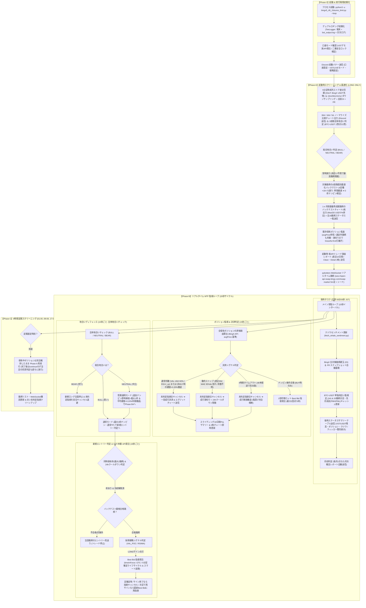

# bingx5_46 プロジェクト運用ルール & 開発アーキテクチャ規約 (PROJECT_RULES)

本ドキュメントは、`bingx5_46`（BingX USDT無期限先物 自動売買ボット）プロジェクトの設計思想、システム起動シーケンス、データパイプライン、取引戦略、資金管理、およびサーバー運用に関する最高位の規約（Single Source of Truth）です。
コアロジック（ノーマライズ3段階地合い判定・2段階72通り最適化・地合いディフェンス）は `hype5_45` と完全同一のアルゴリズムを維持しつつ、取引基盤として **BingX USDT無期限先物（豊富なUSDT流動性）** および **BingX公式 VSTデモ口座（実API発注検証）** に完全特化しています。

---

## 0. システム起動から常駐監視への全体動作シーケンス (System Lifecycle & Execution Sequence)

本システムは、VPS サーバー（Oracle #2）上で常駐プロセスとして完全自律稼働する MTF（マルチタイムフレーム）高機能自動売買ボットです。



### 【各フェーズの要約】
* **【Phase 0】起動 & 実行環境初期化**:
  アンバッファ起動（`-u`）、`TeeLogger` デュアルロギング、二重安全ロック＆VSTデモ口座設定確認、Discord 起動バナー送信（`payload_json` による文字化け防止徹底）。
* **【Phase A】起動時スクリーニング & 最適化**:
  5分足ストア差分同期（SSoT: BingX USDT先物）、30d/10d/5d ノーマライズ比較チャート送信 ＆ 3段階全体地合い判定（`BTC-USDT` 2票/計22票）。地合いに関わらず、この相場状況下でも優位性のある銘柄を発掘するため2段階個別バックテスト＆最適化（4足種×18＝72通り）を常時実行。厳格基準（第1段階単発で最低10回以上かつPnL>0）クリア銘柄を選定し最優秀銘柄チャート1枚を送信、既存ポジション監査（`avgPrice` 基準・Graceful Exit）、直近10日間実損益レポート送信、pybotters WebSocket 5分足リアルタイム購読開始。
* **【Phase B】リアルタイム MTF 監視ループ (15秒サイクル)**:
  * **Phase B1 (毎時 00:05 JST)**: クジラセンチメント更新、BingX OI/FR スナップショット自動蓄積、BTC地合い足更新、**Hype版と完全統一した毎時ステータス配信（`-USDT` 省略・4カラム整列）**、月初レポート送信。
  * **Phase B2 (ポジション監視)**: 保有銘柄の利確（Normal TP または 非BUY時の建値+0.20%早期撤退）・動的ストップ損切り（直近30d MAE 95%ile 割れ、枠数不問発動 ＆ 24hクールダウン）・4時間タイムアウト撤退（48本経過で含み損なら微損撤退）・段階ナンピン（BUY時は最大3枠等倍、非BUY時は即時凍結＝最大1枠）判定。決済時は必ず既存の未約定指値をすべてキャンセルしてから成行決済を実行する。
  * **Phase B3 (地合いディフェンス)**: 全体地合い売り（BEAR）検知時に新規ロング全面一時停止＆未約定指値即時キャンセル退避。中立（NEUTRAL）時はナンピン凍結＆建値早期撤退モードを適用。
  * **Phase B4 (新規エントリー判定)**: 最大2銘柄枠内で「バックテスト厳格合格銘柄」のみ採用戦略シグナルを判定し、BingX API（VSTデモまたは本番）へ Best Bid 指値発注 ＆ 足確定ごとのライフサイクル管理（Pending & Resubmit）。
* **【Phase C】8時間定期スクリーニング (01:00, 09:00, 17:00 JST)**:
  保有中ポジションは利確・損切りまで一切強制決済せず維持し、Phase A と同様に最新データで全体地合い判定・推奨銘柄最適化を再実行。**定期選定完了後、ループを `continue` して確定足をスキップすることを厳禁とし、直ちにその確定足の決済・エントリー判定を実行する。**

---

## 1. 銘柄選定・検証データ収集規約 (Data Pipeline)

### 💎 【単一データ源泉 (SSoT)】5分足 (5m) 差分追記型・永続ローカル時系列ストア
* **巨大データ一括取得・ZIP送信の完全廃止**:
  * 全市場600銘柄以上のダウンロードや巨大CSV/ZIPの生成・送信は完全に廃止し、固定選定20銘柄＋`BTC-USDT`（計21銘柄）の5分足データのみを軽量管理する。
* **アーキテクチャ (`candle_5m_store.py`)**:
  * BingX USDT無期限先物の 5分足（5m）OHLCV を最小データ粒度かつ「単一のデータ源泉（SSoT: Single Source of Truth）」とし、ローカルファイル（`Data/candles_5m/candles_5m_{SYMBOL}.csv`）に永続蓄積・差分追記（Append）する。
  * **初回取得 ＆ 外部補完**: 初回または不足時（30日分/8,640本未満）は BingX API から過去30日分を取得（不足時は OKX/Bybit USDT先物で価格比率 $R_{px}$・出来高比率 $R_{vol}$ 平準化補完）。
  * **増分更新（インクリメンタル更新）とローリング管理**: 2回目以降は既存データの最新タイムスタンプ以降の差分のみを BingX API から取得してマージ（`drop_duplicates`）し、30日〜35日分（上限10,080本）でローリング保持する。
* **動的ダウンサンプリング（リサンプリング）原則**:
  * 検証・運用で用いる `15m`、`30m`、`1h`（60m）、`1d`（1440m）は、すべてこの 5分足ストアから `resample_from_5m` により数学的完全整合で動的に生成する。

### 🏛️ 建玉（OI）時系列蓄積 ＆ ファンディングレート（FR）モニタリング
* **自前蓄積最優先**: 毎時 00 分およびスクリーニング時に BingX 全対象銘柄の建玉（Open Interest）および Funding Rate スナップショットを `Data/oi_store/` へ自動蓄積。データが存在する時間帯は BingX 純正実測建玉を最優先採用する。
* **外部補完と自然移行**: 蓄積前の過去分は Bybit V5 USDT先物データを補完し、稼働に伴い自然と 100% BingX 純正データへ置き換える。現在値の一律べた塗りは厳禁。

---

## 2. 取引対象銘柄 ＆ 全体地合い判定規約 (Symbols & Market Regime)

### 🎯 対象銘柄 ＆ 投票重み配分（USDT先物 アルト固定20銘柄 ＋ BTC-USDT 計22票）
USDCよりも圧倒的に出来高・流動性が厚い **USDT無期限先物ペア** を対象とし、銘柄構成は `hype5_45` と完全統一する：
* **固定選定アルトリスト (`FIXED_SYMBOLS` 20銘柄 / 各1票 = 計20票)**:
  `HYPE-USDT`, `SOL-USDT`, `DOGE-USDT`, `XRP-USDT`, `SUI-USDT`, `AVAX-USDT`, `LINK-USDT`, `APT-USDT`, `NEAR-USDT`, `ARB-USDT`, `UNI-USDT`, `OP-USDT`, `TIA-USDT`, `RENDER-USDT`, `INJ-USDT`, `FET-USDT`, `TAO-USDT`, `AAVE-USDT`, `ENA-USDT`, `ZEC-USDT`
* **BTC 先行指標 (`BTC-USDT` 1銘柄 / 2票分 = 計2票)**:
  `BTC-USDT` は市場全体の牽引役として 2 票分の投票権を持つ（※`BTC-USDT` 自身はアルト発注対象外）。
* **総投票数: 22 票**（「半分以上」の判定基準: **11 票以上**）
* **ETH (`ETH-USDT`) の完全除外規約**:
  ETH は BTC への遅行・連動傾向が強く先行指標としての優位性がないため、トレード対象および地合い監視対象から完全に除外する（WebSocket 購読も行わない）。

---

### 📊 全体地合い判定 3段階プロセス (30d / 10d / 5d ノーマライズ比較)
指定全 20 銘柄 ＋ `BTC-USDT`（計 22 票）について、**【30d (720h)】・【10d (240h)】・【5d (120h)】** の 3 期間ノーマライズ比較チャート（起点価格=1.0）を用いて、`hype5_45` と完全同一の 3 段階判定を厳格に執行する：

```
【地合い判定 ＆ バックテスト・トレードフロー】
各銘柄・各期間の正規化データ（起点=1.0）
      ↓
［第2判定 ＆ 第3判定（補完ルール）］
  ├─ 買い候補 (final >= 1.0): 前半高値ピークアウト監査 (半値以上維持なら合格、割れは除外)
  └─ 売り候補 (final < 1.0): 前半安値ボトム反発監査 (半値以下推移なら合格、越えは除外)
      ↓
［第1判定（各期間 30d / 10d / 5d の投票集計）］
  ├─ 買い合格票 >= 11票 ➔ その期間は「買い (BUY)」
  ├─ 売り合格票 >= 11票 ➔ その期間は「売り (SELL)」
  └─ いずれも 11票未満 ➔ その期間は「中立 (NEUTRAL)」
      ↓
［総合地合い判定 (3期間合致)］
  ├─ 30d / 10d / 5d すべて買い ➔ 総合「買い (BULL)」➔ 買い推奨銘柄のバックテスト・最適化 ➔ 通常トレード
  ├─ それ以外 (不一致または中立) ➔ 総合「中立 (NEUTRAL)」➔ 固定銘柄バックテスト・最適化 ➔ 厳格合格銘柄のみ慎重運用（ナンピン凍結・建値撤退モード）
  └─ 30d / 10d / 5d すべて売り ➔ 総合「売り (BEAR)」➔ 固定銘柄バックテスト・最適化（チャート出力）➔ 新規買い全面停止（ノーポジ待機）
```

#### 🔹 第1判定: 各期間（30d / 10d / 5d）の地合い過半数判定
* 30d / 10d / 5d のノーマライズ比較チャートから、各期間の合格プラス銘柄が半分以上（**11 票以上 / 22 票**）であれば **「買い (BUY)」**。
* 30d / 10d / 5d のノーマライズ比較チャートから、各期間の合格マイナス銘柄が半分以上（**11 票以上 / 22 票**）であれば **「売り (SELL)」**。
* 30d / 10d / 5d の判定が**すべて買いであれば、総合地合いは「買い (BULL)」**。
* 30d / 10d / 5d の判定が**すべて売りであれば、総合地合いは「売り (BEAR)」**。
* **それ以外（判定不一致または中立期間あり）は総合地合い「中立 (NEUTRAL)」**。
  - いずれの地合いであってもバックテスト最適化は完全スキップせず常時実行し、過酷な相場環境下でも勝てる優良銘柄を発掘する。

#### 🔹 第2判定: 前半高値・前半安値による除外スクリーニング
* 30d / 10d / 5d のノーマライズ比較チャートから、**各期間の前半に高値がある銘柄はプラス銘柄（買い候補）から除外**。
* 30d / 10d / 5d のノーマライズ比較チャートから、**各期間の前半に安値がある銘柄はマイナス銘柄（売り候補）から除外**。

#### 🔹 第3判定: 補完ルール（前半高値/安値の半値維持監査）
第2判定で「前半に高値/安値がある銘柄」であっても、相場の反発力・モメンタムが維持されているかを以下のレンジ半値ラインで精密に検証し、真のピークアウトのみを除外する：
```
└─ 📉 個別銘柄 3期間ノーマライズ前半高値/安値検出規約 (ピークアウト除外フィルター)
     ├─ 対象期間: 5d (120h) / 10d (240h) / 30d (720h) 全期間統一基準
     ├─ 【買い候補の判定 (終値 >= 1.0)】:
     │    期間内の最高値(Max)が「前半50%以内」に位置している場合、
     │    現在値が期間レンジの半値ライン（Min + (Max - Min) * 0.5）を維持できているか検証。
     │    ├─ 合格 (セーフ): 一度大きく下落しても、現在値がレンジ半値以上まで買い戻されて盛り上がっている銘柄はプラス銘柄として採用。
     │    └─ 除外 (失格): 前半ピーク かつ 現在値がレンジ半値未満（維持率 50%未満）に沈んでいる銘柄は、
     │                     「ピークアウト（行って来い崩壊）または長期衰退中で反発力なし」とみなしプラス銘柄から除外。
     │    ※最高値が期間の「後半50%以降」にある銘柄は無条件でセーフ（買い票対象）。
     ├─ 【売り候補の判定 (終値 < 1.0)】（逆の同等判定）:
     │    期間内の最安値(Min)が「前半50%以内」に位置している場合、
     │    現在値が期間レンジの半値ライン（Min + (Max - Min) * 0.5）以下に留まっているか検証。
     │    ├─ 合格 (セーフ): レンジ半値以下に安値張り付きしている下落トレンド銘柄はマイナス銘柄として採用。
     │    └─ 除外 (失格): 前半ボトム かつ レンジ半値超えまで戻している銘柄は「底打ち反発中で下落力なし」とみなしマイナス銘柄から除外。
     │    ※最安値が期間の「後半50%以降」にある銘柄は無条件でセーフ（売り票対象）。
     └─ 防衛措置: 除外された銘柄は投票権を喪失（無効票）し、スクリーニング選定から即座に排除 ＆ リアルタイム監視で新規エントリー完全遮断。
```
※上記判定はアルト 20 銘柄および `BTC-USDT`（2票分）の全銘柄に対して同一基準で実行する。

#### 🔹 補助指標: 先月高安（PMH / PML）の記憶 ＆ ノーマライズ反発点線描画
* **先月高安の自動集計・記憶（`Data/monthly_key_levels.json`）**:
  * 初回または不足時は日足データから先月（前月）の高値・安値・終値（PMH / PML / PMC）を自動集計し永続保持。以降は自前の5分足時系列データから自然更新。
* **ノーマライズチャート（30d）上への点線描画**:
  * 30d ノーマライズ比較チャート（起点価格 $P_0 = 1.0$）上に、起点に対する先月高安比率（$PMH / P_0$, $PML / P_0$）を点線（破線）で描画。
  * **BTC-USDT 先月高値・安値**: オレンジ・水色の太い点線（`:`）で描画し、市場全体のサポート・レジスタンス基準線とする。
  * **アルト平均 先月高値・安値**: 赤・緑の破線（`--`）で描画し、市場全体が「先月安値から反発（リバウンド）しているのか」「先月高値の天井圏にあるのか」を視覚的に一目で確認可能とする。

---

### 🚀 バックテスト ＆ トレード実行フロー
全体地合い（買い/売り/中立）の判定結果に基づき、以下のパイプラインで自動売買を執行する：

1. **総合地合いが「買い (BULL)」の場合**:
   - **トレード推奨銘柄の選定**: 30d / 10d / 5d の **3 期間すべてで「買い票」を獲得した銘柄（`recommended_symbols`）のみを買い推奨銘柄として選定**。
   - **バックテスト・個別最適化の実行**:
     - 全ての買い推奨銘柄を対象としてバックテストを行い、2段階個別パラメータ最適化（VAL_POC / RSIMA 72通り）を実行する。
   - **合格銘柄の選抜**:
     - 第1段階（単発）で最低取引回数 10 回以上（`trade_count >= 10`）かつ純利益プラス（`PnL > 0`）を満たした銘柄のみをトレード対象（`selected_symbols`）に採用。
   - **最優秀チャートの出力**:
     - 最もバックテスト成績（PnL）が優秀だった銘柄の資産曲線チャート **1 枚のみ** を Discord へ送信。
   - **通常トレードの開始**:
     - リアルタイム監視ループ（Phase B4）において、同時保有枠（最大 2 銘柄）に空きがある状態で、**エントリーシグナルが出た銘柄から順次 Best Bid 指値を発注しトレードを開始する**（通常TP・最大3枠ナンピン）。

2. **総合地合いが「中立 (NEUTRAL)」の場合**:
   - **過酷相場下での優良銘柄発掘バックテスト**:
     - スキップせず、固定選定銘柄（買い票獲得銘柄を優先配置）を対象として個別パラメータ最適化（72通り）を完全実行。
   - **厳格合格銘柄の選抜**:
     - 最低取引回数 10 回以上（`trade_count >= 10`）かつ純利益プラス（`PnL > 0`）の厳格基準をクリアした銘柄のみをトレード対象（`selected_symbols`）に採用。合格銘柄がない場合はノーポジ待機。
   - **最優秀チャートの出力**:
     - 成績 1 位銘柄の資産曲線チャート **1 枚のみ** を Discord へ送信。
   - **慎重運用トレード（緊急建値撤退＆ナンピン凍結モード）**:
     - シグナル点灯で新規エントリー可能。ただし地合い非BUYのため、**追加ナンピンは即時凍結（最大1枠・単発エントリー）**、利確は欲張らず**平均建値 +0.20%（スリッページ・往復手数料分）で建値早期撤退**を図る。

3. **総合地合いが「売り (BEAR)」の場合**:
   - **バックテスト最適化 ＆ チャート出力**:
     - 固定選定銘柄に対してバックテスト・最適化を実行し、最優秀成績チャート 1 枚を Discord へ送信（相場状況の可視化）。
   - **防衛アクション**:
     - 相場暴落警戒のため、新規エントリーは全面停止（ノーポジ待機）。
   - **保有ポジション**:
     - 既存保有ポジションがある場合のみ、建値+0.20%早期撤退または損切りまで Graceful Exit を継続。

#### 📋 全20銘柄 ステータス完全可視化ダッシュボード（`Data/symbol_status_summary.json`）
* 起動時および8時間ごとの定期選定時において、固定20銘柄すべての最新ステータス（`🟢【トレード選定・監視中】`、`🔴【前半高値ピークアウト除外】`、`🔴【地合い売り見送り】`、`🔴【個別最適化不合格】` 等）とバックテストメトリクス（採用戦略・足種・勝率・PnL・MaxDD）をコンソールおよび `Data/symbol_status_summary.json` に記録・可視化する。

---

## 3. 4大基本戦略体系 ＆ 2段階個別最適化規約 (4-Strategy Optimization with EMA200 Separation)

### 🧩 4大基本戦略体系の位置づけ ＆ EMA 200 トレンドフィルター直交分離モデル
* **4大基本戦略構成**:
  従来の「VAL_POC（EMA200固定）」と「RSIMA（EMA200なし）」の基本戦略から、**EMA 200 トレンドフィルター（`close >= EMA(200)`）を独立した直交ロジックとして分離**。ボリュームプロファイル（出来高構造）と RSI-EMA（モメンタム）の2つのコアロジックに対して、それぞれ「EMA200フィルターなし（Pure）」と「EMA200フィルターあり（EMA）」を直交配備した **4種類の基本戦略体系** を構成する：
  1. **`VAL_POC`**: ボリュームプロファイル反発（EMA 200 フィルター **なし** / Pure VP）
  2. **`VAL_POC_EMA`**: ボリュームプロファイル反発 ＋ **EMA 200 トレンドフィルター**（`close >= EMA(200)`）
  3. **`RSIMA`**: RSI×RSI-EMA ゴールデンクロス反転スキャルピング（EMA 200 フィルター **なし** / Pure RSIMA）
  4. **`RSIMA_EMA`**: RSI×RSI-EMA ゴールデンクロス反転スキャルピング ＋ **EMA 200 トレンドフィルター**（`close >= EMA(200)`）

* **探索組み合わせ数**:
  * **VAL_POC**: 4足種（5m, 15m, 30m, 60m）× 9 MP期間 ＝ **36 通り**
  * **VAL_POC_EMA**: 4足種（5m, 15m, 30m, 60m）× 9 MP期間 ＝ **36 通り**
  * **RSIMA**: 4足種（5m, 15m, 30m, 60m）× 9 パラメータ（EP 3通り × CP 3通り）＝ **36 通り**
  * **RSIMA_EMA**: 4足種（5m, 15m, 30m, 60m）× 9 パラメータ（EP 3通り × CP 3通り）＝ **36 通り**
  * **合計 144 通り** を直近30日分（8,640本）データで低負荷シミュレーション。Market Profile および RSI-EMA の中間計算キャッシュを再利用するため、計算負荷は従来の72通りと実質同等（CPU 15〜25% 以下で実行）。

* **2段階（Two-Stage）個別最適化アプローチ（シングルポジション先行厳選 ➔ ナンピン検証）**:
  * **【第1段階: シングルポジション (max_trades=1) 最適化】**:
    * 全144通り（4戦略 × 各36通り）をまず「単発1本（シングルポジション）」でバックテスト。
    * 最低取引回数 10回以上（`trade_count >= 10`）かつ純利益プラス（`PnL > 0`）を満たす、**「ナンピンに頼らず単発で高勝率・高利益を出せる本物の高精度パラメータ」** を厳選。
    * ナンピンで損失を無理やり延命させた「一発屋・マーチンゲール依存パラメータ」を第1段階で根本から排除。
  * **【第2段階: ナンピン (max_trades=3) バックテスト・最終選定】**:
    * 第1段階で合格・厳選された優良パラメータに対してのみ、ナンピン（最大3枠、均等1倍ロット、VA 60%間隔）シミュレーションを実行。
    * 4戦略の中からナンピン適用後の純利益（Final PnL）、勝率、最大ドローダウンを測定し、最も優秀な戦略・個別パラメータを本番採用する。
* **バックテスト手数料・約定シミュレーション整合規約**:
  * BingX USDT無期限先物の手数料体系（Maker `0.02%` / Taker `0.05%`、往復 `0.07%` 相当）および Best Bid 指値約定を正確に反映して純利益（Net PnL）を算出する。
  * **最大ドローダウン（MaxDD）表示規約**: テーブル・ログ・バックテスト画像すべてにおいて、**「USDT金額」と「元本に対する下落率（%）」を併記**（例: `MaxDD: -10.05 USDT (-10.0%)`）して出力する。

### 📊 戦略 A-1: ボリュームプロファイル Pure（VAL_POC）仕様 (レンジ / LONG ONLY / EMAなし)
* **リサンプリング足種**: `5m`, `15m`, `30m`, `60m`
* **MP期間**: `100, 150, 200, 250, 300, 350, 400, 450, 500`（50刻み 9 種類、指数減衰付き）
* **固定設定**: ビン数 `50` 固定、バリューエリア比率 `70%` 固定、EMAトレンドフィルター **なし**（`trend_ok = True`）。
* **新規エントリー条件 (`INITIAL_ENTRY`)**:
  * ノーポジション、採用時間足の確定終値が VAL を上抜け、バリューエリア幅 `(VAH - VAL) / VAL >= 1.5%`、損切りクールダウン解除済、**前半高値ピークアウト非該当**。

### 📊 戦略 A-2: ボリュームプロファイル ＋ EMA200（VAL_POC_EMA）仕様 (トレンド追随 / LONG ONLY)
* **リサンプリング足種**: `5m`, `15m`, `30m`, `60m`
* **MP期間**: `100, 150, 200, 250, 300, 350, 400, 450, 500`（50刻み 9 種類、指数減衰付き）
* **固定設定**: ビン数 `50` 固定、バリューエリア比率 `70%` 固定、**EMA(200) トレンドフィルター（`close >= EMA(200)`）必須**。
* **新規エントリー条件 (`INITIAL_ENTRY`)**:
  * ノーポジション、採用時間足の確定終値が VAL を上抜け、**`close >= EMA(200)`**、バリューエリア幅 `(VAH - VAL) / VAL >= 1.5%`、損切りクールダウン解除済、**前半高値ピークアウト非該当**。

### 📈 戦略 B-1: RSIMA モメンタムスキャルピング Pure（RSIMA）仕様 (スキャルピング / LONG ONLY / EMAなし)
* **基本指標**: RSI（期間 9）× RSI-EMA（期間 7）
* **リサンプリング足種**: `5m`, `15m`, `30m`, `60m`
* **探索グリッド**: エントリー閾値 `l_ep` (30, 35, 40) × 利確閾値 `l_cp` (60, 65, 70) ＝ 9 通り
* **EMAフィルター**: **なし**
* **新規エントリー条件 (`INITIAL_ENTRY`)**:
  * ノーポジション、RSI が RSI-EMA をゴールデンクロス、`RSI-EMA < l_ep`、損切りクールダウン解除済、**前半高値ピークアウト非該当**。

### 📈 戦略 B-2: RSIMA モメンタムスキャルピング ＋ EMA200（RSIMA_EMA）仕様 (トレンド追随 / LONG ONLY)
* **基本指標**: RSI（期間 9）× RSI-EMA（期間 7）
* **リサンプリング足種**: `5m`, `15m`, `30m`, `60m`
* **探索グリッド**: エントリー閾値 `l_ep` (30, 35, 40) × 利確閾値 `l_cp` (60, 65, 70) ＝ 9 通り
* **EMAフィルター**: **`close >= EMA(200)` 必須**
* **新規エントリー条件 (`INITIAL_ENTRY`)**:
  * ノーポジション、RSI が RSI-EMA をゴールデンクロス、`RSI-EMA < l_ep`、**`close >= EMA(200)`**、損切りクールダウン解除済、**前半高値ピークアウト非該当**。

### 共通決済 ＆ ナンピン・損切り仕様 (4戦略共通)
* **段階ナンピン条件 (`ADD_ENTRY`)**:
  * ポジション保有中かつ最大枠（計3枠）未満（総合地合いが `BULL` の時のみ許可）。
  * 終値が VAL を再上抜け（VAL系）または 再度ゴールデンクロス（RSIMA系）、かつ直近建値から **`(VAH - VAL) * 0.60`** 以上下落。
  * ロット: **1倍均等ロット固定（1.0x 等倍）**。
* **一括成行利確条件 (`CLOSE_ALL`)**:
  * VAL系: 確定足終値または高値が `target_price = VAL + (VAH - VAL) * 0.60` に到達し、かつ平均建値（`avgPrice`）以上のプラス圏で一括成行決済（`Normal TP`）。
  * RSIMA系: `RSI > l_cp` かつ 平均建値（`avgPrice`）から `+addPct`（+0.4%〜+1.0%）以上プラス浮上で一括成行決済。
* **損切り条件 (`STOP_LOSS`) ＆ タイムアウト撤退 (`TIMEOUT_EXIT`)**:
  * **動的 MAE 95%ile ストップ（枠数不問発動）**: 平均建値（`avgPrice`）から、直近30日ローリング実データより動的算出した **`MAE 95%ile`（安全バンド: -1.5% 〜 -3.2%、基準値 -2.5%）** 割れで全決済し、**24時間クールダウン** 発動。
  * **4時間タイムアウト微損撤退 (`TIMEOUT_EXIT`)**: エントリー後 **4時間（5分足48本 = 240分）** 経過時に含み損の場合、成行微損撤退を実行。

### 🛡️ リスク管理 ＆ ナンピン・マージンセーフティ規約
* **【ナンピン上限の物理ロック（最大3枠厳守）】**:
  * メモリ上のカウンタ消失を防ぐため、実際の BingX 口座保有数量（`current_qty / base_lot`）および永続ストアから物理枠数をリアルタイム多重算出・同期。
  * 枠数 $N \ge 3$ の場合、いかなる場合も追加ナンピン（`ADD_ENTRY`）の発注を物理的に遮断。
* **【1銘柄あたりの最大許容ポジション金額（USDT換算）ガード】**:
  * 端数ズレや過大ロットを防ぐ二重安全策として、**`MAX_POSITION_NOTIONAL_LIMIT = base_notional * 3.15`**（目標投資額 $15.0 の場合 約 $47.25 USDT）を上限に設定。
  * 追加後の想定元本がこの上限を超える場合は、発注直前に自動でブロック（スキップ）。
* **【証拠金維持率（マージン）セーフティリミッター】**:
  * 追加後のポートフォリオ有効レバレッジ（$\text{Effective Leverage} = \text{Total Notional} / \text{Equity}$）が **3.0 倍** を超える場合、または証拠金維持率が危険水準に達した場合は、ナンピン枠が残っていても追加発注を自動でスキップ（ブロック）。
* **【動的 MAE 95%ile ストップロス規約（直近30dローリング ＆ 安全バンドクランプ）】**:
  * **動的計算アーキテクチャ**:
    * 起動時および8時間ごとの定期スクリーニング時（Phase A / Phase C）において、直近30日間のローカル5分足データ（SSoT）から各銘柄の採用戦略および採用足種（`interval`）における過去トレードの最大逆行幅（MAE: Maximum Adverse Excursion）を高速算出。
    * **シミュレーション内にも4時間タイムアウト微損撤退を完全連動** させ、長時間捕まって深く掘った異常トレードを勝ちトレード群から除外することで、健全な勝ちトレード本来の最大逆行幅（約 -2.0% 〜 -2.6% 付近）を正確に抽出。
    * **勝ちトレードの 95%ile MAE** をその銘柄の動的ストップ率（`dynamic_mae_stop`）として設定する。
  * **安全クランプバンド（Safety Clamp Band）**:
    * 市場環境の変化に対して、極端に浅すぎるノイズカットや深すぎる大損失を防ぐため、**`-1.5%`（上限クランプ）から `-3.2%`（下限クランプ）** の適正安全バンドに必ずクランプする（デフォルト基準値: `-2.50%`）。
    * 直近30日データの実証値（-2.44%）が自然に適用され、将来のボラティリティ変動にも完全に自律追従する。
  * **枠数不問のストップロス発動（デッドロック完全根絶）**:
    * `current_trades_count >= max_trades`（3枠満額）という前提条件を完全撤廃。
    * **1枠目であってもナンピン後であっても、現在価格または確定終値が `avgPrice * (1.0 + dynamic_mae_stop)` を割り込んだ瞬間に成行損切り（`STOP_LOSS`）を発動** する。
    * これにより、地合い悪化でナンピンが凍結された状態での一方的暴落・塩漬け事故を物理的に完全根絶する。
    * 損切り後は既存仕様通り **24時間（288足）新規エントリーを完全遮断** する。
* **【4時間タイムアウト微損撤退規約 (Timeout Exit: 塩漬け完全排除)】**:
  * エントリーから **4時間（5分足で48本 = 240分）** が経過したポジションについて、含み損（`current_price < avgPrice`）状態である場合は「モメンタム喪失・トレンド転換」と判定し、成行微損撤退（`TIMEOUT_EXIT`）を実行する。
  * **再起動時のタイマー完全保持**: ボット再起動時にメモリやローカル状態がリセットされた場合でも、BingX 先物 API（`/openApi/swap/v2/user/positions`）の **`updateTime`（ミリ秒）** から実約定時刻を正確に復元し、4時間タイマーをゼロリセットせず正確に引き継ぐ。
  * バックテスト検証において MaxDD を 18.0% から **12.1%** へ大幅に抑制した実証仕様であり、資金拘束を解消して常に健全な資金回転率を維持する。

---

## 4. BingX 発注執行（VSTデモ / 本番）＆ リスク・ポジション管理規約 (Execution & Risk Management)

### 🎯 ベストビット（Best Bid）指値発注 ＆ 5分足確定ごとのライフサイクル
* **VSTデモ口座でも本番と同一のAPI指値ロジックを実行**:
  * BingXの公式VSTデモ取引所（`https://open-api-vst.bingx.com`）は豊富な流動性を持つUSDT板と連動しているため、デモ口座検証でも成行に逃げず、本番口座と全く同じ **`order_price = best_bid`（買い気配最良値）への指値発注（`timeInForce: "GTC"`）** を実行し、実APIの約定挙動・未約定キャンセル・再配置を徹底検証する。
* **5分足確定ごとの指値ライフサイクル（Pending & Smart Resubmit / Cancel）**:
  * **サイン点灯**: ロングサインが出たら現在の `best_bid` に指値を配置し、その足が確定するまで（最大約4分間＝240秒、15秒×16サイクル）板で押し目を待機する。
  * **スマート気配値追随（キュー優先順位保持）**: 待機中に最良気配値が変化していない場合は無駄なキャンセル再発注を行わず、指値キューの優先順位を維持する。
  * **サイン終了時**: 足確定時にサインが消滅していた場合、未約定指値を `active_order_cancel` で安全に即時キャンセルし注文を取り消す（下落ナイフ掴みの物理的防止）。
  * **次足で再サイン点灯時**: 旧指値をキャンセルし、改めてその最新足の `best_bid` に指値を出し直す。
* **約定検知とクリーンアップ**:
  * 95%以上の約定（`filled_qty >= target_lot * 0.95`）を検知した瞬間に待機を完了し、余剰指値をキャンセルしてナンピン・利確・損切り監視フェーズへ移行する。

### 🛡️ ポジション管理 ＆ BingX API 固有仕様の厳守
* **平均建値の厳格参照 (`avgPrice`)**:
  * BingX 先物 API（`/openApi/swap/v2/user/positions`）は平均取得価格を **`avgPrice`** フィールドで返却する（`entryPrice` は存在しない）。建値・損益計算・ストップ判定・建値撤退判定では必ず **`p.get("avgPrice")`** を最優先で参照する。
* **決済（Exit / Flatten）時の未約定指値先行キャンセル規約**:
  * 利確・損切り・建値撤退のいずれにおいても、成行決済を発注する直前に、対象銘柄の既存未約定指値をすべて安全にキャンセル（`active_order_cancel`）してから成行決済（`reduceOnly=True` 相当またはポジション指定クローズ）を実行し、誤約定・ドテン事故を物理的に遮断する。
* **同時保有上限**: **最大 2 銘柄（`MAX_ACTIVE_POSITIONS = 2`）** 厳守（同時保有 + 待機指値の合計）。
* **ポジション枠**: **最大 3 枠（初期 1 本 ＋ ナンピン最大 2 回）** 厳守。
* **段階ナンピンロット**: **全回数 1倍均等ロット固定（1.0x 等倍）**。
* **損切り後の 24時間クールダウン**:
  * 損切り発生銘柄は、リベンジトレード・往復ビンタ防止のため以降 24 時間（288足）新規エントリーを物理的に完全遮断する。

### ⚙️ 数量・価格の丸め込み（Quantization）＆ 資金管理
* **精度メタデータの厳格適用**:
  * 取引所API（`/openApi/swap/v2/quote/contracts`）より `quantityPrecision`、`pricePrecision`、`tradeMinQuantity`（最小発注枚数）を取得し、端数処理エラーによる発注拒否を防止する。
* **レバレッジ**: 原則 **10 倍（`LEVERAGE_FACTOR = 10.0`）** をAPI経由で設定・適用。
* **目標投資額（1枠あたりの想定元本）**:
  * **`$15.0 USDT`**（`BINGX_TARGET_POSITION_VALUE_USDT = 15.0`）。VSTデモ口座・本番口座ともに1枠あたりの基準サイズを `$15.0 USDT` に統一し、本番移行時のロット感覚・スリッページ検証を完全一致させる（後続処理での勝手な100.0等への上書きは厳禁）。
* **必要証拠金チェック**: 発注直前に必要証拠金（`(current_price * lot) / LEVERAGE_FACTOR`）が口座の利用可能残高（VST / USDT）を下回る場合は新規発注を安全にスキップ。

### 📊 エントリー ＆ 決済チャート足種統一規約 (Chart Interval Consistency)
* **バックテスト採用足種（`interval`）への完全準拠**:
  * エントリーチャート（`plot_entry_chart`）および決済チャート（`plot_exit_chart`）は、**個別最適化でバックテストに合格・採用されたパラメータの足種（5m, 15m, 30m, 60m）** に完全に統一して生成する。
  * 5分足採用銘柄はエントリーも決済も **5分足**、15分足採用銘柄はエントリーも決済も **15分足** で描画し、エントリーから決済までの細かい値動きの軌跡（直近48本）を視覚的に明瞭に可視化する。
* **足種ラベルの明記**:
  * チャート画像のタイトルおよび Discord 送信メッセージに `[5m足]` や `[15m足]` のように足種タグを明記し、一目で何分足のチャートか判別可能とする。

---

## 5. 口座設定・VSTデモ実API検証 ＆ 二重安全ロック規約

`bingx5_46` では、単なるメモリ上のペーパートレード（AIRモード）ではなく、**BingX公式のVSTデモ口座（`https://open-api-vst.bingx.com`）に対して実際にREST API発注・キャンセル・ポジション管理を行う「VST実API検証モード」** を標準の検証スタイルとする。

[`bingx5_46_1futures_limit.py`](./bingx5_46_1futures_limit.py) 冒頭のフラグで環境を明確に制御する：

```python
# [ 0 ] 本番リアル発注の物理安全ロック (Trueにしない限り本番APIへは絶対発注しない)
ALLOW_LIVE_TRADING = False

# [ 1 ] 口座切替フラグ
#       False = VSTデモ口座 (open-api-vst.bingx.com / 実APIデモ検証モード: デフォルト)
#       True  = 本番リアル口座 (open-api.bingx.com / リアルUSDT運用)
BINGX_IS_LIVE = False

# [ 2 ] ローカル仮想シミュレーションフラグ (AIR Mode)
#       False = 取引所APIへ実際に発注 (VSTデモ口座 または 本番口座: デフォルト)
#       True  = AIRモード (API発注を行わずローカルメモリ上でシミュレーション)
BINGX_IS_AIR = ("--air" in sys.argv or "--mock" in sys.argv)
```

* **本番リアル発注への切替規約（二重安全ロック）**:
  * 本番口座（リアルUSDT）へ切り替える際は、コード内の `ALLOW_LIVE_TRADING = True` かつ `BINGX_IS_LIVE = True` の両方が揃う二重ロック構造を維持し、誤発注を完全に防止する。
* **ポジションメタデータの自動永続化（`Data/active_positions_meta.json`）**:
  * VSTデモ口座・本番口座の実ポジションと連動し、再起動時にも各ポジションの「ナンピン枠数」「エントリー時採用戦略（VAL_POC / RSIMA）」「採用時間足・最適化パラメータ」をローカルJSONから自動復元する。
* **保有中ポジションの Graceful Exit 原則（戦略完全維持）**:
  * 定期スクリーニングで選定外となった銘柄や再起動後であっても、**保有中ポジションはエントリー時の元戦略（VAL_POC または RSIMA）およびその個別最適化パラメータを最後まで完全維持し、利確または損切りまで追従・完遂** すること。

---

## 6. レポーティング ＆ Discord 通知フォーマット統一規約 (Reporting & Analytics)

* **日本語文字化け完全防止 (`payload_json`)**:
  * Discord Webhookへの画像・ファイル送信時は、必ず `payload_json` パラメータを使用し、日本語や絵文字の文字化けを防止する。
* **平時5分足ログ・未約定試行ログのDiscordスパム抑止**:
  * 平時の5分確定足のルーチンチェック、含み損益ログ、未約定の指値発注試行（`[ENTRY>>]`）、指値キャンセル、見送りログはすべてローカルログ（`level="debug"`）のみとし、Discordへは「毎時サマリー」「スクリーニング結果」「実際の約定・決済イベント」のみをクリーンに通知する。
* **毎時ステータスサマリーテーブル (正時 00:05 JST / `hype5_45` 完全統一フォーマット)**:
  * **見出し・残高のコードブロック外表示**:
    `⏰ 【BingX 毎時ステータスサマリー (HH:00 JST)】`
    `💰 残高: $XXX.XX VST (VST Demo Mode) | 監視体制: 5分足 WebSocketリアルタイム稼働中`
  * **テーブル整形規約（列ズレ防止・4カラム統一）**:
    * 銘柄名は表示時に `.replace("-USDT", "")` でティッカーのみ（`HYPE`, `RENDER` 等）に整形し、固定幅フォーマット（`f"{sym:<8}"`）で列ズレを完全に排除する。
    * カラム構成は `銘柄` / `現在価格` / `ポジション` / `クジラ` の4列に統一し、ポジション未保有時は `FLAT` ではなく **`ノーポジ`** と表記する。
* **ノーマライズ比較チャート（30d / 10d / 5d 全20銘柄）＆ 3期間地合い評価**:
  * 起動時および8時間スクリーニング時に、指定全20銘柄＋`BTC-USDT` の **【30日】・【10日】・【5日】** 比較チャート（計3枚、30dには先月高安PMH/PML点線入り）を Discord へ送信。
  * チャート送信直後に「30日（買い/売り/中立）、10日（買い/売り/中立）、5日（買い/売り/中立）」それぞれの地合い評価と総合評価テキストを即時配信。
* **直近10日間実トレード損益レポート ＆ 累積チャート（Clean版・Detail版）**:
  * 起動時、8時間スクリーニング時、およびポジション決済直後に送信。
  * スライディング 10 日間の確定実績サマリー（有効勝率、PnL、PF、銘柄別ランキング）と、**Clean版（SNS共有用）** および **Detail版（千鳥配置アノテーション付き）** の 2 枚の累積損益チャートを生成・送信。
* **実運用損益の取引所 API 直接取得・手動損切り完全同期規約 (API-Driven Realized PnL SSoT)**:
  * **取引所 API 直接取得**:
    ボット内部の約定検知のみに依存せず、起動時・再起動時および定期実行時に BingX 先物 API（`/openApi/swap/v2/user/income?incomeType=REALIZED_PNL`）から実際の確定実現損益データを直接取得して同期する。
  * **手動損切り・外部決済の完全網羅**:
    ユーザーが手動スクリプトや取引所 UI から行った成行決済（Manual Flatten）、外部決済、清算イベントを自動検知し、未登録の決済を `Data/real_trades_history.json` および `Data/trades_history.csv` へ自動補完・反映する。
  * **起動・再起動時の実運用損益表出力**:
    ボット起動・再起動時に、取引所 API 実データと同期した最新の「直近10日間 実運用損益表（集計期間、取引回数、勝敗、勝率、確定損益、PF、平均利益/損失、銘柄別内訳）」をコンソールログ（`bot_output.log`）に整然とした固定幅テーブルで出力し、Discord へサマリーと累積PnLチャート（Clean版・Detail版）を即座に送信する。
* **月初（毎月1日 09:00 JST）月次確定レポート**:
  * 前月1ヶ月間の確定実績（総損益、勝率、PF、銘柄ランキング）および月次チャート（`monthly_performance_YYYYMM.png`）を自動配信（二重送信防止管理付き）。

---

## 7. サーバー運用 ＆ Git デプロイ規約 (Infrastructure & Git Workflow)

### 🖥️ VPS 環境 (オラクルナンバー2) & プロセス管理
* **サーバー情報**: Oracle Cloud VPS #2 (`158.101.157.117`) / ユーザー: `ubuntu`
* **SSH秘密鍵**: `C:\Users\user\OneDrive\Desktop\OracleVPS\id_rsa.oracle2`
* **作業ディレクトリ**: `/home/ubuntu/bingx5_46`
* **Python仮想環境 (Venv)**: `/home/ubuntu/pybot-env`
* **Cron 自動死活監視**: `check_and_restart.sh` を 5分間隔（`*/5 * * * *`）で実行し、ダウン時は自動再起動。
* **アンバッファ実行**: ログのリアルタイム出力を担保するため、必ず `python3 -u` で実行。

### 🚨 【絶対厳守】Git ベースデプロイ規約 (SCP コード直接上書きの禁止)
* **Windows ローカル環境から VPS へプログラムコード（`.py`, `.sh`, `.json` 等）を SCP で直接上書きアップロードすることは重大事故の原因となるため絶対に禁止する。**
* **標準デプロイ 4 ステップ**:
  1. **ローカル開発 & 検証**: Python 構文チェック（`python -m py_compile`）、単体テストを実施。
  2. **ローカル Git コミット & プッシュ**: `git add <変更ファイル>` ➔ `git commit -m "..."` ➔ `git push origin main`
  3. **VPS 側 Git プル同期**: `ssh -i "C:\Users\user\OneDrive\Desktop\OracleVPS\id_rsa.oracle2" ubuntu@158.101.157.117 "cd /home/ubuntu/bingx5_46 && git pull origin main"`
  4. **プロセス確認 & 安全な再起動**: SSH経由でボットプロセスを安全に再起動し、`Data/bot_output.log` で正常稼働を確認。
* **データダウンロードの SCP は許可**: ログ（`bot_output.log`）、取引履歴（`.csv`, `.json`）、チャート（`.png`）のダウンロードは安全であり許可される。

### 🌐 クロスプラットフォーム動作保証 ＆ フェイルセーフ例外隔離
* Windows（`cmd.exe` / PowerShell）および Linux（Ubuntu VPS）の双方でエンコードエラーやパス差異なく動作するよう、`encoding="utf-8"` と `pathlib.Path` の使用を徹底する。
* 外部 API 通信（HTTP 502/503、タイムアウト、レート制限等）やバックグラウンド処理は、フェイルセーフな例外ブロック（`except (Exception, BaseException):`）で隔離し、メインループが絶対に異常終了しない構造を維持する。

### 📡 WebSocket リアルタイム通信堅牢化 ＆ 未回収タスク例外（`Task exception was never retrieved`）完全根絶規約
* **送信前クローズ状態チェック**:
  - WebSocket へのメッセージ送信（`ws.send_str()`、`ws.send_json()` 等）を実行する際は、事前に必ずソケットのクローズ状態（`getattr(ws, "closed", False)`）を確認し、クローズ中または切断済みのトランスポートへの無駄な書き込み（`ClientConnectionResetError: Cannot write to closing transport`）を防止する。
* **通信例外の完全隔離 (`_safe_send_str`)**:
  - すべての送信処理は専用の安全送信メソッドを経由し、`try ... except (asyncio.CancelledError, Exception):` で完全防御する。切断例外やキャンセル例外が呼び出し元に波及してプロセスやループを不安定にすることを厳禁とする。
* **非同期タスク強参照保持 ＆ 自動解放パターン（未回収例外の完全根絶）**:
  - `asyncio.create_task` で非同期タスク（Ping/Pong 応答、動的銘柄購読等）を生成する際は、**投げっぱなし（参照破棄）を厳禁** とする。
  - インスタンスレベルのタスクセット（`self._bg_tasks: Set[asyncio.Task] = set()`）にタスクを登録し、`task.add_done_callback(self._bg_tasks.discard)` により完了時に自動解放する Python 公式推奨パターンを必須とする。
  - これにより、ガベージコレクション（GC）による実行中タスクの強制破棄や、標準エラーへの未回収例外（`Task exception was never retrieved`）の出力を永久に根絶する。
  - モジュール停止（`stop()`）時は、残存する全タスクを明示的にキャンセルし、`asyncio.gather(*self._bg_tasks, return_exceptions=True)` で安全に回収・クリーンアップする。
* **pybotters / 外部通信ライブラリの最新安定版維持**:
  - WebSocket クライアントライブラリ（pybotters、aiohttp 等）は常に最新の安定版（例: pybotters v1.11.2 以上）を維持し、古い開発版や既知のバグを含むバージョンの使用を禁止する。

### ⚡ CPUバウンド計算（個別最適化・バックテスト）時の GIL 協調解放規約
* **バックテスト実行中のメインイベントループ保護**:
  - 8時間ごとの銘柄スクリーニングおよび個別パラメータ最適化（72通り検証）等の CPU バウンドな Pure Python / Pandas 計算処理を実行する際は、各足種ループやパラメータ探索ループの合間に小刻みなスリープ（`time.sleep(0.005)` 〜 `time.sleep(0.01)`）を必ず挿入する。
* **OSレベルでのコンテキストスイッチ強制**:
  - `asyncio.to_thread` 内で動作していても、計算ループが GIL（グローバルインタプリタロック）を長時間占有すると、メインスレッドの `asyncio` イベントループが遅延し、取引所からの Ping 受信や Pong 応答がタイムアウトして切断される原因となる。
  - 小刻みな `time.sleep` を挟むことで、OSレベルで確実に GIL を解放し、メインスレッドの WebSocket Keep-Alive、リアルタイム価格更新、注文管理ループが途切れることなく滑らかに常駐稼働し続けることを保証する。
