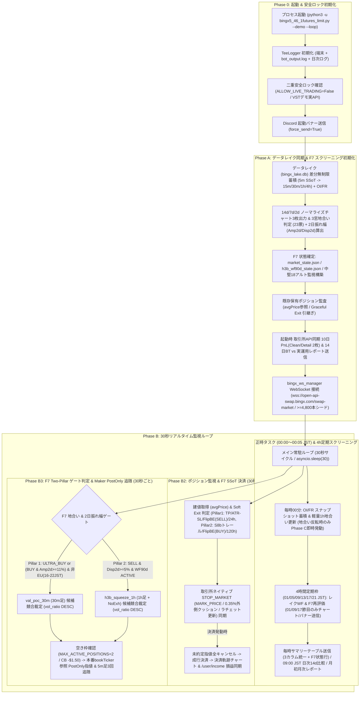

# bingx5_46 BingX USDT無期限先物 自動売買ボット 公式運用・開発仕様書 (PROJECT_RULES)

**Single Source of Truth (`PROJECT_RULES.md`)**
本ドキュメントは、`d:\python_bitcoin\motiobtc\bingx\bingx5_46`（BingX USDT無期限先物 自動売買ボット / 決済通貨: `USDT`）における取引ロジック、SQLite データレイク、2段階ウォークフォワード OOS、3窓全体地合い＆2日振れ幅ゲート、発注執行・リスク管理、およびサーバー運用に関する唯一の仕様原本です。すべてのコード変更・テスト・デプロイは本仕様に完全準拠して実施します。
コアアルゴリズム（**F7 Two-Pillar 戦略体系 C4 仕様**: `F7_30mNoEU_Amp2d_S8bNoExhDisp2d_WF90d`）は `hype5_45`（2026-11-28 最新検証仕様）と完全同一の SSoT（`strategy_f7_two_pillar.py`）に統一しつつ、取引基盤として **BingX USDT無期限先物** および **BingX 公式 VST デモ口座（実 API 発注検証）** に特化しています。

---

## §0. システム全体像・起動シーケンス ＆ 二重安全ロック (`ALLOW_LIVE_TRADING`)

### 0.1 二重安全ロック ＆ VST デモ実 API 検証モード
[`bingx5_46_1futures_limit.py`](./bingx5_46_1futures_limit.py) および [`bingx5_46_2api.py`](./bingx5_46_2api.py) 冒頭のフラグで口座・実行モードを厳密に制御する：

```python
ALLOW_LIVE_TRADING = False  # 本番リアル口座への発注・キャンセル・STOP_MARKET を物理遮断
BINGX_IS_LIVE = False       # False: VSTデモ (open-api-vst.bingx.com) / True: 本番 (open-api.bingx.com)
BINGX_IS_AIR = ("--air" in sys.argv or "--mock" in sys.argv)  # False: 実API発注 / True: 仮想AIR
```

- **二重物理ロック**: 本番リアル発注（`open-api.bingx.com`）へ切り替える際は、`ALLOW_LIVE_TRADING = True` かつ `BINGX_IS_LIVE = True`（かつ非 AIR）の両方が揃う構造を維持し、誤発注を構造的に防止する。
- **VST デモ実 API 検証スタイル**: デフォルトでは BingX 公式 VST デモ口座（`https://open-api-vst.bingx.com`）に対して実際に REST API 発注・PostOnly キャンセル・`STOP_MARKET` 保険逆指値配置・ポジション照会・`/openApi/swap/v2/user/income` 損益同期を実行し、リアルタイム検証を行う。
- **共通投資枠 (`$15.0 USDT`) ＆ 米国時間24h稼働**: デモ・本番ともに 1枠基準サイズを `BINGX_TARGET_POSITION_VALUE_USDT = 15.0` USDT に統一し、`ALLOW_NY_SESSION_LIVE = True` により 24時間稼働してバックテスト（`WalkForwardConfig.position_cost_usdt = 15.0`）と 1:1 一致させる。

### 0.2 全体動作シーケンス（起動 ➔ 30秒リアルタイム監視ループ）
本システムは Oracle Cloud VPS #2 上で `python3 -u bingx5_46_1futures_limit.py --demo --loop --skip-history` として常駐稼働する自律 MTF ボットである。



### 0.3 コアモジュール構成
| モジュール | 役割 |
|---|---|
| `symbol_universe.py` | 固定21アルト (`FIXED_TRADABLE_SYMBOLS`)、中堅18アルト (`TRADABLE_MID_CAP_SYMBOLS`)、除外超大型 (`EXCLUDED_TRADE_MEGA_CAPS`)、ベンチマーク (`BTC-USDT`)、除外大型 (`BTC-USDT`, `ETH-USDT`)、外部エイリアス (`PEPE` ➔ `1000PEPE-USDT` 等) の唯一定義 |
| `lake_store.py` | SQLite WAL データレイク (`Data/lake/bingx_lake.db`) 9テーブル管理（`backtest_simulated_trades` 時点地合い5カラム含む）・因果結合・軽量監査 CSV 出力 |
| `candle_5m_store.py` | 固定22銘柄 `5m` 足永続ストア・OKX 等からの過去分自動補完・確定足決定論的リサンプリング (`drop_unclosed=True`) |
| `bingx_oi_collector.py` | BingX 全対象銘柄の毎時 OI/FR スナップショット蓄積 (`Data/oi_store/{symbol}_oi.csv`) および過去補完 |
| `lake_backtest_engine.py` | リークゼロ 2段階ウォークフォワード OOS (`Opt 90d -> Eval 90d`)・時点1h地合い＋2日振れ幅再計算・旧6戦略ポートフォリオリプレイ |
| `strategy_f7_two_pillar.py` | **F7 Two-Pillar 戦略体系 SSoT**（`val_poc_30m` + `h3b_squeeze_1h`、2日振れ幅指標 `norm_amp_2d` / `norm_disp_2d`、C4 ゲート・BT/ライブ共通判定・保険 SL 算出） |
| `lake_live_bridge.py` | `bingx5_46_1futures_limit.py` 用 F7/レイク接続・`run_f7_screening_for_bot`・`refresh_hourly_regime_for_bot`・`h3b_wf90d` 状態保存・実約定/決済書き戻し |
| `lake_reproduce.py` / `compare_screening_vs_lake.py` | 保存済み `run_id` からの再現検収 CLI および比較監査 |
| `record_regime_history.py` | 1h 確定足基準の 3窓地合い履歴 (`regime_snapshots` ＆ `Data/regime_history.csv`) 更新・再構築 |
| `show_symbol_status.py` | 固定21アルト選定・除外ステータス一覧ダッシュボード出力 & Discord 配信（クジラフィルター・24hクールダウン非表示） |
| `real_trade_tracker.py` | `/openApi/swap/v2/user/income` 損益＆手数料同期・決済軌跡チャート (`plot_exit_chart` MP期間同期)・10日/月次レポート・**14日間理論BT vs 実運用比較レポート＆白ベース2段グラフ** |
| `bingx5_46_4mix_candle_Merged_Alt10.py` | 14d/7d/2d ノーマライズ比較チャート（22銘柄・PMH/PML 重畳）・3窓全体地合い判定・`Data/market_state.json` 保存 |
| `monthly_key_levels.py` | 先月高安（PMH / PML）キャッシュ (`Data/monthly_key_levels.json`) の自動更新・維持 |
| `bingx_ws_manager.py` | `pybotters` ベース BingX Perpetual Swap WebSocket 管理（`wss://open-api-swap.bingx.com/swap-market`） |
| `bingx5_46_1futures_limit.py` | 30秒サイクル MTF リアルタイム監視・非ブロッキング PostOnly 指値追随・F7 決済・ネイティブ `STOP_MARKET` 同期・状態永続化 |
| `bingx5_46_2api.py` | BingX REST API ラッパー、本番単一参照 `get_bingx_orderbook` / `contracts`、`_place_maker_entry_limit`、`sync_protective_stop_order`、`avgPrice` 取得 |
| `bingx5_46_3logic.py` | 単一 MP 算出コア (`MPStrategy`)・3窓地合いティア算出・旧6戦略ロジック＆テスト後方互換 |
| `tests/verify_lake_acceptance.py` & `tests/test_*.py` | 受入検収テスト群 `(a)〜(j)` および F7 C4・PostOnly・Net PnL・日次14d比較等の単体テスト群 |

---

## §1. 銘柄ユニバース定義 ＆ 月次剪定運用 (`symbol_universe.py`)

- **固定21取引対象アルト (`FIXED_TRADABLE_SYMBOLS`)**:
  `HYPE-USDT`, `SOL-USDT`, `DOGE-USDT`, `XRP-USDT`, `SUI-USDT`, `AVAX-USDT`, `LINK-USDT`, `APT-USDT`, `NEAR-USDT`, `ARB-USDT`, `UNI-USDT`, `OP-USDT`, `TIA-USDT`, `RENDER-USDT`, `INJ-USDT`, `TAO-USDT`, `AAVE-USDT`, `ENA-USDT`, `ZEC-USDT`, `1000PEPE-USDT`, `WIF-USDT`
- **地合い先行指標 (`BENCHMARK_SYMBOL`)**: `BTC-USDT`（3窓地合い投票 2票専用。売買エントリー対象からは完全除外）。
- **データレイク・ノーマライズチャート対象 (`LAKE_UNIVERSE_SYMBOLS`)**: 上記固定21アルト ＋ `BTC-USDT` ＝ **計22銘柄**。
- **常時取引除外大型 (`EXCLUDED_MEGA_CAPS`)**: `["BTC-USDT", "ETH-USDT"]`（いかなる状況でも売買しない）。
- **実運用時の中堅アルト特化フィルタ (`EXCLUDED_TRADE_MEGA_CAPS` / `TRADABLE_MID_CAP_SYMBOLS`)**:
  - `SOL-USDT`, `DOGE-USDT`, `XRP-USDT` の超大型3銘柄は板厚・HFT 競争・タイムアウト傾向回避のためライブ選抜およびポートフォリオ評価から除外し、**中堅18アルト (`TRADABLE_MID_CAP_SYMBOLS`)** に集中する（データレイク基盤およびノーマライズ比較では22銘柄すべてを蓄積・評価する）。
- **外部データ銘柄表記の自動正規化 (`normalize_symbol`)**:
  - OKX / Binance 等の補完時は `PEPE` / `PEPE-USDT` ➔ `1000PEPE-USDT`、`RNDR` / `RNDR-USDT` ➔ `RENDER-USDT` へ統一する。
- **月次銘柄見直し原則**:
  - 月次メンテナンス時（毎月1日）に過去実績（流動性・約定頻度・24h 出来高・単体 PF・過剰最適化回避）を点検し、必要時のみ `symbol_universe.py` の構成銘柄を見直す。

---

## §2. SQLite WAL データレイク ＆ 2段階ウォークフォワード OOS 基盤

### 2.1 正本データベース仕様 (`Data/lake/bingx_lake.db`)
- **同期・整合プリミティブ**: `PRAGMA foreign_keys=ON; PRAGMA journal_mode=WAL; PRAGMA synchronous=NORMAL;`
- **データ保持期間（無制限蓄積）**: 旧仕様の「65日保持切り捨て」は完全撤廃済み。過去の `5m` 足およびリサンプリング足・OI/FR・地合い履歴・OOS トレード台帳を期限なしで追記・蓄積する。
- **正規化9テーブル構成**:
  1. `universe_symbols`: 22銘柄（21アルト + `BTC-USDT`）+ `ETH-USDT` のロール・取引可否メタ
  2. `market_candles`: 確定足 OHLCV（`5m`, `15m`, `30m`, `1h`, `4h`）。`ts_utc + tf_sec <= cutoff_utc` の確定足のみ許可
  3. `market_oi_fr`: BingX 自前蓄積（`Data/oi_store/`）および OKX / Bybit 補完の `open_interest`, `open_interest_val`, `mark_price`, `funding_rate`
  4. `regime_snapshots`: 3窓地合い判定および 2日振れ幅指標のスナップショット履歴（毎時因果再計算を含む）
  5. `backtest_runs`: WF 実行メタ（窓範囲・手数料・Git SHA・全設定JSON）
  6. `backtest_cells`: `(symbol, strategy, side, timeframe)` ごとの Opt/Eval 成績・格付け・最適パラメータ
  7. `backtest_simulated_trades`: 全約定・全キャンセル (`CANCEL_SIGNAL_END`)・全決済・`ext_atr`・時点地合い5カラム (`regime_at_signal`, `strength_tier_at_signal`, `net_score_at_signal`, `buy_votes_at_signal`, `sell_votes_at_signal`) 明細
  8. `daily_selections`: 定期選定結果および実行ステータス (`SELECTED` / `EXECUTED` / `NO_CANDIDATE` / `NO_TRADE_REGIME`)
  9. `live_trades`: VSTデモ/本番の実トレードエントリー〜決済実績および `selection_id` 紐付け記録

### 2.2 時間足構成・5分足 SSoT ＆ ウォームアップ保証
- `candle_5m_store.py` ＆ `Data/lake/bingx_lake.db` では確定済み **`5m`** 足を単一データ源泉（SSoT）とし、`drop_unclosed=True` で未確定足を完全除外した上で **`15m`**, **`30m`**, **`1h`**, **`4h`** を決定論的にリサンプリング・格納する（`1d` の生成は廃止維持）。
- **F7 Two-Pillar 本番ロジック使用足**: Pillar 1 (`val_poc_30m`) は **`30m` 足**、Pillar 2 (`h3b_squeeze_1h`) は **`1h` 足** を使用する。
- **最低 4,800 本確保規約**: ライブ監視および `1h` 足指標（168h ボリンジャーバンド幅分位＋BB20）のウォームアップ不足を防ぐため、ローカルストア・データレイク・WebSocket をマージし最低 **`>= 4,800` 本の `5m` 足**（過去分不足時は OKX REST `/api/v5/market/history-candles` 等で自動補完）を保持する。

### 2.3 建玉 (OI) ＆ ファンディングレート (FR) 因果結合
- 毎時00分（Phase B1）およびスクリーニング時に BingX 全対象銘柄の OI/FR スナップショットを `Data/oi_store/{symbol}_oi.csv` および `market_oi_fr` へ自動蓄積する。
- `enrich_candles_with_oi_fr` 等で特徴量結合を行う際は、各足確定時刻 `bar_close_utc = ts_utc + tf_sec` 以前の最新確定 OI/FR のみを `merge_asof(..., direction="backward", tolerance=7200)` で結合し、欠損値は `np.nan` 維持で未来参照を構造的に遮断する。

### 2.4 未来リーク遮断 ＆ 2段階ウォークフォワード OOS (`WalkForwardConfig`)
- **時系列窓分割**:
  1. `Optimization Window` (`opt_days = 90日`): 検証窓と分離して最良パラメータを探索
  2. `Embargo` (`embargo_bars = 0`): 境界ポジションをリセットした上で評価窓へ移行
  3. `Evaluation OOS Window` (`eval_days = 90日`): Opt パラメータを凍結固定し未知区間で純粋 OOS 評価
- **悲観的検証コスト規約**: レイク WF エンジンおよび F7 シミュレータはともに往復 **`0.08%`**（`fee_maker = 0.0002`, `fee_taker = 0.0006`）、`position_cost_usdt = 15.0` を厳格控除する（実運用 BingX 往復 `0.07%` より保守的に設定）。
- **OOS 格付け (`select_eval_winner` / 旧6戦略および比較監査用)**:
  - `QUALIFIED`: `eval_trades >= 30` かつ `eval_ev > 0`
  - `PROVISIONAL`: `10 <= eval_trades < 30` かつ `eval_ev > 0`
  - `REJECTED_EV`: `eval_trades >= 10` かつ `eval_ev <= 0` / `INSUFFICIENT_N`: `eval_trades < 10`

### 2.5 スクリーニング周期 (`ANALYSIS_HOURS`)・差分同期・軽量監査 CSV 出力
- **定期スクリーニング周期 (`ANALYSIS_HOURS = [1, 5, 9, 13, 17, 21]`) ＆ 毎時反転検知**:
  - CPU 負荷分散と 30秒監視ループの高稼働維持のため、定期フル選定・WF再評価は JST **4時間間隔（`01:00, 05:00, 09:00, 13:00, 17:00, 21:00 JST`）** を標準とする（`--analysis-hours` / `--reset-hours` で上書き可）。
  - 主要チャート画像・定期バナー・10日間レポートの Discord 送信は **8時間節目（`01:00, 09:00, 17:00 JST`）** および起動時のみ実行し、中間枠（`05:00, 13:00, 21:00 JST`）や地合い反転時はローカル更新のみ行う。
  - 定期選定非該当の正時（Phase B1）では `refresh_hourly_regime_for_bot` による軽量 1h 地合い＋2日振れ幅更新のみを実行し、`overall_regime` が前回選定時点から反転した場合にのみオフスケジュールの即時 Phase C（再スクリーニング）を発動する。また LONG 解放条件（`ULTRA_BUY` または `BUY & norm_amp_2d >= 11.0%`）が変化した場合は Discord 通知を行う。
- **インクリメンタル履歴同期 (`sync_incremental_candles_for_symbol`)**:
  - 稼働中銘柄は全 CSV 再取込や全上位足再構築を行わず、直近確定足からの差分追記と境界整列による部分リサンプリングのみを実行する。
- **軽量監査 CSV エクスポート (`export_audit_csvs`)**:
  - `include_heavy_history=False`（デフォルト）では軽量テーブル・最新 Run 分（`backtest_cells_latest.csv`, `backtest_simulated_trades_latest.csv`）・直近14日地合い履歴（`regime_snapshots_recent.csv`）のみを出力し、メモリ負荷を抑える。

---

## §3. 3窓全体地合いエンジン・2日振れ幅指標 ＆ ノーマライズ監査

### 3.1 3期間全体地合い判定（23票体制）
- `1h` 確定足を用い、直近 **14日（336h）・7日（168h）・2日（48h）** の3窓で、`BTC-USDT`（2票）＋ 固定21アルト（各1票）＝ **計23票体制**（過半数 12票）で各窓の状態（`BUY` / `SELL` / `NEUTRAL`）を判定し、3窓の多数決で総合地合い `overall_regime`（`BUY` / `SELL` / `NEUTRAL`）を決定する。
- **強度ティア (`strength_tier`) ＆ `net_score`**:
  - `mean_buy = (buy_14d + buy_7d + buy_2d) / 3.0`, `mean_sell = (sell_14d + sell_7d + sell_2d) / 3.0`
  - `net_score = (mean_buy - mean_sell) / 23.0`（`-1.0 〜 +1.0`）
  - **BUY 系**: `ULTRA_BUY`（3窓すべて BUY）/ `STRONG_BUY`（`mean_buy >= 16.0`）/ `MODERATE_BUY`（`13.0 <= mean_buy < 16.0`）/ `WEAK_BUY`（`mean_buy < 13.0`）
  - **NEUTRAL 系**: `LEAN_BUY`（`net_score >= +0.15`）/ `BALANCED`（`-0.15 < net_score < +0.15`）/ `LEAN_SELL`（`net_score <= -0.15`）
  - **SELL 系**: `WEAK_SELL`（`mean_sell < 13.0`）/ `MODERATE_SELL`（`13.0 <= mean_sell < 16.0`）/ `STRONG_SELL`（`mean_sell >= 16.0`）/ `ULTRA_SELL`（3窓すべて SELL）
- **永続履歴記録 (`Data/regime_history.csv` & `Data/market_state.json`)**:
  - 起動時・4h定期選定時・毎時軽量更新時に最新地合い・2日振れ幅・除外リスト・`btc_ret14d`・`sym_ret14d_map`・`h3b_wf90d` 状態を `Data/market_state.json` へ保存し、履歴を `Data/regime_history.csv`（および SQLite `regime_snapshots`）へ時系列追記する。

### 3.2 2日ノーマライズ振れ幅指標 (`norm_amp_2d` / `norm_disp_2d`)
直近 **48時間（48本）の確定 `1h` 足**（先頭バー終値で正規化した `norm = close / close[0]`）から、銘柄横断のボラティリティと分散度を毎時算出する（`compute_norm_2d_vol_metrics_from_close_arrays`）：
- **`norm_amp_2d`（2日振幅中央値, `%`）**: 各有効銘柄の `(max(norm) - min(norm)) * 100` の全銘柄中央値。通常 `BUY` 相場でレンジ押し目（`val_poc_30m`）が利幅を確保できるボラ環境（`>= 11.0%`）にあるかを判定する。
- **`norm_disp_2d`（2日銘柄間分散, `%`）**: 各有効銘柄の48h最終正規化値 `final_norm = norm[-1]` における全銘柄分布の `(P90 - P10) * 100`。全銘柄が同じ値幅に張り付く団子相場（`< 5.0%`）を検知してスクイーズ売り（`h3b_squeeze_1h`）のダマシを回避する。

### 3.3 ノーマライズ前半高安監査 ＆ クジラフィルター完全廃止
- **ノーマライズ前半高安監査**: 14d / 7d / 2d 各窓で正規化推移を監査し、買い相場（`BUY`）では「前半50%以内に高値があり現在値がレンジ半値未満」の銘柄を `is_norm_excluded` としてロング対象から除外、売り相場（`SELL`）では「前半50%以内に安値があり現在値がレンジ半値超え」の銘柄を `is_norm_excluded` としてショート対象から除外する。なお F7 モードでは当該除外判定のみを厳格適用する（後半高値/安値維持銘柄を温存）。
- **クジラセンチメントフィルター完全廃止（2026-11-16 撤廃）**: 後追い・少数アドレス偏重による機会損失を排除するため、`fetch_whale_sentiment.py` の定期呼び出し、クジラ判定による銘柄除外・エントリー遮断・毎時サマリー表示はすべて廃止済み。

---

## §4. F7 Two-Pillar 戦略体系 (`strategy_f7_two_pillar.py` SSoT / `USE_F7_TWO_PILLAR_MODE = True`)

2021年〜2026年11月（50,786時間 / 全6暦年・中堅18アルト固定 `$15.0` 枠・往復 `0.08%` コスト控除後）の因果検証で全6年黒字を達成した **C4 拡張仕様（`F7_30mNoEU_Amp2d_S8bNoExhDisp2d_WF90d`）** を、ライブ（VSTデモ / 本番）およびバックテスト共通の単一仕様（SSoT）として運用する。

### 4.1 Pillar 仕様一覧（単発 `$15.0 USDT` 固定・ナンピン完全ゼロ）
| 項目 | Pillar 1: `val_poc_30m` (LONG) | Pillar 2: `h3b_squeeze_1h` (SHORT) |
|---|---|---|
| **時間足 / 地合い解放条件** | **`30m` 足** / **`ULTRA_BUY` または (`overall_regime == "BUY"` かつ `norm_amp_2d >= 11.0%`)** | **`1h` 足** / **`overall_regime == "SELL"`** |
| **除外・前提フィルタ** | `not is_norm_excluded`（BUY除外なし）<br>**欧州時間 (`16:00〜22:00 JST`) 新規禁止 (`NoEU`)**<br>中堅18アルト対象 (`SOL`/`DOGE`/`XRP`/`BTC`/`ETH` 除外) | `not is_norm_excluded`（SELL除外なし）<br>**2日団子相場除外 (`norm_disp_2d >= 5.0%`)**（※`WF90d` ペーパー台帳にも同一適用）<br>**疲れ切り除外 (`NoExh`: `btc_ret14d >= -10%` かつ `sym_ret14d >= -20%`)**<br>**因果90日 WF ヒステリシスゲート (`WF90d`: 直近90日確定台帳 `n >= 10` で `net < -3.00 & pf < 0.85` 休止 / `pf >= 1.00 or net >= 0` 解除)** |
| **エントリー条件** | `warmup >= 155`<br>指数減衰 MP(`period=120`, `half_life=60`, `bins=50`, `va=0.70`)<br>`VAL * 0.965 <= close <= VAL * 1.002`<br>`vol_ratio >= 1.2` | `warmup >= 170`<br>`BB(20, ddof=0)` 幅 `<= q25(168h, min_periods=50)` on `shift(1)`<br>`vol_ratio >= 1.5`<br>`close < low.rolling(48).min().shift(1)` |
| **利確 (TP) / 損切り (SL)** | TP = `max(VAL + (VAH - VAL) * 0.70, epx * 1.006)`（`VAL >= VAH` 等は `poc` 基準フォールバック）<br>SL = `epx - min(2.0 * ATR14, epx * 0.040)` | **S8b 段階的防衛トレール**:<br>初期 SL = `epx + 2.0 * ATR14`<br>翌足以降 `min(init_sl, trough + 2.0 * prev_atr)`<br>利益 `(epx - min_trough) >= 1.5 * entry_atr` 到達で **`BE_LOCK_SL = epx * 0.9980`** ロック |
| **地合い反転撤退 (`FlipBE`)** | **`overall_regime == "SELL"` 時のみ** `>= epx * 1.0020` (+0.20%) で決済（`NEUTRAL` では決済しない） | **`overall_regime == "BUY"` 時のみ** `<= epx * 0.9980` (-0.20%) で決済（`NEUTRAL` では決済しない） |
| **最大保有 (`MaxHold`) / タイムアウト** | **MaxHold `1440分` (24時間 / 48本)**<br>（4h タイムアウト強制損切りなし） | **MaxHold `7200分` (120時間 / 120本)**<br>（4h タイムアウト強制損切りなし） |
| **候補競合裁定 / 指値追随** | 同時候補は `(vol_ratio DESC, symbol ASC)` で空き枠 (`MAX_ACTIVE_POSITIONS = 2`) へ配分<br>PostOnly 指値（Best Bid）・5m確定足ごと最大 **3サイクル** 追随 | 同時候補は `(vol_ratio DESC, symbol ASC)` で空き枠 (`MAX_ACTIVE_POSITIONS = 2`) へ配分<br>PostOnly 指値（Best Ask）・5m確定足ごと最大 **3サイクル** 追随 |

#### 4.1.1 F7 実運用堅牢化仕様
- **取引所ネイティブ保険逆指値 (`STOP_MARKET` / `MARK_PRICE`) 併用**:
  - `bingx5_46_1futures_limit.py` による 30秒ソフト SL（`eff_sl`）を第一執行としつつ、VPS 瞬断・通信遅延時の最終防衛線として、保有中および S8b トレール/`BE_LOCK` による `eff_sl` 有利化時に `sync_protective_stop_order` で取引所側 `STOP_MARKET`（`workingType: "MARK_PRICE"`）を配置・ラチェット更新する。
  - 配置価格は `eff_sl` の **`0.35%` 外側**（`F7_INSURANCE_SL_BUFFER_PCT = 0.0035`：Long `eff_sl * 0.9965` / Short `eff_sl * 1.0035`）とし、現在値から最低 **`0.20%`**（`F7_INSURANCE_SL_MIN_GAP_PCT = 0.0020`）の安全距離を確保した上で、有利方向へ **`0.05%`**（`F7_INSURANCE_SL_MIN_STEP_PCT = 0.0005`）以上移動した時のみ更新する（配置失敗時は `120秒` クールダウン）。
- **`WF90d` 同一 1h 確定足キャッシュ**:
  - `Data/h3b_wf90d_state.json` の `evaluated_at_utc == cutoff_1h` かつ `mode_name == F7_MODE_NAME` の場合は SQLite 全履歴再走査を省略しキャッシュ値を即時返却する（モード名更新・キャッシュ未存在・時刻更新時は因果再評価）。
- **毎時 F7 状態行 ＆ 軽量取得**:
  - `USE_F7_TWO_PILLAR_MODE = True` 時は旧 `safe_make_logic` 計算をスキップし WS バッファ・本番板気配から高速に現在値を取得し、正時サマリーに `🏛️ F7状態:` 行を出力する。

#### 4.1.2 2日ノーマライズ振れ幅ゲート（C4 仕様）の因果検証根拠（2021〜2026年11月 / 50,786時間）
2021年1月〜2026年11月（中堅1hパネル / 往復 `0.08%` 手数料・同時最大2枠・日次CB `-$1.50` 適用）の因果バックテスト比較において、C4 仕様は最大純利益・最小最大DD・全6暦年黒字を達成している：

| 構成案 | ロング条件 (`val_poc_30m`) | ショート条件 (`h3b_squeeze_1h`) | 取引数 | 勝率 | 純損益 (Net) | PF | 最大DD | 黒字年 |
|---|---|---|---:|---:|---:|---:|---:|---:|
| C0 (旧F7) | `ULTRA_BUY` 限定 | `SELL` + `NoExh` + `WF90d` | 1015 | 49.2% | +\$63.87 | 1.39 | \$8.17 | 6/6 |
| C2 (Long拡張) | `ULTRA_BUY` or (`BUY` & `amp_2d >= 11%`) | 現行と同等 | 1102 | 49.7% | +\$74.30 | 1.41 | \$7.32 | 6/6 |
| C3 (Long厳選) | `ALL_BUY` & `amp_2d >= 11%` | 現行と同等 | 722 | 51.5% | +\$69.57 | 1.60 | \$7.18 | 6/6 |
| **C4 (採用仕様)** | `ULTRA_BUY` or (`BUY` & `amp_2d >= 11%`) | 現行 + **`disp_2d >= 5.0%`** | **966** | **50.7%** | **+\$76.80** | **1.47** | **\$6.92** | **6/6** |

### 4.2 旧セッション連動 Pure 6大戦略体系（後方互換・テスト参照用）
*(旧 `5m/15m` 6戦略・126通りグリッド・`select_session_entry_spec` は `tests/` 後方互換および `USE_F7_TWO_PILLAR_MODE = False` 用に保守維持。通常運用 `USE_F7_TWO_PILLAR_MODE = True` では §4.1 F7 C4 ロジックのみが稼働する)*
| セッション (JST) | 対象時間足 | 許可戦略 (ロング) | 許可戦略 (ショート) | 役割・参照パラメータ |
|---|---|---|---|---|
| 東京 (`09:00〜16:00`) | `5m` / `15m` | `val_poc`, `rsima` | `vah_poc`, `rsima_short` | レンジ逆張り専用 (`range_params`) |
| ロンドン (`16:00〜22:00`) | `5m` / `15m` | `vah_break` | `val_break` | ブレイクアウト専用 (`breakout_params`) |
| NY (`22:00〜翌09:00`) | `5m` / `15m` | `best_overall` (地合い連動) | `best_overall` (地合い連動) | 24h稼働 (`ALLOW_NY_SESSION_LIVE = True`) / 4hタイムアウト・8h MAX_HOLD |

---

## §5. BingX 発注執行（VSTデモ / 本番）＆ ポジション・リスク管理規約

### 5.1 Maker PostOnly 指値・本番板単一参照・非ブロッキング追随 (`_place_maker_entry_limit`)
- **本番 API 単一参照規約（デモ・本番共通）**:
  - BingX Web UI の板および約定判定は VST デモ時でも本番リアル板に同期しているため、契約仕様（`/openApi/swap/v2/quote/contracts`・300秒キャッシュ）および相場板気配値（`/openApi/swap/v2/quote/bookTicker`）は VST デモ運用時であっても**常に本番公開 API（`https://open-api.bingx.com`）から取得**する。発注・キャンセル・`STOP_MARKET`・ポジション照会のみ VST デモ API（`https://open-api-vst.bingx.com`）へルーティングする。
- **PostOnly 指値発注 ＆ 3回ティック退避リトライ**:
  - Long エントリーは **`best_bid`**（`side="BUY", positionSide="LONG"`）、Short エントリーは **`best_ask`**（`side="SELL", positionSide="SHORT"`）に対し `type="LIMIT", timeInForce="PostOnly"` で配置する（ただし最良気配値が参照終値から `0.5%` 超乖離時は参照価格へフォールバック）。
  - 既存未約定注文をキャンセル後、最大 **3回**（`attempt_idx = 0, 1, 2`）試行し、PostOnly 交差リジェクト検知時（`CANCELLED` 等またはエラーコード `101215 / 109425 / 101209`）は最新 `bookTicker` から `attempt_idx * tick_size`（`tick_size = 10 ** (-price_place)`）外側へ自動退避して再配置する。3回とも交差した場合は見送り、次サイクルで再評価する。
- **非ブロッキング追随 (`pending_entry_orders`)**:
  - 指値配置後は即座にリターンし、`pending_entry_orders` で一括管理する。F7 モードでは 5m 確定足ごとに最大 **3サイクル**（`max_chase = 3`）まで追随を許可し、同一確定足重複抑止（`last_signal_tf_close_map`）を適用する。
  - シグナル消滅・追随上限到達・稼働戦略切替・`NoExh` / `WF90d` / `Amp2d` / `Disp2d` ゲート無効化・地合い中立・日次 CB 発動時は即座に `active_order_cancel()` で撤去する。

### 5.2 平均建値 (`avgPrice`)・決済安全手順・数量丸め・資金管理
- **平均取得価格 (`avgPrice`) 厳格参照**: `/openApi/swap/v2/user/positions` は `avgPrice` を基準に返却するため、建値・評価損益・SL/FlipBE 判定は常に `p.get("avgPrice")` を最優先で参照する（フォールバック: `entryPrice` / `avgEntryPrice`）。
- **決済 (Flatten) 前全キャンセル規約**: TP / SL / FlipBE / MaxHold いずれの成行決済時も、実行直前に必ず `active_order_cancel()` で対象銘柄の既存未約定指値および保護逆指値を全キャンセルしてから成行一括決済（`close_long` / `close_short`）を実行する。
- **数量・価格の丸め込み (`Quantization`)**: 取引所 `contracts` メタデータの `quantityPrecision`、`pricePrecision`、`tradeMinQuantity` に従って厳格に丸め込み、端数拒否エラーを防止する。
- **レバレッジ・目標サイズ・必要証拠金**: `LEVERAGE_FACTOR = 10.0`（API 経由で設定）、1枠基準想定元本 `BINGX_TARGET_POSITION_VALUE_USDT = 15.0` USDT。発注直前に必要証拠金 `(current_price * lot) / LEVERAGE_FACTOR` が口座利用可能残高を下回る場合は新規発注をスキップする。

### 5.3 同時保有枠・日次損失サーキットブレーカー・状態永続化
- **同時保有上限 & 単発1本固定**: `MAX_ACTIVE_POSITIONS = 2`（保有中ポジション ＋ 未約定待機指値の合計）および `MAX_TRADES_COUNT = 1`（初期1枠のみ・ナンピン `ADD_ENTRY` 完全ゼロ）を厳守する。
- **日次回数制限解除 (`DAILY_MAX_TRADES = 0`) ＆ 日次損失 CB (`-$1.50 USDT`)**:
  - 1日あたりのトレード回数上限は撤廃済み。JST 09:00（UTC 00:00）を営業日境界として `Data/daily_trade_state.json` に当日確定損益（推定往復手数料 `0.02% + 0.05%` 控除後ベース）を累積し、未決済含み損を加算した実効損失 `effective_loss = daily_pnl_usdt + min(0, total_unrealized_pnl)` が **`-$1.50 USDT`**（`DAILY_MAX_LOSS_USDT = 1.50`）以下に達した時点で当日の新規エントリーを全面停止し、翌朝 09:00 JST まで待機する（既存ポジションの決済監視は継続）。
- **24時間 SL クールダウン完全撤廃 (`SL_COOLDOWN_HOURS = 0.0`)**:
  - 損切り・タイムアウト後の 24時間クールダウンおよび 20分間任意再発注停止は廃止済み。同一シグナル確定足での重複エントリー抑止のみ行う。
- **状態永続化 ＆ Graceful Exit 原則**:
  - 約定直後に `Data/scale_in_state.json`（および互換メタ `Data/active_positions_meta.json`）へ `strategy`、`timeframe`、`entry_atr`、`init_sl`、`target_tp`、`trough_price`、`be_locked`、`protective_sl_price` / `protective_sl_order_id`、`lake_trade_id`・`lake_selection_id`・`lake_run_id` を永続化し、再起動やスクリーニング対象外化後であっても保有中ポジションはエントリー時の戦略・パラメータで最後まで決済監視（Graceful Exit）する。決済完了時は `record_live_exit_to_lake` でレイクへ書き戻す。

---

## §6. レポーティング・取引所 API 損益同期 ＆ Discord 通知運用

- **文字化け防止 & 数式誤爆防止**: Discord Webhook へのファイル送信は必ず `payload_json`（UTF-8）を使用し、すべての matplotlib グラフ生成モジュールで `plt.rcParams["text.parse_math"] = False` を設定する。
- **起動・定期選定バナー (`force_send=True`)**: 起動時および 8時間節目（`01:00, 09:00, 17:00 JST`）に `AUTO TRADING SYSTEM START` / `PERIODIC SCREENING & OPTIMIZE` バナー（最新 F7 C4 態勢・単発 `$15.0` 枠表記）を即時送信する。
- **毎時ステータスサマリーテーブル（正時 00:00〜00:05 JST / 3カラム統一）**:
  - ヘッダーに口座残高（VST Demo / Live）、本日トレード進捗・CB 状態、全体地合い（`overall_regime` / 強度説明）、および **`🏛️ F7状態:` 行**（`NoExh`・`WF90d`・`NoEU`・`2d振れ幅:Amp{x}%/Disp{y}%`・`BUY+Amp2d`・`Disp2d団子<5%`・地合いティア）を表示。
  - テーブルは **`銘柄` / `現在価格` / `ポジション`** の 3カラム固定幅（`-USDT` 省略ティッカー、`保有S({sign}$X.XX/1枠)` / `保有L({sign}$X.XX/1枠)` / `指値($X.XXXX)` / **`ノーポジ`**）に統一する（クジラ列なし）。
- **ノーマライズ比較チャート（14d / 7d / 2d・計22銘柄）**:
  - 起動時および 8時間節目（`01:00, 09:00, 17:00 JST`）に、`LAKE_UNIVERSE_SYMBOLS`（固定21アルト ＋ `BTC-USDT` ＝ **22銘柄**、14d チャートは先月高安 PMH/PML 点線・除外タグ付き）の比較チャート3枚と 3窓全体地合いサマリーを Discord 送信する（中間 4h 枠・反転時はローカル更新のみ）。
- **エントリー通知・決済軌跡チャート集約**:
  - **エントリー約定時**: 画像出力は廃止し、約定価格・数量・戦略・TP/SL 条件等のテキスト通知のみ即時送信する。
  - **決済確定時**: `plot_exit_chart`（採用戦略の本来の `mp_period` 完全同期・約定足/決済足時間軸同期・トレード軌跡点線・損益/理由注記）のみを生成・送信し、続けて直近10日間実トレード損益レポート（Clean版・Detail版 2枚）を更新送信する。
- **取引所 API 実損益同期 (`/openApi/swap/v2/user/income` SSoT / `real_trade_tracker.py`)**:
  - 起動時・決済直後・定期実行時に `/openApi/swap/v2/user/income` を `incomeType` フィルタなしで一括取得し、`REALIZED_PNL`・`TRADING_FEE`・`FUNDING_FEE` を合算して真の純損益（`Net PnL = gross_pnl + fee`）を `Data/real_trades_history.json` / `Data/trades_history.csv` へ同期する。
  - `tranId` 未紐付けのボット決済レコード（`CLOSE`）は、同一銘柄・方向において時刻差 **`900秒`（15分）以内** かつ損益差 **`±$0.50 USDT` 以内** のうち時刻差最小の取引所 `REALIZED_PNL` と照合して統合・重複排除し、手動成行決済（Manual Flatten）や外部決済も漏れなく自動取り込みする。
- **日次 14日間 理論BT vs 実運用比較レポート ＆ 月次レポート**:
  - 起動時（日次送信枠 `Data/last_daily_14d_report_sent.json` は非消費）および毎日 `09:00 JST`（同日重複防止管理付き）に、直近14日間の理論BT（F7 C4 SSoT: `F7_30mNoEU_Amp2d_S8bNoExhDisp2d_WF90d`・時点1h地合い・2日振れ幅ゲート・2枠・CB `-$1.50`・往復 `0.08%` 手数料）と取引所 API 同期済み実運用 PnL の比較表＆白背景 (`#ffffff`) 2段比較チャート (`Data/daily_14d_bt_vs_live.png`) を送信する。
  - 毎月1日 `09:00 JST`（重複防止付き）に前月月次確定レポートと月次チャート (`monthly_performance_YYYYMM.png`) を配信する。

---

## §7. 本番運用環境 (Oracle Cloud VPS #2)・Git デプロイ ＆ 堅牢化規約

- **稼働 VPS ＆ プロセス管理**:
  - **ホスト**: Oracle Cloud VPS #2 (`158.101.157.117`) / ユーザー: `ubuntu`
  - **SSH秘密鍵**: `C:\Users\user\OneDrive\Desktop\OracleVPS\id_rsa.oracle2`
  - **ディレクトリ / 仮想環境**: `/home/ubuntu/bingx5_46` / `/home/ubuntu/pybot-env`
  - **自動死活監視 (`check_and_restart.sh`)**: 5分間隔 cron (`*/5 * * * *`) にて `pgrep -f "python.*bingx5_46_1futures_limit.py"` を監視。停止時は既存 `bot_output.log` を最大5世代（`bot_output_prev_*.log`）退避の上、`nohup nice -n 10 /home/ubuntu/pybot-env/bin/python3 -u bingx5_46_1futures_limit.py --demo --loop --skip-history` でアンバッファ起動し、5秒後クラッシュ検知を行う。
- **標準 Git デプロイ規約（`.py` / `.sh` の SCP 上書き厳禁）**:
  1. ローカル検証（`python -m py_compile`・`python -m unittest discover -s tests -p "test_*.py" -v`）
  2. ローカル Git コミット ＆ プッシュ（`git add` ➔ `git commit` ➔ `git push origin main`）
  3. VPS 側 `git pull origin main` による同期
  4. ボット安全再起動 ＆ `bot_output.log` 正常稼働確認（※ログ・CSV・JSON・PNG のダウンロード用 SCP は許可）
- **クロスプラットフォーム ＆ 例外隔離**:
  - すべてのファイル I/O に `encoding="utf-8"` と `pathlib.Path` を使用し、`.gitattributes`（`*.sh text eol=lf`）で LF 改行を保証する。外部 API 通信やバックグラウンド処理は例外隔離ブロックで保護し、メインループ停止を防止する。
- **WebSocket リアルタイム通信堅牢化 (`bingx_ws_manager.py`)**:
  - 接続先: `wss://open-api-swap.bingx.com/swap-market`（`pybotters >= 1.11.2` 使用）。
  - 送信前 `getattr(ws, "closed", False)` チェックおよび `_safe_send_str` による完全例外隔離を行う。
  - `asyncio.create_task` 生成タスク（Pong 応答等）は `self._bg_tasks: Set[asyncio.Task]` に強参照登録し、`add_done_callback(self._bg_tasks.discard)` で自動解放して `Task exception was never retrieved` を根絶する。`stop()` 時は全残存タスクをキャンセル・`asyncio.gather(..., return_exceptions=True)` で回収する。
- **CPU バウンド計算時の GIL 協調解放**:
  - 重いバックテスト・最適化ループの合間に `time.sleep(0.005)` 等を挿入して OS レベルで GIL を解放し、メインイベントループの WebSocket Keep-Alive・価格更新・30秒監視ループの遅延を防止する。
- **デプロイ前標準検収コマンド**:
  1. 構文検証: `python -m py_compile`（対象 `.py` 一式）
  2. 受入＆単体テスト: `python -m unittest discover -s tests -p "*.py" -v`
  3. ステータス確認: `python show_symbol_status.py`
