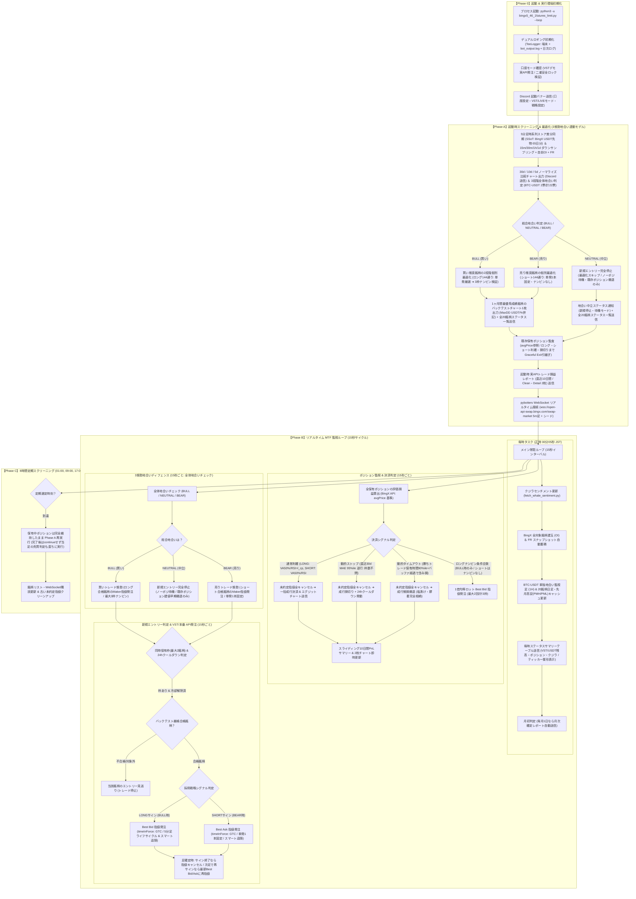

# bingx5_46 プロジェクト運用ルール & 開発アーキテクチャ規約 (PROJECT_RULES)

本ドキュメントは、`bingx5_46`（BingX USDT無期限先物 自動売買ボット）プロジェクトの設計思想、システム起動シーケンス、データパイプライン、取引戦略、資金管理、およびサーバー運用に関する最高位の規約（Single Source of Truth）です。
コアロジック（ノーマライズ3段階地合い判定・2段階72通り最適化・地合いディフェンス）は `hype5_45` と完全同一のアルゴリズムを維持しつつ、取引基盤として **BingX USDT無期限先物（豊富なUSDT流動性）** および **BingX公式 VSTデモ口座（実API発注検証）** に完全特化しています。

---

## 0. システム起動から常駐監視への全体動作シーケンス (System Lifecycle & Execution Sequence)

本システムは、VPS サーバー（Oracle #2）上で常駐プロセスとして完全自律稼働する MTF（マルチタイムフレーム）高機能自動売買ボットです。



### 【各フェーズの要約】
* **【Phase 0】起動 & 実行環境初期化**:
  アンバッファ起動（`-u`）、`TeeLogger` デュアルロギング、二重安全ロック＆VSTデモ口座設定確認、Discord 起動バナー送信（`payload_json` による文字化け防止徹底）。
* **【Phase A】起動時スクリーニング & 最適化 (3態勢地合い連動モデル)**:
  5分足ストア差分同期（SSoT: BingX USDT先物 65日分）、30d/10d/5d ノーマライズ比較チャート送信 ＆ 3段階全体地合い判定（`BTC-USDT` 2票/計22票）。
  - **BULL (買い)**: 買い推奨銘柄を対象に2段階個別バックテスト（ロング144通り: 単発厳選 ➔ 3枠ナンピン検証）を実行。
  - **NEUTRAL (中立)**: 新規個別最適化はスキップし、新規エントリーを完全停止（ノーポジ待機・既存ポジションの建値早期撤退のみ）。
  - **BEAR (売り)**: 売り推奨銘柄を対象に個別バックテスト（ショート144通り: 単発1本固定）を実行。
  厳格基準（全体10回以上 ＆ 前半純利益>0 ＆ 後半純利益>前半純利益、後半利益最大選抜）クリア銘柄を選定し最優秀銘柄チャート1枚を送信、既存ポジション監査（`avgPrice` 基準・Graceful Exit）、直近10日間実損益レポート送信、pybotters WebSocket 5分足リアルタイム購読開始。
* **【Phase B】リアルタイム MTF 監視ループ (15秒サイクル)**:
  * **Phase B1 (毎時 00:05 JST)**: クジラセンチメント更新、BingX OI/FR スナップショット自動蓄積、BTC地合い足更新、**Hype版と完全統一した毎時ステータス配信（`-USDT` 省略・4カラム整列）**、月初レポート送信。
  * **Phase B2 (ポジション監視)**: 保有銘柄の利確（Normal TP または 非合致時の建値早期撤退）・動的ストップ損切り（直近30d MAE 95%ile 逆行、枠数不問発動 ＆ 24hクールダウン）・4時間タイムアウト撤退（48本経過で含み損なら微損撤退）・段階ナンピン（LONGのみ最大3枠等倍、SHORTはナンピンなし単発固定）判定。決済時は必ず既存の未約定指値をすべてキャンセルしてから成行決済を実行する。
  * **Phase B3 (3態勢地合いディフェンス)**: 
    - **BULL (買い)**: ロング合格銘柄へのエントリーを許可。
    - **NEUTRAL (中立)**: 新規エントリーを完全停止（ノーポジ待機）。既存ポジションは建値早期撤退（ロング: `avgPrice * 1.0020`, ショート: `avgPrice * 0.9980`）で安全に回収。
    - **BEAR (売り)**: ショート合格銘柄へのエントリーを許可（単発1本固定）。
  * **Phase B4 (新規エントリー判定)**: 最大2銘柄枠内で「バックテスト厳格合格銘柄」のみ採用戦略シグナルを判定し、BingX API（VSTデモまたは本番）へ Best Bid（買い）/ Best Ask（売り）指値発注 ＆ 足確定ごとのライフサイクル管理（Pending & Resubmit）。
* **【Phase C】8時間定期スクリーニング (01:00, 09:00, 17:00 JST)**:
  保有中ポジションは利確・損切りまで一切強制決済せず維持し、Phase A と同様に最新データで全体地合い判定・推奨銘柄最適化を再実行。**定期選定完了後、ループを `continue` して確定足をスキップすることを厳禁とし、直ちにその確定足の決済・エントリー判定を実行する。**

---

## 1. 銘柄選定・検証データ収集規約 (Data Pipeline)

### 💎 【単一データ源泉 (SSoT)】5分足 (5m) 差分追記型・永続ローカル時系列ストア
* **巨大データ一括取得・ZIP送信の完全廃止**:
  * 全市場600銘柄以上のダウンロードや巨大CSV/ZIPの生成・送信は完全に廃止し、固定選定20銘柄＋`BTC-USDT`（計21銘柄）の5分足データのみを軽量管理する。
* **アーキテクチャ (`candle_5m_store.py`)**:
  * BingX USDT無期限先物の 5分足（5m）OHLCV を最小データ粒度かつ「単一のデータ源泉（SSoT: Single Source of Truth）」とし、ローカルファイル（`Data/candles_5m/candles_5m_{SYMBOL}.csv`）に永続蓄積・差分追記（Append）する。
  * **初回取得 ＆ OKX外部補完 (2ヶ月分/65日分蓄積)**: 初回または不足時は BingX API から取得可能な直近分を取得し、45日〜65日前の不足分は GCP・Oracle 等の全クラウド環境でアクセス遮断のない **OKX REST API（`/api/v5/market/history-candles`）** より価格比率 $R_{px}$・出来高比率 $R_{vol}$ 平準化補完してシームレスに結合する。
  * **増分更新（インクリメンタル更新）とローリング管理**: 2回目以降は既存データの最新タイムスタンプ以降の差分のみを BingX API から取得してマージ（`drop_duplicates`）し、**60日〜65日分（上限18,720本＝約2ヶ月強）** でローリング保持する。これにより地合い判定（30d/10d/5d）およびウォークフォワード検証で常に安定した過去2ヶ月分の時系列データが確保される。
* **動的ダウンサンプリング（リサンプリング）原則**:
  * 検証・運用で用いる `15m`、`30m`、`1h`（60m）、`1d`（1440m）は、すべてこの 5分足ストアから `resample_from_5m` により数学的完全整合で動的に生成する。

### 🏛️ 建玉（OI）時系列蓄積 ＆ ファンディングレート（FR）モニタリング
* **自前蓄積最優先**: 毎時 00 分およびスクリーニング時に BingX 全対象銘柄の建玉（Open Interest: USDT建て想定元本）および Funding Rate スナップショットを `Data/oi_store/` へ自動蓄積。データが存在する時間帯は BingX 純正実測建玉を最優先採用する。
* **外部補完と自然移行**: 蓄積前の過去分（直近35日分）は全クラウド・日本人環境互換の OKX 公開API（1時間OI・8時間FR履歴）を最優先（未上場時のみBybitフォールバック）で境界比率スケーリング補完し、稼働に伴い自然と 100% BingX 純正データへ置き換える。現在値の一律べた塗りは厳禁。
* **バックテスト＆実運用 100% 一致統合 (`enrich_candles_with_oi_fr`)**: 5分足およびリサンプリング後の各時間足（15m, 30m, 60m）に `openInterest`、`oi_chg_4h`（直近4時間OI変化率%）、`fundingRate`（8時間率）を結合し、30日間の個別最適化バックテストとリアルタイム監視ループで完全に同一の3要素エントリー精度フィルターを適用する。

---

## 2. 取引対象銘柄 ＆ 全体地合い判定規約 (Symbols & Market Regime)

### 🎯 対象銘柄 ＆ 投票重み配分（USDT先物 アルト固定20銘柄 ＋ BTC-USDT 計22票）
USDCよりも圧倒的に出来高・流動性が厚い **USDT無期限先物ペア** を対象とし、銘柄構成は `hype5_45` と完全統一する：
* **固定選定アルトリスト (`FIXED_SYMBOLS` 20銘柄 / 各1票 = 計20票)**:
  `HYPE-USDT`, `SOL-USDT`, `DOGE-USDT`, `XRP-USDT`, `SUI-USDT`, `AVAX-USDT`, `LINK-USDT`, `APT-USDT`, `NEAR-USDT`, `ARB-USDT`, `UNI-USDT`, `OP-USDT`, `TIA-USDT`, `RENDER-USDT`, `INJ-USDT`, `FET-USDT`, `TAO-USDT`, `AAVE-USDT`, `ENA-USDT`, `ZEC-USDT`
* **BTC 先行指標 (`BTC-USDT` 1銘柄 / 2票分 = 計2票)**:
  `BTC-USDT` は市場全体の牽引役として 2 票分の投票権を持つ（※`BTC-USDT` 自身はアルト発注対象外）。
* **総投票数: 22 票**（「半分以上」の判定基準: **11 票以上**）
* **ETH (`ETH-USDT`) の完全除外規約**:
  ETH は BTC への遅行・連動傾向が強く先行指標としての優位性がないため、トレード対象および地合い監視対象から完全に除外する（WebSocket 購読も行わない）。

---

### 📊 全体地合い判定 3段階プロセス (30d / 10d / 5d ノーマライズ比較)
指定全 20 銘柄 ＋ `BTC-USDT`（計 22 票）について、**【30d (720h)】・【10d (240h)】・【5d (120h)】** の 3 期間ノーマライズ比較チャート（起点価格=1.0）を用いて、`hype5_45` と完全同一の 3 段階判定を厳格に執行する：

```
【地合い判定 ＆ 3態勢バックテスト・トレードフロー】
各銘柄・各期間の正規化データ（起点=1.0）
      ↓
［第2判定 ＆ 第3判定（補完ルール）］
  ├─ 買い候補 (final >= 1.0): 前半高値ピークアウト監査 (半値以上維持なら合格、割れは除外)
  └─ 売り候補 (final < 1.0): 前半安値ボトム反発監査 (半値以下推移なら合格、越えは除外)
      ↓
［第1判定（各期間 30d / 10d / 5d の投票集計）］
  ├─ 買い合格票 >= 11票 ➔ その期間は「買い (BUY)」
  ├─ 売り合格票 >= 11票 ➔ その期間は「売り (SELL)」
  └─ いずれも 11票未満 ➔ その期間は「中立 (NEUTRAL)」
      ↓
［総合地合い判定 (3態勢連動)］
  ├─ 30d / 10d / 5d すべて買い ➔ 総合「買い (BULL)」
  │    ➔ 買い推奨銘柄の2段階個別最適化（ロング144通り: 単発厳選 ➔ 3枠ナンピン検証）
  │    ➔ 通常ロングトレード（最大3枠ナンピン、VAL-VAH 50%水準利確）
  │
  ├─ 【30d底打ち反転 ＆ 10d/5d買い連動判定（買い態勢緩和）】:
  │    30d判定が「売り (SELL)」または「中立」であっても、
  │    30d市場が「前半安値からレンジ半値以上へ急反発（底打ち反転・V字回復型）」しており、
  │    かつ「10d = 買い (BUY)」かつ「5d = 買い (BUY)」であれば、総合「買い (BULL)」と判定。
  │    ➔ 買い推奨銘柄: 10d買い ∩ 5d買い ∩ (30d底打ち反転 または 30d買い)
  │    ➔ 通常ロングトレード（最大3枠ナンピン、VAL-VAH 50%水準利確）
  │
  ├─ 30d / 10d / 5d すべて売り ➔ 総合「売り (BEAR)」
  │    ➔ 売り推奨銘柄の個別最適化（ショート144通り: 単発1本固定）
  │    ➔ 単発ショートトレード（ナンピン完全なし・目標額100%フルロット、VA 50%水準利確）
  │
  ├─ 【30d天井崩壊 ＆ 10d/5d売り連動判定（売り態勢緩和）】:
  │    30d判定が「買い (BUY)」または「中立」であっても、
  │    30d市場が「前半高値からレンジ半値以下へ崩落（天井崩壊トレンド）」しており、
  │    かつ「10d = 売り (SELL)」かつ「5d = 売り (SELL)」であれば、総合「売り (BEAR)」と判定。
  │    ➔ 売り推奨銘柄: 10d売り ∩ 5d売り ∩ (30d天井崩壊 または 30d売り)
  │    ➔ 単発ショートトレード（ナンピン完全なし、目標額100%フルロット）
  │
  └─ それ以外 (不一致または中立) ➔ 総合「中立 (NEUTRAL)」
       ➔ 新規個別最適化スキップ ＆ 新規エントリー完全停止（ノーポジ待機）
       ➔ 既存ポジションの建値早期撤退（+0.20%）および損切り管理のみ
```

#### 🔹 第1判定: 各期間（30d / 10d / 5d）の地合い過半数判定
* 30d / 10d / 5d のノーマライズ比較チャートから、各期間の合格プラス銘柄が半分以上（**11 票以上 / 22 票**）であれば **「買い (BUY)」**。
* 30d / 10d / 5d のノーマライズ比較チャートから、各期間の合格マイナス銘柄が半分以上（**11 票以上 / 22 票**）であれば **「売り (SELL)」**。
* 30d / 10d / 5d の判定が**すべて買いであれば、総合地合いは「買い (BULL)」**。
* 30d / 10d / 5d の判定が**すべて売りであれば、総合地合いは「売り (BEAR)」**。
* **【30d底打ち反転上昇 ＆ 10d/5d買い連動規約】**: 
  30d の判定が「売り (SELL)」または「中立 (NEUTRAL)」であっても、30dにおいて「前半50%以内に最安値をつけ、現在値がレンジ半値ライン以上へ力強く買い戻されている（セリクラ底打ち反転・V字回復型）」ことが検知され（BTC底打ち反転、市場平均ノーマライズ底打ち反転、またはアルト底打ち反転過半数のいずれか）、かつ直近の **「10d = 買い (BUY)」かつ「5d = 買い (BUY)」** の場合は、相場全体の底打ち反転トレンド転換をデータドリブンに認定し、**総合地合いを「買い (BULL)」** と判定する。
* **【30d天井崩壊下落 ＆ 10d/5d売り連動規約】**: 
  30d の判定が「買い (BUY)」または「中立 (NEUTRAL)」であっても、30dにおいて「前半50%以内に最高値をつけ、現在値がレンジ半値ライン以下へ崩落している（天井崩壊トレンド）」ことが検知され（BTC天井崩壊、市場平均ノーマライズ天井崩壊、またはアルト天井崩壊過半数のいずれか）、かつ直近の **「10d = 売り (SELL)」かつ「5d = 売り (SELL)」** の場合は、相場全体の下落トレンド転換をデータドリブンに認定し、**総合地合いを「売り (BEAR)」** と判定する。
* **それ以外（判定不一致または中立期間あり）は総合地合い「中立 (NEUTRAL)」**。

#### 🔹 第2判定: 前半高値・前半安値による除外スクリーニング
* 30d / 10d / 5d のノーマライズ比較チャートから、**各期間の前半に高値がある銘柄はプラス銘柄（買い候補）から除外**。
* 30d / 10d / 5d のノーマライズ比較チャートから、**各期間の前半に安値がある銘柄はマイナス銘柄（売り候補）から除外**。

#### 🔹 第3判定: 補完ルール（前半高値/安値の半値維持監査 ＆ 買い/売り完全対称設計マトリクス）
第2判定で「前半に高値/安値がある銘柄」であっても、相場の反発力・モメンタムが維持されているかを以下のレンジ半値ラインで精密に検証し、真のピークアウト/ボトム反発のみを除外する（買い/売りの完全対称設計）：
```
└─ 📉 個別銘柄 3期間ノーマライズ前半高値/安値検出規約 (買い/売り完全対称マトリクス)
     ├─ 対象期間: 5d (120h) / 10d (240h) / 30d (720h) 全期間統一基準
     ├─ 【買い相場 (BULL態勢) の採用 ＆ 除外ルール】:
     │    ├─ 🟢 採用・追加 (好機):
     │    │    ① 後半高値更新型 (順張り上昇トレンド)
     │    │    ② セリクラ底打ち反転型 (前半ボトム急反発):
     │    │       期間内最安値(Min)が「前半50%以内」に位置し、現在値がレンジ半値ライン
     │    │       (Min + (Max - Min) * 0.5) 以上まで力強く買い戻されている銘柄は、
     │    │       「底打ち反転・V字回復（上昇モメンタム発生）」とみなして買い候補銘柄に正式追加・採用する。
     │    └─ 🔴 除外・遮断 (リスク):
     │         前半ピーク半値割れ型 (ピークアウト警戒):
     │         期間内最高値(Max)が「前半50%以内」にあり、現在値がレンジ半値未満に沈んでいる銘柄は、
     │         「天井打ち崩壊・反発力枯渇」とみなしてロング対象から完全に除外・遮断する。
     │
     ├─ 【売り相場 (BEAR態勢) の採用 ＆ 除外ルール】 (完全対称の売り側判定):
     │    ├─ 🟢 採用・追加 (好機):
     │    │    ① 後半安値更新型 (順張り下落トレンド)
     │    │    ② 天井崩壊トレンド型 (前半ピーク急落):
     │    │       期間内最高値(Max)が「前半50%以内」に位置し、現在値がレンジ半値ライン以下に
     │    │       沈み込んでいる銘柄は、「天井打ち崩落・下落モメンタム発生」とみなして売り候補銘柄に正式追加・温存する。
     │    └─ 🔴 除外・遮断 (リスク):
     │         前半ボトム半値超え型 (底打ち反発警戒):
     │         期間内最安値(Min)が「前半50%以内」にあり、現在値がレンジ半値超えまで戻している銘柄は、
     │         「底打ち反発・踏み上げ（ショートスクイズ）リスク」とみなしてショート対象から完全に除外・遮断する。
     │
     └─ 防衛措置:
          ・買い態勢時: 前半ピーク半値割れ銘柄（ピークアウト警戒）をロング候補から除外。
          ・売り態勢時: 前半ボトム半値超え銘柄（底打ち反発警戒）をショート候補から除外。
          ・除外銘柄は新規エントリーを完全遮断。
```
※上記判定はアルト 20 銘柄および `BTC-USDT`（2票分）の全銘柄に対して同一基準で実行する。

#### 🔹 クジラセンチメント判定の買い/売り対称規約
* **買い態勢 (BULL)**: 大口売り偏重（`SHORT_ONLY`）の銘柄はエントリー除外（下落リスク回避）。
* **売り態勢 (BEAR)**: 大口買い偏重（`LONG_ONLY`）の銘柄はエントリー除外（踏み上げリスク回避）。大口売り偏重（`SHORT_ONLY`）はショートの追い風としてエントリーを許可。

#### 🔹 補助指標: 先月高安（PMH / PML）の記憶 ＆ ノーマライズ反発点線描画
* **先月高安の自動集計・記憶（`Data/monthly_key_levels.json`）**:
  * 初回または不足時は日足データから先月（前月）の高値・安値・終値（PMH / PML / PMC）を自動集計し永続保持。以降は自前の5分足時系列データから自然更新。
* **ノーマライズチャート（30d）上への点線描画**:
  * 30d ノーマライズ比較チャート（起点価格 $P_0 = 1.0$）上に、起点に対する先月高安比率（$PMH / P_0$, $PML / P_0$）を点線（破線）で描画。
  * **BTC-USDT 先月高値・安値**: オレンジ・水色の太い点線（`:`）で描画し、市場全体のサポート・レジスタンス基準線とする。
  * **アルト平均 先月高値・安値**: 赤・緑の破線（`--`）で描画し、市場全体が「先月安値から反発（リバウンド）しているのか」「先月高値の天井圏にあるのか」を視覚的に一目で確認可能とする。

---

### 🚀 バックテスト ＆ トレード実行フロー (3態勢地合い連動)
全体地合い（買い/売り/中立）の判定結果に基づき、以下のパイプラインで自動売買を執行する：

1. **総合地合いが「買い (BULL)」の場合**:
   - **買い推奨銘柄の選定**: 
     - **3期間BUY一致時**: 30d / 10d / 5d の **3 期間すべてで「買い票」を獲得した銘柄に加え、前半ボトム急反発型（セリクラ底打ち反転・V字回復: 前半安値からレンジ半値以上へ買い戻された銘柄）を買い候補銘柄として正式採用・追加**（前半ピーク半値割れの失速銘柄は除外）。
     - **30d底打ち反転緩和発動時**: 10d買い合格 ∩ 5d買い合格 かつ 30d底打ち反転型（または30d買い合格）の銘柄を選定。
   - **バックテスト・個別最適化の実行**:
     - 全ての買い推奨銘柄を対象としてバックテストを行い、2段階個別パラメータ最適化（ロング4大戦略 144通り: 単発厳選 ➔ 3枠ナンピン検証）を実行する。
   - **合格銘柄の選抜**:
     - 第1段階（単発）で最低取引回数 10 回以上（`trade_count >= 10`）かつ純利益プラス（`PnL > 0`）を満たした銘柄のみをトレード対象（`selected_symbols`）に採用。
   - **最優秀チャートの出力**:
     - 最もバックテスト成績（総合スコア: 30日総合純利益 × 1.0 + 後半純利益 × 0.5 + 直近7日純利益 × 0.5 + 勝率 × 0.05）が優秀だった銘柄の資産曲線チャート **1 枚のみ** を Discord へ送信（Tier 1 直近7日黒字銘柄を最優先）。
   - **通常ロングトレードの開始**:
     - リアルタイム監視ループ（Phase B4）において、同時保有枠（最大 2 銘柄）に空きがある状態で、**ロングシグナルが出た銘柄から順次 Best Bid 指値を発注しトレードを開始する**（通常TP・最大3枠ナンピン）。

2. **総合地合いが「中立 (NEUTRAL)」の場合**:
   - **新規エントリー完全停止 ＆ 最適化スキップ**:
     - 中立相場（相場の約62%）での無謀なポジション形成を物理的に遮断するため、新規の個別最適化計算はスキップし、新規エントリー判定を全面停止（ノーポジ待機）。
   - **既存保有ポジションの早期建値撤退**:
     - 既に保有しているポジション（ロングまたはショート）がある場合、リスク最小化のため**平均建値 +0.20%（ロング） / 平均建値 -0.20%（ショート）での建値早期撤退**または損切りルールに従って安全にポジションを回収（Graceful Exit）。
   - **ステータス送信**:
     - 全20銘柄の地合いステータスサマリーを送信し、新規エントリー停止中であることを明示。

3. **総合地合いが「売り (BEAR)」の場合**:
   - **売り推奨銘柄の選定**: 
     - **3期間SELL一致時**: 30d / 10d / 5d の **3 期間すべてで「売り票」を獲得した銘柄に加え、前半ピーク急落型（天井崩壊トレンド: 前半高値からレンジ半値以下へ崩落した銘柄）を売り候補銘柄として正式採用・温存**（前半ボトム半値超えの底打ち反発銘柄は除外）。
     - **30d天井崩壊緩和発動時**: 10d売り合格 ∩ 5d売り合格 かつ 30d天井崩壊型（または30d売り合格）の銘柄を選定。
   - **売りロジック個別最適化の実行**:
     - 全ての売り推奨銘柄を対象としてバックテストを行い、ショート4大戦略（`VAH_POC`, `VAH_POC_EMA`, `RSIMA_SHORT`, `RSIMA_SHORT_EMA` 計144通り）の個別パラメータ最適化を実行。
   - **ショート厳格合格銘柄の選抜**:
     - 最低取引回数 10 回以上（`trade_count >= 10`）かつ純利益プラス（`PnL > 0`）を満たした銘柄のみをトレード対象（`selected_symbols`）に採用。
   - **最優秀ショートチャートの出力**:
     - 最もバックテスト成績が優秀だったショート戦略の資産曲線チャート **1 枚のみ** を Discord へ送信。
     - **戦略名・チャートラベル厳格動的反映規約**:
       - チャートラベルおよびログタイトルは、採用された真実の戦略名（`VAH_POC`, `VAH_POC_EMA`, `RSIMA_SHORT`, `RSIMA_SHORT_EMA` 等）を `str(best_strat).upper()` により動的反映（`Best1Month_{STRAT}_{INV}m`）する。
       - ショート戦略においてロング専用の `VAL_POC` と誤表記・ハードコードすることを永久に禁止・根絶する。
   - **単発ショートトレードの開始（ナンピン完全なし）**:
     - リアルタイム監視ループ（Phase B4）において、**ショートシグナルが出た銘柄から順次 Best Ask 指値を発注**。
     - **ナンピンは完全排除（単発1本固定、目標投資額100%フルロット）**。利確はバリューエリア最適比率（`VAH - (VAH-VAL)*target_ratio`、グリッドサーチ [0.50, 0.60, 0.70, 0.80]、最低+0.40%以上）または RSI冷却（`RSI < s_cp`）、逆行時は動的MAEまたは4時間タイムアウトで成行即損切り（撤退後は24時間クールダウン）。

#### 📋 全20銘柄 ステータス完全可視化ダッシュボード（`Data/symbol_status_summary.json`）
* 起動時および8時間ごとの定期選定時において、固定20銘柄すべての最新ステータス（`🟢【トレード選定・監視中】`、`🔴【前半ピーク半値割れ除外】`（BUY時）、`🔴【前半ボトム半値超え除外】`（SELL時）、`🔴【大口偏重除外】`、`🔴【個別最適化不合格】` 等）とバックテストメトリクス（採用戦略・足種・勝率・PnL・MaxDD）をコンソールおよび `Data/symbol_status_summary.json` に記録・可視化する。

---

## 3. 基本戦略体系（買い4大戦略 ＆ 売り4大戦略）＆ 個別最適化規約 (Dual 4-Strategy System & Individual Optimization)

### 🧩 3-1. 買い4大戦略 ＆ 売り4大戦略の直交分離アーキテクチャ（計288通り、各144通り）
ボリュームプロファイル（出来高構造・レンジ反発/反落）と RSI-EMA（モメンタムスキャルピング）の2大コアロジックに対し、**EMA 200 トレンドフィルターを独立した直交ロジックとして分離**。それぞれに「フィルターなし（Pure）」と「フィルターあり（EMA）」を直交配備し、**買い（LONG / BULL時）4戦略 ＋ 売り（SHORT / BEAR時）4戦略 の完全対称な計8戦略体系（計288通り、各144通り）** を構成する：

#### 📊 買い4大戦略（LONG）＆ 売り4大戦略（SHORT）完全対比マトリクス

| 分類 | コアロジック | EMA200 フィルター | 買い戦略 (LONG / BULL用) | 売り戦略 (SHORT / BEAR用) | 探索数 |
| :--- | :--- | :--- | :--- | :--- | :--- |
| **VP系 (Pure)** | **ボリュームプロファイル** | **なし** (`trend_ok = True`) | **`VAL_POC`** (VAL上抜け反発) | **`VAH_POC`** (VAH下抜け反落) | 各36通り |
| **VP系 (EMA)** | **ボリュームプロファイル** | **あり** (`close >= / <= EMA`) | **`VAL_POC_EMA`** (上昇トレンド押し目) | **`VAH_POC_EMA`** (下落トレンド戻り売り) | 各36通り |
| **RSIMA系 (Pure)** | **RSI × RSI-EMA** | **なし** (`trend_ok = True`) | **`RSIMA`** (GC反転スキャル) | **`RSIMA_SHORT`** (DC反落スキャル) | 各36通り |
| **RSIMA系 (EMA)** | **RSI × RSI-EMA** | **あり** (`close >= / <= EMA`) | **`RSIMA_EMA`** (上昇モメンタム追随) | **`RSIMA_SHORT_EMA`** (下落モメンタム追随) | 各36通り |

* **探索グリッド詳細**:
  * **VP系 (`VAL_POC`, `VAL_POC_EMA`, `VAH_POC`, `VAH_POC_EMA`)**: 
    - 4足種（5m, 15m, 30m, 60m）× 9 MP期間（100, 150, 200, 250, 300, 350, 400, 450, 500）＝ **各 36 通り**
  * **RSIMA系 (`RSIMA`, `RSIMA_EMA`, `RSIMA_SHORT`, `RSIMA_SHORT_EMA`)**: 
    - 4足種（5m, 15m, 30m, 60m）× 9 パラメータ（エントリー閾値 3通り × 利確閾値 3通り）＝ **各 36 通り**
  * **各態勢で 144 通り**（4戦略 × 36通り）を直近30日分データ（SSoT）から高速シミュレーション。中間計算キャッシュ再利用によりCPU負荷を 15〜25% 以下に抑制。

---

### 🎯 3-2. 態勢別・個別パラメータ最適化（各144通り）の選定フロー

総合地合い（BULL / BEAR）に応じて、戦略体系の個別最適化と選定アプローチを適用する：

* **【ロング個別最適化（BULL時：2段階選定アプローチ）】**:
  * **第1段階: シングルポジション先行厳選 (`max_trades = 1`)**:
    * 買い4大戦略（計144通り）をまず「単発1本」でバックテスト。
    * **三段階頑健性 ＆ 直近1週間（7d）実効性ゲート（Triple-Stage Recency Gate）**:
      1. 全体取引回数 10回以上（`trade_count >= 10`）
      2. 前半15日間の純利益がプラス（`pnl_first_half > 0`）
      3. 後半15日間の純利益が前半純利益を上回る（`pnl_second_half > pnl_first_half`）
      4. **【直近実効性】直近7日間の純利益がプラス（`pnl_recent_7d > 0`）かつ 直近取引発生（`trades_recent_7d >= 1`）**（昔稼いで直近1〜2週間沈黙・死んでいる設定を完全排除）
    * 上記を満たす候補の中で、**直近7日間の純利益（`pnl_recent_7d`）および後半純利益** が最大の優良パラメータを厳選（Tier 1）。直近黒字候補がない場合は二重頑健性合格群（Tier 2）から選抜。
  * **第2段階: ナンピン検証 ＆ 最終選定 (`max_trades = 3`)**:
    * 第1段階合格パラメータに対してのみ、ナンピン（最大3枠、均等1.0xロット、VA 50%間隔）シミュレーションを実行。
    * ナンピン適用後の純利益（Final PnL）、勝率、最大ドローダウンを測定し、最も優秀な個別パラメータを本番採用。

* **【ショート個別最適化（BEAR時：単発固定厳選アプローチ）】**:
  * **単発1本固定 (`max_trades = 1`) 原則**:
    * アルトコイン特有の急激なショートスクイーズ・踏み上げリスクを物理的に根絶するため、**ショートはナンピンを一切行わず単発1本固定（目標額100%フルロット）** とする。
  * **自力選定基準（Triple-Stage Recency Gate ＆ 直近利益最大選抜）**:
    * 売り4大戦略（計144通り）を単発1本（`max_trades = 1`）でバックテスト。
    * **三段階頑健性 ＆ 直近1週間（7d）実効性ゲート（Triple-Stage Recency Gate）**:
      1. 全体取引回数 10回以上（`trade_count >= 10`）
      2. 前半15日間の純利益がプラス（`pnl_first_half > 0`）
      3. 後半15日間の純利益が前半純利益を上回る（`pnl_second_half > pnl_first_half`）
      4. **【直近実効性】直近7日間の純利益がプラス（`pnl_recent_7d > 0`）かつ 直近取引発生（`trades_recent_7d >= 1`）**（昔稼いで直近失速・横ばい・沈黙している設定を完全排除）
    * 上記をクリアした優良パラメータの中から、**直近7日純利益（`pnl_recent_7d`）が最大** のパラメータを最優先（Tier 1）本番採用。直近黒字がなければ二重頑健性合格群（Tier 2）から選抜。基準を満たすパラメータが存在しない銘柄は「個別最適化不合格」としてエントリーを物理遮断し、ノーポジで安全待機する。

* **Volume × OI × FR 3要素エントリー精度フィルター（バックテスト＆実運用完全一致仕様）**:
  * 全20銘柄×30日間（4,095シグナル）の独立統計検証および実トレード検証に基づき、初期エントリー判定時（バックテスト・実運用共通）に以下の3要素フィルターを適用する：
  * **① Volume（出来高倍率 = 直近確定足出来高 ÷ 直前20本平均出来高）**:
    * **全戦略共通の上限ガード**: `vol_ratio <= 2.5`（2.5倍超の異常スパイク・ブレイク初動・清算連鎖足での逆張りを遮断）。
    * **VP系戦略（`VAL_POC`, `VAL_POC_EMA`, `VAH_POC`, `VAH_POC_EMA`）のみの下限ガード**: `vol_ratio >= 0.6`（薄商い時のランダム境界ノイズを排除。`RSIMA` 系は買い疲れ・売り疲れ失速を捉えるため下限なし）。
  * **② Open Interest（4時間OI変化率 `oi_chg_4h`）**:
    * **SHORT時（BEAR）**: `-3.0% <= oi_chg_4h <= +3.0%`（OIが+3.0%超で急増している大口買い集め・トレンド爆発局面や、-3.0%超の投げ売り一巡局面でのショートを遮断）。
    * **LONG時（BULL）**: `-3.0% <= oi_chg_4h <= +5.0%`（OIが-3.0%超で急減しているロング投げ売り・資金流出崩壊局面でのロングを遮断）。
  * **③ Funding Rate（8時間資金調達率 `fundingRate`）**:
    * **SHORT時（BEAR）**: `fundingRate >= -0.00005`（`-0.005%` / 8h 以上。ショート過密によるショートスクイズ危険域を遮断）。
    * **LONG時（BULL）**: `-0.00005 <= fundingRate <= +0.00025`（`-0.005% 〜 +0.025%` / 8h。極端な逆風およびロング過密による清算ドミノ域を遮断）。

* **バックテスト手数料・約定シミュレーション整合規約**:
  * BingX USDT無期限先物の実効手数料体系（Maker `0.02%` / Taker `0.05%`、往復 `0.07%` 相当）および Best Bid/Ask 指値約定を正確に反映して純利益（Net PnL）を算出。
  * **最大ドローダウン（MaxDD）表示規約**: テーブル・ログ・バックテスト画像すべてにおいて、「USDT金額」と「元本に対する下落率（%）」を併記（例: `MaxDD: -10.05 USDT (-10.0%)`）して出力。

---

### 📊 3-3. 買い4大戦略（LONG）個別エントリー仕様

* **戦略 A-1: ボリュームプロファイル Pure (`VAL_POC`) 仕様 (レンジ反発 / LONG ONLY / EMAなし)**:
  * **足種**: `5m`, `15m`, `30m`, `60m` / **MP期間**: `100〜500`（50刻み 9種）
  * **固定設定**: ビン数 `50`、バリューエリア比率 `70%`、EMAフィルター **なし**（`trend_ok = True`）。
  * **新規買いエントリー条件 (`INITIAL_ENTRY`)**:
    * ノーポジション、確定終値が VAL を上抜け、VA幅 `(VAH - VAL) / VAL >= 1.5%`、損切りクールダウン解除済、**前半高値ピークアウト非該当**。

* **戦略 A-2: ボリュームプロファイル ＋ EMA200 (`VAL_POC_EMA`) 仕様 (トレンド押し目 / LONG ONLY)**:
  * **足種**: `5m`, `15m`, `30m`, `60m` / **MP期間**: `100〜500`（50刻み 9種）
  * **固定設定**: ビン数 `50`、バリューエリア比率 `70%`、**`close >= EMA(200)` 必須**。
  * **新規買いエントリー条件 (`INITIAL_ENTRY`)**:
    * ノーポジション、確定終値が VAL を上抜け、**`close >= EMA(200)`**、VA幅 `(VAH - VAL) / VAL >= 1.5%`、損切りクールダウン解除済、**前半高値ピークアウト非該当**。

* **戦略 B-1: RSIMA モメンタムスキャルピング Pure (`RSIMA`) 仕様 (反転スキャル / LONG ONLY / EMAなし)**:
  * **基本指標**: RSI（期間 9）× RSI-EMA（期間 7） / **足種**: `5m`, `15m`, `30m`, `60m`
  * **探索グリッド**: エントリー閾値 `l_ep` (30, 35, 40) × 利確閾値 `l_cp` (60, 65, 70) ＝ 9 通り
  * **EMAフィルター**: **なし**
  * **新規買いエントリー条件 (`INITIAL_ENTRY`)**:
    * ノーポジション、RSI が RSI-EMA をゴールデンクロス、`RSI-EMA < l_ep`、損切りクールダウン解除済、**前半高値ピークアウト非該当**。

* **戦略 B-2: RSIMA モメンタムスキャルピング ＋ EMA200 (`RSIMA_EMA`) 仕様 (トレンド追随 / LONG ONLY)**:
  * **基本指標**: RSI（期間 9）× RSI-EMA（期間 7） / **足種**: `5m`, `15m`, `30m`, `60m`
  * **探索グリッド**: エントリー閾値 `l_ep` (30, 35, 40) × 利確閾値 `l_cp` (60, 65, 70) ＝ 9 通り
  * **EMAフィルター**: **`close >= EMA(200)` 必須**
  * **新規買いエントリー条件 (`INITIAL_ENTRY`)**:
    * ノーポジション、RSI が RSI-EMA をゴールデンクロス、`RSI-EMA < l_ep`、**`close >= EMA(200)`**、損切りクールダウン解除済、**前半高値ピークアウト非該当**。

---

### 📉 3-4. 売り4大戦略（SHORT）個別エントリー仕様

* **戦略 C-1: ボリュームプロファイル Pure ショート (`VAH_POC`) 仕様 (戻り売りクロスアンダー / SHORT ONLY / EMAなし)**:
  * **足種**: `5m`, `15m`, `30m`, `60m` / **MP期間**: `100〜500`（50刻み 9種）
  * **固定設定**: ビン数 `50`、バリューエリア比率 `70%`、EMAフィルター **なし**（`trend_ok = True`）。
  * **新規売りエントリー条件 (`INITIAL_ENTRY_SHORT`) - 真の戻り売りクロスアンダー規約**:
    * ノーポジション、損切りクールダウン解除済、**前半安値ボトム反発非該当**、VA幅 `(VAH - VAL) / VAL >= 1.5%`。
    * **上抜け到達確認**: 1本前の終値が VAH 以上、または直近3本の高値が VAH 以上（`high.max() >= VAH`）まで買われていたこと。
    * **確定足クロスアンダー**: 現在の確定終値が VAH ラインを上から下へ突き抜けていること（`close < VAH`）。
    * **天井圏・上位位置フィルター**: 現在の終値がバリューエリア半値以上（`close >= VAL + (VAH - VAL) * 0.50`）の高値圏に位置すること（安値圏でのブレイクアウト突っ込みショートの物理完全遮断）。

* **戦略 C-2: ボリュームプロファイル ＋ EMA200 ショート (`VAH_POC_EMA`) 仕様 (トレンド戻り売りクロスアンダー / SHORT ONLY)**:
  * **足種**: `5m`, `15m`, `30m`, `60m` / **MP期間**: `100〜500`（50刻み 9種）
  * **固定設定**: ビン数 `50`、バリューエリア比率 `70%`、**`close <= EMA(200)` 必須**。
  * **新規売りエントリー条件 (`INITIAL_ENTRY_SHORT`) - 真の戻り売りクロスアンダー規約**:
    * ノーポジション、損切りクールダウン解除済、**前半安値ボトム反発非該当**、**`close <= EMA(200)`**、VA幅 `(VAH - VAL) / VAL >= 1.5%`。
    * **上抜け到達確認**: 1本前の終値が VAH 以上、または直近3本の高値が VAH 以上（`high.max() >= VAH`）まで買われていたこと。
    * **確定足クロスアンダー**: 現在の確定終値が VAH ラインを上から下へ突き抜けていること（`close < VAH`）。
    * **天井圏・上位位置フィルター**: 現在の終値がバリューエリア半値以上（`close >= VAL + (VAH - VAL) * 0.50`）の高値圏に位置すること（安値圏でのブレイクアウト突っ込みショートの物理完全遮断）。

* **戦略 D-1: RSIMA モメンタムスキャルピング Pure ショート (`RSIMA_SHORT`) 仕様 (反落スキャル / SHORT ONLY / EMAなし)**:
  * **基本指標**: RSI（期間 9）× RSI-EMA（期間 7） / **足種**: `5m`, `15m`, `30m`, `60m`
  * **探索グリッド**: ショートエントリー閾値 `s_ep` (60, 65, 70) × ショート利確閾値 `s_cp` (30, 35, 40) ＝ 9 通り
  * **EMAフィルター**: **なし**
  * **新規売りエントリー条件 (`INITIAL_ENTRY_SHORT`)**:
    * ノーポジション、RSI が RSI-EMA をデッドクロス、`RSI-EMA > s_ep`、損切りクールダウン解除済、**前半安値ボトム反発非該当**。

* **戦略 D-2: RSIMA モメンタムスキャルピング ＋ EMA200 ショート (`RSIMA_SHORT_EMA`) 仕様 (トレンド追随 / SHORT ONLY)**:
  * **基本指標**: RSI（期間 9）× RSI-EMA（期間 7） / **足種**: `5m`, `15m`, `30m`, `60m`
  * **探索グリッド**: ショートエントリー閾値 `s_ep` (60, 65, 70) × ショート利確閾値 `s_cp` (30, 35, 40) ＝ 9 通り
  * **EMAフィルター**: **`close <= EMA(200)` 必須**
  * **新規売りエントリー条件 (`INITIAL_ENTRY_SHORT`)**:
    * ノーポジション、RSI が RSI-EMA をデッドクロス、`RSI-EMA > s_ep`、**`close <= EMA(200)`**、損切りクールダウン解除済、**前半安値ボトム反発非該当**。

---

### ⚖️ 3-5. 決済 ＆ ナンピン・損切り完全対称マトリクス (Exit & Risk Management Symmetry)

買い（LONG）と売り（SHORT）の利確計算式、ナンピン設計、損切り・タイムアウト撤退条件を完全に対称マトリクスとして定義する。各戦略節での重複記述を排除し、本節を唯一の仕様原本とする：

#### 📋 買いトレード vs 売りトレード 完全対比仕様表

| 項目 | 買いトレード (LONG / BULL時) | 売りトレード (SHORT / BEAR時) | 完全対称性・仕様根拠 |
| :--- | :--- | :--- | :--- |
| **目標ポジション規模** | 目標額 100%（`$15.0 USDT`） | 目標額 100%（`$15.0 USDT`） | 実証値完全統一 |
| **発注スタイル** | **Best Bid（買い気配最良値）Maker指値** | **Best Ask（売り気配最良値）Maker指値** | 本番リアル板（`open-api.bingx.com`）単一参照規約 |
| **ポジション枠・ナンピン** | **最大 3 枠**（初期1本 ＋ 追加最大2回） | **単発 1 枠固定**（ナンピン完全なし） | ショートの踏み上げ・暴騰リスクを物理遮断 |
| **ロット配分** | **1.0x 均等ロット**（3分割等倍配分） | **1.0x フルロット**（目標額 100% 一括発注） | リスクの均等化と明快な損益管理 |
| **段階ナンピン条件 (`ADD_ENTRY`)** | 直近建値から **`drop_dist = (VAH - VAL) * 0.50`**（VA 50%間隔、最低 1.0%）下落 ＋ 終値が VAL 再上抜け（VAL系）または RSI 再度GC（RSIMA系） | **なし（発注自体を物理遮断）** | 下落トレンドへの順張り維持 |
| **VP系 利確目標 (`Normal TP`)** | **`Target TP = VAL + (VAH - VAL) * target_ratio`**<br>（利確幅 `target_ratio` は `[0.50, 0.60, 0.70, 0.80]` でグリッドサーチ最適化）到達かつ建値+0.40%以上利益 | **`Target TP = VAH - (VAH - VAL) * target_ratio`**<br>（利確幅 `target_ratio` は `[0.50, 0.60, 0.70, 0.80]` でグリッドサーチ最適化）到達かつ建値-0.40%以下利益 | **完全対称数式・利確幅グリッドサーチ最適化仕様**<br>（銘柄特性に応じた最適利確幅を自律選抜、薄利決済を完全排除） |
| **RSIMA系 利確目標 (`Normal TP`)** | `RSI > l_cp`（過熱: 60/65/70）かつ 平均建値から `+addPct`（+0.4%〜+1.0%）以上利益確保 | `RSI < s_cp`（冷却: 30/35/40）かつ 平均建値から `-addPct`（-0.4%〜-1.0%）以上利益確保 | **完全対称オシレーター条件**<br>（一括成行決済） |
| **動的 MAE 損切り (`STOP_LOSS`)** | 平均建値から直近30d MAE 95%ile（安全バンド: **-1.5% 〜 -3.2%**）割れで全決済 | 平均建値から直近30d MAE 95%ile（安全バンド: **+1.5% 〜 +3.2%** 逆行上昇）超えで全決済 | **枠数不問即時発動**<br>決済後は該当銘柄 **24時間新規エントリー遮断** |
| **4時間タイムアウト (`TIMEOUT_EXIT`)** | エントリー後 **4時間（240分 / 足種連動バー数）** 経過時に含み損の場合、成行微損撤退 | エントリー後 **4時間（240分 / 足種連動バー数）** 経過時に含み損の場合、成行微損撤退 | **塩漬け完全排除 ＆ 24時間クールダウン**<br>撤退後は該当銘柄 **24時間新規エントリー遮断**（往復被弾防止） |
| **中立相場時の建値撤退 (`NEUTRAL_EXIT`)** | 総合地合いが中立転落時、**平均建値 +0.20%** 到達で早期撤退 | 総合地合いが中立転落時、**平均建値 -0.20%** 到達で早期撤退 | 往復手数料（約0.07%）をカバーしてノーリスク回収 |

### 🛡️ リスク管理 ＆ ナンピン・マージンセーフティ規約
* **【ナンピン上限の物理ロック（最大3枠厳守）】**:
  * メモリ上のカウンタ消失を防ぐため、実際の BingX 口座保有数量（`current_qty / base_lot`）および永続ストアから物理枠数をリアルタイム多重算出・同期。
  * 枠数 $N \ge 3$ の場合、いかなる場合も追加ナンピン（`ADD_ENTRY`）の発注を物理的に遮断。
* **【1銘柄あたりの最大許容ポジション金額（USDT換算）ガード】**:
  * 端数ズレや過大ロットを防ぐ二重安全策として、**`MAX_POSITION_NOTIONAL_LIMIT = base_notional * 3.15`**（目標投資額 $15.0 の場合 約 $47.25 USDT）を上限に設定。
  * 追加後の想定元本がこの上限を超える場合は、発注直前に自動でブロック（スキップ）。
* **【証拠金維持率（マージン）セーフティリミッター】**:
  * 追加後のポートフォリオ有効レバレッジ（$\text{Effective Leverage} = \text{Total Notional} / \text{Equity}$）が **3.0 倍** を超える場合、または証拠金維持率が危険水準に達した場合は、ナンピン枠が残っていても追加発注を自動でスキップ（ブロック）。
* **【動的 MAE 95%ile ストップロス規約（直近30dローリング ＆ 安全バンドクランプ）】**:
  * **動的計算アーキテクチャ**:
    * 起動時および8時間ごとの定期スクリーニング時（Phase A / Phase C）において、直近30日間のローカル5分足データ（SSoT）から各銘柄の採用戦略および採用足種（`interval`）における過去トレードの最大逆行幅（MAE: Maximum Adverse Excursion）を高速算出。
    * **シミュレーション内にも4時間タイムアウト微損撤退を完全連動** させ、長時間捕まって深く掘った異常トレードを勝ちトレード群から除外することで、健全な勝ちトレード本来の最大逆行幅（約 -2.0% 〜 -2.6% 付近）を正確に抽出。
    * **勝ちトレードの 95%ile MAE** をその銘柄の動的ストップ率（`dynamic_mae_stop`）として設定する。
  * **安全クランプバンド（Safety Clamp Band）**:
    * 市場環境の変化に対して、極端に浅すぎるノイズカットや深すぎる大損失を防ぐため、**`-1.5%`（上限クランプ）から `-3.2%`（下限クランプ）** の適正安全バンドに必ずクランプする（デフォルト基準値: `-2.50%`）。
    * 直近30日データの実証値（-2.44%）が自然に適用され、将来のボラティリティ変動にも完全に自律追従する。
  * **枠数不問のストップロス発動（デッドロック完全根絶）**:
    * `current_trades_count >= max_trades`（3枠満額）という前提条件を完全撤廃。
    * **1枠目であってもナンピン後であっても、現在価格または確定終値が `avgPrice * (1.0 + dynamic_mae_stop)` を割り込んだ瞬間に成行損切り（`STOP_LOSS`）を発動** する。
    * これにより、地合い悪化でナンピンが凍結された状態での一方的暴落・塩漬け事故を物理的に完全根絶する。
    * 損切り後は既存仕様通り **24時間（288足）新規エントリーを完全遮断** する。
* **【ショート確定足 直近高値（Swing High）ストップロス規約（データ実証型・早期見切り）】**:
  * **背景と目的**:
    * ショートポジション（単発1本固定・ナンピン完全なし）において、従来の約+2.5%固定ストップでは戻り売り失敗後のレジスタンス突破時にも耐えてしまい、負け幅が大きくなる課題を解消。
    * エントリー根拠となった「直近高値（レジスタンス / 戻り高値）」を上抜けた確定足で即座に損切り撤退し、損失を最小限に抑え資金効率を劇的に向上させる。
  * **基準価格（Swing High SL）算出**:
    * エントリー時点の直近過去 $N$ 本（採用足種において直近 10本＝例えば15m足なら過去2.5時間、5m足なら50分、30m足なら5時間、60m足なら10時間）の最高値 `high.max()` をスイングハイ（直近高値）として算出。
    * **下限ガード（スプレッド・エントリー足ノイズ防止）**: 直近高値が建値に極端に近すぎる場合（+0.20%未満）、スプレッドや微弱な揺れですぐ狩られるのを防ぐため、最低でも `avg_entry_price * 1.0020`（+0.20%）を確保し、それ以上の直近高値は真のレジスタンス水準をそのまま適用する。
    * **上限ガード（大損防止）**: 直近高値が離れすぎている場合（動的MAE上限超）、従来の動的MAE上限（例: +2.50%）でキャップ。
    * 数式:
      $$\text{sl\_price} = \min(\max(\text{recent\_high}, \text{avg\_price} \times 1.0020), \text{avg\_price} \times (1.0 + \text{eff\_sl\_pct}))$$
  * **確定足執行（ヒゲ狩り防止 ＆ 未確定リサンプル足除外）**:
    * 実運用時、15m / 30m / 60m 足へのリサンプリング（`resample_candles(df_5m, interval, drop_unclosed=True)`）では未確定の最新バーを除外し、完全に閉じた確定バーのみを評価対象とする。
    * ポジション保有中、採用足種（5m, 15m, 30m, 60m）の確定足が閉じるタイミング（確定バー終値 `close`）において、
      $$\text{close} > \text{sl\_price}$$
      となった瞬間に**成行買戻し損切り（`STOP_LOSS`）** を執行。
    * 一時的なヒゲによるストップ狩りを物理的に回避し、足確定での明確なブレイクアウトを確認してスマートに撤退する。
    * 損切り後は既存仕様通り **24時間（288足）新規エントリーを完全遮断（クールダウン）** する。
    * ※異常急変へのフェイルセーフとして、リアルタイム現在価格が `avg_price * 1.030`（+3.0%）に達した場合は足確定を待たずに成行カットする二重防護を維持。
  * **バックテスト・個別最適化シミュレータ完全同期**:
    * 個別最適化（`optimize_rsima3_short_fast`, `simulate_vah_poc_fast`）およびチャート生成において同一ロジックを完全連動させ、検証結果と実運用を100%一致させる。
* **【動的タイムアウト微損撤退規約 (Dynamic Timeout Exit: バックテスト保有時間最適化 ＆ 24時間クールダウン)】**:
  * **データ実証型・最適見切り時間の動的算出**:
    * 一律固定4時間の仕様を進化させ、直近30日のシミュレーションにおける**勝ちトレードの保有時間分布（平均値、中央値、90%ile、最大値）** をバックテスト時に統計集計。
    * 勝てるトレードの 90% が利確を達成するバー数（`p90_bars`）に安全バッファを加味した **動的タイムアウト値（`dynamic_timeout_bars`）** を銘柄・戦略ごとに個別算出する。
  * **厳格な安全ガード（上限・下限クランプ）**:
    * **下限ガード（Min Timeout）**: 最低 1時間相当（5分足で 12本 / 足種連動 `max(3, 60 // interval)` 本）。短すぎて日常的な押し目・ノイズで誤決済されるのを物理的に遮断。
    * **上限ガード（Max Timeout）**: 最大 4時間相当（5分足で 48本 / 足種連動 `240 // interval` 本）。これまでの最大安全弁を超えない安全設計。
  * **発動条件とアクション**:
    * エントリーから `dynamic_timeout_bars`（足種連動）が経過したポジションについて、含み損（ロングは `current_price < avgPrice`、ショートは `current_price > avgPrice`）である場合は「モメンタム喪失・レンジ膠着または反転警戒」と判定し、成行微損撤退（`TIMEOUT_EXIT`）を実行する。
  * **24時間エントリー遮断（バックテスト完全準拠）**:
    * タイムアウト撤退後は、同銘柄への再突入による往復被弾（損切り被弾）を防止するため、損切り時と同様に **24時間新規エントリーを遮断（クールダウン）** する。
  * **再起動時のタイマー完全保持**:
    * ボット再起動時にメモリやローカル状態がリセットされた場合でも、BingX 先物 API（`/openApi/swap/v2/user/positions`）の **`updateTime`（ミリ秒）** から実約定時刻を正確に復元し、動的タイムアウトタイマーをゼロリセットせず正確に引き継ぐ。
  * **経過バー数と採用足種の厳格一致規約（単位不一致の完全根絶）**:
    * 経過バー数 `bars_held` は必ずポジションの採用足種（`interval`）を基準に `int(elapsed_min // interval)` として算出し、足種単位の不一致による早期誤タイムアウト決済（例: 30m足で8本＝240分待つべきところを、5m換算の15本＝75分で誤爆する事故）を物理的に完全根絶する。
    * 保有中ポジションのエントリー足種（`interval`）および戦略（`strategy`）は `scale_in_states` に永続保持し、定期スクリーニングによって保有中ポジションの監視足種が途中で勝手にすり替わる現象を永久に遮断する。
  * **資金回転率と防御力の最大化**:
    * 天井や大底で好位置エントリーした後に初動で利確目標に達せず方向感を失ったデッドポジションを、4時間待たずに早期（例: 1〜2時間）でスパッと見切り、その後の大暴騰・大暴落による大損失を未然に回避しつつ資金拘束を劇的に解消する。

---

## 4. BingX 発注執行（VSTデモ / 本番）＆ リスク・ポジション管理規約 (Execution & Risk Management)

### 🎯 Maker 指値優先発注（Best Bid / Best Ask）＆ 5分足確定ごとのライフサイクル
* **VSTデモ口座でも本番と同一のAPI指値ロジックを実行**:
  * BingXの公式VSTデモ取引所（`https://open-api-vst.bingx.com`）は豊富な流動性を持つUSDT板と連動しているため、デモ口座検証でも成行に逃げず、本番口座と全く同じ **Maker指値発注（`timeInForce: "GTC"`）** を実行し、実APIの約定挙動・未約定キャンセル・再配置を徹底検証する：
    - **ロングエントリー**: **`order_price = best_bid`（買い気配最良値）** への指値発注（`side="BUY"`, `positionSide="LONG"`）。
    - **ショートエントリー**: **`order_price = best_ask`（売り気配最良値）** への指値発注（`side="SELL"`, `positionSide="SHORT"`）。
  * **相場板情報 (bookTicker) の本番 API 単一参照規約（デモ・本番共通）**:
    - BingX の Web 取引画面および約定判定エンジンは、デモ口座（VST）運用時であっても本番市場（LIVE）のリアルタイム取引板・約定価格に完全連動している。
    - デモ専用ドメイン（`open-api-vst.bingx.com`）の気配値は本番板と同期しておらずスプレッドが 0.3 ドル近く開いた孤立シミュレーション板であるため、**板気配値（`best_bid` / `best_ask`）の取得は、デモ口座運用時であっても常に本番公開 API（`https://open-api.bingx.com/openApi/swap/v2/quote/bookTicker`）を参照する**。
    - これにより、画面の取引板の最前列（ベストアスク・ベストビッド）に 100% 完全に一致した Maker 指値配置を実現する。発注・ポジション照会のみデモ用 API（`open-api-vst.bingx.com`）へルーティングする。
* **5分足確定ごとの指値ライフサイクル（Pending & Smart Resubmit / Cancel）**:
  * **サイン点灯**: サイン（買い/売り）が出たら現在の最良気配値（買いは `best_bid`、売りは `best_ask`）に指値を配置し、その足が確定するまで（最大約4分間＝240秒、15秒×16サイクル）板で押し目・戻りを待機する。
  * **スマート気配値追随（キュー優先順位保持）**: 待機中に最良気配値が変化していない場合は無駄なキャンセル再発注を行わず、指値キューの優先順位を維持する。
  * **サイン終了時**: 足確定時にサインが消滅していた場合、未約定指値を `active_order_cancel` で安全に即時キャンセルし注文を取り消す（突発急変時の誤約定を物理的に防止）。
  * **次足で再サイン点灯時**: 旧指値をキャンセルし、改めてその最新足の最良気配値に指値を出し直す。
* **約定検知とクリーンアップ**:
  * 95%以上の約定（`filled_qty >= target_lot * 0.95`）を検知した瞬間に待機を完了し、余剰指値をキャンセルして利確・損切り監視フェーズへ移行する。

### 🛡️ ポジション管理 ＆ BingX API 固有仕様の厳守
* **平均建値の厳格参照 (`avgPrice`)**:
  * BingX 先物 API（`/openApi/swap/v2/user/positions`）は平均取得価格を **`avgPrice`** フィールドで返却する（`entryPrice` は存在しない）。建値・損益計算・ストップ判定・建値撤退判定では必ず **`p.get("avgPrice")`** を最優先で参照する。
* **決済（Exit / Flatten）時の未約定指値先行キャンセル規約**:
  * 利確・損切り・建値撤退のいずれにおいても、成行決済を発注する直前に、対象銘柄の既存未約定指値をすべて安全にキャンセル（`active_order_cancel`）してから成行決済（ロング決済は `side="SELL"`, ショート決済は `side="BUY"`）を実行し、誤約定・ドテン事故を物理的に遮断する。
* **同時保有上限**: **最大 2 銘柄（`MAX_ACTIVE_POSITIONS = 2`）** 厳守（同時保有 + 待機指値の合計）。
* **ポジション枠**: 
  - **ロング**: **最大 3 枠（初期 1 本 ＋ ナンピン最大 2 回、1.0x 等倍ロット）**。
  - **ショート**: **単発 1 枠固定（初期 1 本のみ、ナンピン完全なし、目標投資額 100% フルサイズ）**。
* **段階ナンピンロット**: **全回数 1倍均等ロット固定（1.0x 等倍、ロングのみ）**。
* **非合致相場時の建値早期撤退**:
  - 保有中に地合いが変化した場合のリスク管理：
    - ロング保有中かつ総合地合いが `BULL` でなくなった場合 ➔ **平均建値 +0.20%（`avgPrice * 1.0020`）** で早期撤退。
    - ショート保有中かつ総合地合いが `BEAR` でなくなった場合 ➔ **平均建値 -0.20%（`avgPrice * 0.9980`）** で早期撤退。
* **損切り ＆ タイムアウト撤退後の 24時間クールダウン**:
  * 動的MAE損切り（`STOP_LOSS`）または 4時間タイムアウト微損撤退（`TIMEOUT_EXIT`）が発生した銘柄は、リベンジトレード・往復ビンタ防止およびバックテスト仕様完全準拠のため、以降 **24 時間（`SL_COOLDOWN_HOURS = 24.0`）新規エントリーを物理的に完全遮断** する。

### ⚙️ 数量・価格の丸め込み（Quantization）＆ 資金管理
* **精度メタデータの厳格適用**:
  * 取引所API（`/openApi/swap/v2/quote/contracts`）より `quantityPrecision`、`pricePrecision`、`tradeMinQuantity`（最小発注枚数）を取得し、端数処理エラーによる発注拒否を防止する。
* **レバレッジ**: 原則 **10 倍（`LEVERAGE_FACTOR = 10.0`）** をAPI経由で設定・適用。
* **目標投資額（1枠あたりの想定元本）**:
  * **`$15.0 USDT`**（`BINGX_TARGET_POSITION_VALUE_USDT = 15.0`）。VSTデモ口座・本番口座ともに1枠あたりの基準サイズを `$15.0 USDT` に統一し、本番移行時のロット感覚・スリッページ検証を完全一致させる（後続処理での勝手な100.0等への上書きは厳禁）。
* **必要証拠金チェック**: 発注直前に必要証拠金（`(current_price * lot) / LEVERAGE_FACTOR`）が口座の利用可能残高（VST / USDT）を下回る場合は新規発注を安全にスキップ。

### 📊 エントリー ＆ 決済チャート足種統一規約 (Chart Interval Consistency)
* **バックテスト採用足種（`interval`）への完全準拠**:
  * エントリーチャート（`plot_entry_chart`）および決済チャート（`plot_exit_chart`）は、**個別最適化でバックテストに合格・採用されたパラメータの足種（5m, 15m, 30m, 60m）** に完全に統一して生成する。
  * 5分足採用銘柄はエントリーも決済も **5分足**、15分足採用銘柄はエントリーも決済も **15分足** で描画し、エントリーから決済までの細かい値動きの軌跡（直近48本）を視覚的に明瞭に可視化する。
* **足種ラベルの明記**:
  * チャート画像のタイトルおよび Discord 送信メッセージに `[5m足]` や `[15m足]` のように足種タグを明記し、一目で何分足のチャートか判別可能とする。

### 📈 決済チャート描画・同期・2段プロット規約 (Exit Chart Synchronization & Multi-Panel)
* **ボリュームプロファイルの表示期間完全同期**:
  * 決済チャート（`plot_exit_chart`）描画時、大昔（200本前等）の過去データを引きずった古いバンドは破棄し、画面に描画されるローソク足の実勢価格・出来高分布に基づいて正確な VAH / POC / VAL を再計算して描画する。ローソク足とボリュームプロファイルの線の上下乖離・ズレを完全に根絶する。
* **時間軸・最新決済足の完全同期**:
  * 決済が発生した時刻が確定足の区間外（未確定の最新足）である場合、決済時刻・決済価格を反映した最新足をチャート末尾に自動補完する。05:02の決済なら05:00の足の上に Exit マーカーを配置し、「決済時刻なのに数本前の足にマーカーが付く」時間軸の遅延ズレを永久に防止する。
  * エントリーマーカーも約定時刻の足区間 `[開始時刻, 終了時刻)` に厳密に一致させる。
* **RSIMA戦略時の 2段構成プロット（メインVP ＋ サブRSI/RSIMA）**:
  * **メインチャート（上段70%）**: ローソク足、画面同期ボリュームプロファイル（VAH/POC/VAL）、エントリー＆エグジットマーカー、トレード軌跡点線、決済理由アノテーション。
  * **サブプロット（下段30%）**:
    * **RSIMA戦略の場合**: RSI（期間9）ライン（黄）、RSI-EMA（期間7）ライン（水色）、エントリー閾値線（s_ep/l_ep）、利確閾値線（s_cp/l_cp）、エントリー時・エグジット時のRSIプロット（●）。
    * **VAH_POC戦略の場合**: 出来高バー（陰陽線色分け） ＋ 出来高EMA(20)ライン。
* **ショート利確目標（TP）安全ガード規約**:
  * ショート戦略における目標利確価格（`target_tp`）は、エントリー価格（`avg_entry_price`）より必ず下（利益方向）でなければならない。上空のVAHに起因する逆転計算を防止するため、`target_tp = min(target_tp, avg_entry_price * 0.9960)` の上限安全ガードを適用する。

---

## 5. 口座設定・VSTデモ実API検証 ＆ 二重安全ロック規約

`bingx5_46` では、単なるメモリ上のペーパートレード（AIRモード）ではなく、**BingX公式のVSTデモ口座（`https://open-api-vst.bingx.com`）に対して実際にREST API発注・キャンセル・ポジション管理を行う「VST実API検証モード」** を標準の検証スタイルとする。

[`bingx5_46_1futures_limit.py`](./bingx5_46_1futures_limit.py) 冒頭のフラグで環境を明確に制御する：

```python
# [ 0 ] 本番リアル発注の物理安全ロック (Trueにしない限り本番APIへは絶対発注しない)
ALLOW_LIVE_TRADING = False

# [ 1 ] 口座切替フラグ
#       False = VSTデモ口座 (open-api-vst.bingx.com / 実APIデモ検証モード: デフォルト)
#       True  = 本番リアル口座 (open-api.bingx.com / リアルUSDT運用)
BINGX_IS_LIVE = False

# [ 2 ] ローカル仮想シミュレーションフラグ (AIR Mode)
#       False = 取引所APIへ実際に発注 (VSTデモ口座 または 本番口座: デフォルト)
#       True  = AIRモード (API発注を行わずローカルメモリ上でシミュレーション)
BINGX_IS_AIR = ("--air" in sys.argv or "--mock" in sys.argv)
```

* **本番リアル発注への切替規約（二重安全ロック）**:
  * 本番口座（リアルUSDT）へ切り替える際は、コード内の `ALLOW_LIVE_TRADING = True` かつ `BINGX_IS_LIVE = True` の両方が揃う二重ロック構造を維持し、誤発注を完全に防止する。
* **ポジションメタデータの自動永続化（`Data/active_positions_meta.json`）**:
  * VSTデモ口座・本番口座の実ポジションと連動し、再起動時にも各ポジションの「ナンピン枠数」「エントリー時採用戦略（VAL_POC / RSIMA）」「採用時間足・最適化パラメータ」をローカルJSONから自動復元する。
* **保有中ポジションの Graceful Exit 原則（戦略完全維持）**:
  * 定期スクリーニングで選定外となった銘柄や再起動後であっても、**保有中ポジションはエントリー時の元戦略（VAL_POC または RSIMA）およびその個別最適化パラメータを最後まで完全維持し、利確または損切りまで追従・完遂** すること。

---

## 6. レポーティング ＆ Discord 通知フォーマット統一規約 (Reporting & Analytics)

* **日本語文字化け完全防止 (`payload_json`)**:
  * Discord Webhookへの画像・ファイル送信時は、必ず `payload_json` パラメータを使用し、日本語や絵文字の文字化けを防止する。
* **平時5分足ログ・未約定試行ログのDiscordスパム抑止**:
  * 平時の5分確定足のルーチンチェック、含み損益ログ、未約定の指値発注試行（`[ENTRY>>]`）、指値キャンセル、見送りログはすべてローカルログ（`level="debug"`）のみとし、Discordへは「毎時サマリー」「スクリーニング結果」「実際の約定・決済イベント」のみをクリーンに通知する。
* **毎時ステータスサマリーテーブル (正時 00:05 JST / `hype5_45` 完全統一フォーマット)**:
  * **見出し・残高のコードブロック外表示**:
    `⏰ 【BingX 毎時ステータスサマリー (HH:00 JST)】`
    `💰 残高: $XXX.XX VST (VST Demo Mode) | 監視体制: 5分足 WebSocketリアルタイム稼働中`
  * **テーブル整形規約（列ズレ防止・4カラム統一）**:
    * 銘柄名は表示時に `.replace("-USDT", "")` でティッカーのみ（`HYPE`, `RENDER` 等）に整形し、固定幅フォーマット（`f"{sym:<8}"`）で列ズレを完全に排除する。
    * カラム構成は `銘柄` / `現在価格` / `ポジション` / `クジラ` の4列に統一する。
    * ポジション表記規約:
      * **ショート保有時**: **`保有S({sign}${abs(pnl):.2f}/1枠)`**（例: `保有S(-$0.13/1枠)`）と表記（売り建玉を確実に反映し虚偽ノーポジ表示を完全防止）。
      * **ロング保有時**: **`保有L({sign}${abs(pnl):.2f}/{cnt}枠)`**（例: `保有L(+$0.50/2枠)`）と表記。
      * **指値待機時**: **`指値(${price})`** と表記。
      * **未保有時**: `FLAT` ではなく **`ノーポジ`** と表記。
* **エントリー報告・実績トラッカー (real_trade_tracker) の厳格な売買方向 (side) 伝達規約**:
  * 新規エントリー約定時、`_async_post_entry_reporting` には必ず建玉の売買方向（`side="SHORT"` または `side="LONG"`）を厳格に伝達する。
  * `record_real_trade` は伝達された `side` を実績原本（`Data/real_trades_history.json`）へ正確に記録し、逆方向記録を永久に根絶する。
  * **Discordエントリー通知文**:
    * ショート約定時: `🚀🚀🚀 【新規ショートエントリー約定 [Xm足]】 🚀🚀🚀`、利確目標: `VAH-VAL 50%水準 / RSI冷却利確`、ナンピン: `単発1本固定 (ナンピン完全なし)`。
    * ロング約定時: `🚀🚀🚀 【新規ロングエントリー約定 [Xm足]】 🚀🚀🚀`、利確目標: `VAL-VAH 50%水準 / RSI過熱利確`、ナンピン: `VA 50%間隔・均等1倍ロット (最大2回追加 / 合計最大3枠)`。
  * **決済トレード軌跡チャート描画 (`plot_exit_chart`) ＆ Market Profile 完全同期規約**:
    * エントリー時の画像出力を廃止し、決済（エグジット）確定時のみ、エントリー位置（▲/▼）からエグジット位置（▼）までのトレード軌跡（点線）、確定損益（PnL）、決済理由（TP/SL/建値撤退）を明確に描画した決済チャート画像を生成・送信する。
    * **Market Profile（VAH/VAL/POC）期間完全同期**: 決済チャート描画時のボリュームプロファイル帯は、固定48本（4時間）等での再計算を完全廃止し、各銘柄の採用戦略が実際に取引判定で使用した **Market Profile 期間（`mp=100〜500`）と 100% 同一の期間** を用いて描画する。これにより、取引判断に用いた真の VAH/VAL ラインと送信チャートの表示ラインの上下乖離を永久に根絶する。
* **ノーマライズ比較チャート（30d / 10d / 5d 全20銘柄）＆ 3期間地合い評価**:
  * 起動時および8時間スクリーニング時に、指定全20銘柄＋`BTC-USDT` の **【30日】・【10日】・【5日】** 比較チャート（計3枚、30dには先月高安PMH/PML点線入り）を Discord へ送信。
  * チャート送信直後に「30日（買い/売り/中立）、10日（買い/売り/中立）、5日（買い/売り/中立）」それぞれの地合い評価と総合評価テキストを即時配信。
* **直近10日間実トレード損益レポート ＆ 累積チャート（Clean版・Detail版）**:
  * 起動時、8時間スクリーニング時、およびポジション決済直後に送信。
  * スライディング 10 日間の確定実績サマリー（有効勝率、PnL、PF、銘柄別ランキング）と、**Clean版（SNS共有用）** および **Detail版（千鳥配置アノテーション付き）** の 2 枚の累積損益チャートを生成・送信。
* **実運用損益の取引所 API 直接取得・手動損切り完全同期規約 (API-Driven Realized PnL SSoT)**:
  * **取引所 API 直接取得**:
    ボット内部の約定検知のみに依存せず、起動時・再起動時および定期実行時に BingX 先物 API（`/openApi/swap/v2/user/income?incomeType=REALIZED_PNL`）から実際の確定実現損益データを直接取得して同期する。
  * **手動損切り・外部決済の完全網羅**:
    ユーザーが手動スクリプトや取引所 UI から行った成行決済（Manual Flatten）、外部決済、清算イベントを自動検知し、未登録の決済を `Data/real_trades_history.json` および `Data/trades_history.csv` へ自動補完・反映する。
  * **起動・再起動時の実運用損益表出力**:
    ボット起動・再起動時に、取引所 API 実データと同期した最新の「直近10日間 実運用損益表（集計期間、取引回数、勝敗、勝率、確定損益、PF、平均利益/損失、銘柄別内訳）」をコンソールログ（`bot_output.log`）に整然とした固定幅テーブルで出力し、Discord へサマリーと累積PnLチャート（Clean版・Detail版）を即座に送信する。
* **月初（毎月1日 09:00 JST）月次確定レポート**:
  * 前月1ヶ月間の確定実績（総損益、勝率、PF、銘柄ランキング）および月次チャート（`monthly_performance_YYYYMM.png`）を自動配信（二重送信防止管理付き）。
* **起動時・定期選定時 アスキーアートバナー即時送信規約 (`force_send=True`)**:
  * ボット起動・再起動時および定期選定時刻到達時、`AUTO TRADING SYSTEM START` および `PERIODIC SCREENING & OPTIMIZE` のアスキーアート・システム概要バナーを `force_send=True` で Discord へ即座に送信する。
  * バナー内の戦略表記は「3態勢地合い連動（BULL:買い / NEUTRAL:待機 / BEAR:売り）」および最新のポジション枠・ナンピン・動的MAE仕様を明記する。
* **エントリー・決済時のDiscord通知＆チャート画像出力規約**:
  * **エントリー時**: チャート画像出力を廃止。約定価格、発注数量、想定元本、適用戦略、利確目標、損切り仕様、クジラ流入等の詳細テキスト通知のみを即時送信する。
  * **エグジット時（利確・損切り確定時）**: エントリー位置からエグジット位置までのトレード軌跡（点線）、確定損益（PnL）、決済理由（TP/SL/建値撤退）を明確に描画した決済チャート画像（`plot_exit_chart`）を出力・送信する。

---

## 7. サーバー運用 ＆ Git デプロイ規約 (Infrastructure & Git Workflow)

### 🖥️ VPS 環境 (オラクルナンバー2) & プロセス管理
* **サーバー情報**: Oracle Cloud VPS #2 (`158.101.157.117`) / ユーザー: `ubuntu`
* **SSH秘密鍵**: `C:\Users\user\OneDrive\Desktop\OracleVPS\id_rsa.oracle2`
* **作業ディレクトリ**: `/home/ubuntu/bingx5_46`
* **Python仮想環境 (Venv)**: `/home/ubuntu/pybot-env`
* **Cron 自動死活監視**: `check_and_restart.sh` を 5分間隔（`*/5 * * * *`）で実行し、ダウン時は自動再起動。
* **アンバッファ実行**: ログのリアルタイム出力を担保するため、必ず `python3 -u` で実行。

### 🚨 【絶対厳守】Git ベースデプロイ規約 (SCP コード直接上書きの禁止)
* **Windows ローカル環境から VPS へプログラムコード（`.py`, `.sh`, `.json` 等）を SCP で直接上書きアップロードすることは重大事故の原因となるため絶対に禁止する。**
* **標準デプロイ 4 ステップ**:
  1. **ローカル開発 & 検証**: Python 構文チェック（`python -m py_compile`）、単体テストを実施。
  2. **ローカル Git コミット & プッシュ**: `git add <変更ファイル>` ➔ `git commit -m "..."` ➔ `git push origin main`
  3. **VPS 側 Git プル同期**: `ssh -i "C:\Users\user\OneDrive\Desktop\OracleVPS\id_rsa.oracle2" ubuntu@158.101.157.117 "cd /home/ubuntu/bingx5_46 && git pull origin main"`
  4. **プロセス確認 & 安全な再起動**: SSH経由でボットプロセスを安全に再起動し、`Data/bot_output.log` で正常稼働を確認。
* **データダウンロードの SCP は許可**: ログ（`bot_output.log`）、取引履歴（`.csv`, `.json`）、チャート（`.png`）のダウンロードは安全であり許可される。

### 🌐 クロスプラットフォーム動作保証 ＆ フェイルセーフ例外隔離
* Windows（`cmd.exe` / PowerShell）および Linux（Ubuntu VPS）の双方でエンコードエラーやパス差異なく動作するよう、`encoding="utf-8"` と `pathlib.Path` の使用を徹底する。
* 外部 API 通信（HTTP 502/503、タイムアウト、レート制限等）やバックグラウンド処理は、フェイルセーフな例外ブロック（`except (Exception, BaseException):`）で隔離し、メインループが絶対に異常終了しない構造を維持する。

### 📡 WebSocket リアルタイム通信堅牢化 ＆ 未回収タスク例外（`Task exception was never retrieved`）完全根絶規約
* **送信前クローズ状態チェック**:
  - WebSocket へのメッセージ送信（`ws.send_str()`、`ws.send_json()` 等）を実行する際は、事前に必ずソケットのクローズ状態（`getattr(ws, "closed", False)`）を確認し、クローズ中または切断済みのトランスポートへの無駄な書き込み（`ClientConnectionResetError: Cannot write to closing transport`）を防止する。
* **通信例外の完全隔離 (`_safe_send_str`)**:
  - すべての送信処理は専用の安全送信メソッドを経由し、`try ... except (asyncio.CancelledError, Exception):` で完全防御する。切断例外やキャンセル例外が呼び出し元に波及してプロセスやループを不安定にすることを厳禁とする。
* **非同期タスク強参照保持 ＆ 自動解放パターン（未回収例外の完全根絶）**:
  - `asyncio.create_task` で非同期タスク（Ping/Pong 応答、動的銘柄購読等）を生成する際は、**投げっぱなし（参照破棄）を厳禁** とする。
  - インスタンスレベルのタスクセット（`self._bg_tasks: Set[asyncio.Task] = set()`）にタスクを登録し、`task.add_done_callback(self._bg_tasks.discard)` により完了時に自動解放する Python 公式推奨パターンを必須とする。
  - これにより、ガベージコレクション（GC）による実行中タスクの強制破棄や、標準エラーへの未回収例外（`Task exception was never retrieved`）の出力を永久に根絶する。
  - モジュール停止（`stop()`）時は、残存する全タスクを明示的にキャンセルし、`asyncio.gather(*self._bg_tasks, return_exceptions=True)` で安全に回収・クリーンアップする。
* **pybotters / 外部通信ライブラリの最新安定版維持**:
  - WebSocket クライアントライブラリ（pybotters、aiohttp 等）は常に最新の安定版（例: pybotters v1.11.2 以上）を維持し、古い開発版や既知のバグを含むバージョンの使用を禁止する。

### ⚡ CPUバウンド計算（個別最適化・バックテスト）時の GIL 協調解放規約
* **バックテスト実行中のメインイベントループ保護**:
  - 8時間ごとの銘柄スクリーニングおよび個別パラメータ最適化（72通り検証）等の CPU バウンドな Pure Python / Pandas 計算処理を実行する際は、各足種ループやパラメータ探索ループの合間に小刻みなスリープ（`time.sleep(0.005)` 〜 `time.sleep(0.01)`）を必ず挿入する。
* **OSレベルでのコンテキストスイッチ強制**:
  - `asyncio.to_thread` 内で動作していても、計算ループが GIL（グローバルインタプリタロック）を長時間占有すると、メインスレッドの `asyncio` イベントループが遅延し、取引所からの Ping 受信や Pong 応答がタイムアウトして切断される原因となる。
  - 小刻みな `time.sleep` を挟むことで、OSレベルで確実に GIL を解放し、メインスレッドの WebSocket Keep-Alive、リアルタイム価格更新、注文管理ループが途切れることなく滑らかに常駐稼働し続けることを保証する。
