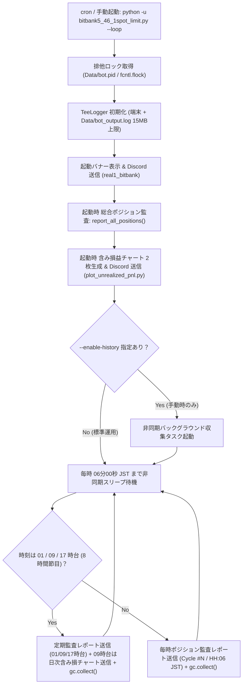

# bitbank5_46 プロジェクト運用ルール & 開発アーキテクチャ規約 (PROJECT_RULES)

**Single Source of Truth (`PROJECT_RULES.md`)**
本ドキュメントは、`d:\python_bitcoin\motiobtc\bitbank\bitbank5_46`（Bitbank & Binance Japan 現物ポートフォリオ監査ボット ＋ Polymarket トレンドチャート配信）における設計思想、システム動作シーケンス、実保有資産・含み損監査、サーバー運用、および Git デプロイに関する公式仕様原本です。
すべてのコード変更・テスト・デプロイは本仕様に準拠して実施します。

---

## 0. システム全体像 ＆ 安全ロック (`ALLOW_LIVE_TRADING = False`)

### 0.1 現行の運用方針（売買停止・保有銘柄監査専念）
* **実売買・エアトレードの完全廃止**:
  * 新規発注・決済発注・エアトレード（ペーパートレード）・戦略バックテスト最適化・WebSocket 常時接続はすべて廃止しています。
  * `bitbank5_46_1spot_limit.py` および `bitbank5_46_2api.py` において `ALLOW_LIVE_TRADING = False` を設定し、本番口座への発注 API を物理的に遮断した上で、**「実保有暗号資産の含み損・評価額・未約定指値監査レポート」** に専念しています。
* **海外取引所 5 分足収集のデフォルト停止（OOM 解消）**:
  * Hyperliquid（235銘柄）＆ BingX（599銘柄）の 5 分足マスターグリッド一括生成は、VPS（物理 RAM 952 MiB + Swap 2.0 GiB）の上限（約 3.0 GB）を超過して OOM Killer による再起動ループを引き起こしていたため、**2026-11-17（コミット `9707e04`）よりデフォルト停止**としました（手動実行時のみ `--enable-history` / `--with-history` 指定で有効化可能）。
  * これにより稼働メモリ（RSS）は約 200〜335 MB に抑制され、OOM・不要な再起動なしでの連続長期稼働を実現しています。

### 0.2 コアモジュール構成
| モジュール | 役割 |
|---|---|
| `bitbank5_46_1spot_limit.py` | メイン常駐プロセス（`--loop`）。起動バナー、起動時・毎時06分・8時間節目監査、シングルインスタンス排他ロック（`Data/bot.pid`）、`TeeLogger` ログ15MBローテーション管理 |
| `portfolio_tracker.py` | Bitbank ＆ Binance Japan の全現物残高・移動加重平均建値・評価額・含み損益・未約定指値注文を取得し、縦揃えレポートを生成・Discord 配信 |
| `long_term_btc_tracker.py` | 長期保有現物 BTC（保護数量 `0.1434 BTC` / 既知簿価 `12,794,387 円`）の保護・損益算出ユーティリティ |
| `active_orders_tracker.py` | Bitbank 主要ペアの未約定アクティブ指値注文（拘束 JPY・乖離率）の取得・集計 |
| `plot_unrealized_pnl.py` | BTC（1年分）・RENDER・NEAR（購入当初〜現在）の含み損益推移 ＆ 評価額vs元本 2×2 チャート生成 ＆ Discord 送信（起動時・毎日 09:06 JST） |
| `bitbank5_46_2api.py` | Bitbank Private/Public REST API ラッパー（Nonce 管理、`aiohttp` による都度セッション生成・クローズ） |
| `bitbank5_46_3logic.py` | `send_discord` ロギング（ANSI バッファリング、プラットフォーム別 Webhook 振分）および既存補助ユーティリティ |
| `config_loader.py` | `bitbank_credentials.json` 読み込み、Windows（`test4_test`）/ Linux（`real1_bitbank`）自動振り分け、`WEBHOOK_ALIASES` 管理 |
| `polymarket_top20_chart.py` | Polymarket 相場センチメント 5 カテゴリ（`Crypto` / `Econ/Fin` / `Tech/AI` / `Geo` / `Politics`）24h出来高 Top 20 の直近1ヶ月ノーマライズ比較チャート生成（Top 1-10 / Top 11-20）＆ 24h急変Top 5付き Discord 配信（VPS cron 1日3回実行） |
| `check_and_restart.sh` | VPS cron（5分間隔）からのプロセス死活監視・`flock` 多重起動防止・自動復旧スクリプト |
| `master_data_collector.py` / `download_*.py` / `data_pipeline_utils.py` | 海外・国内取引所ヒストリカル収集関連モジュール（通常監視時は停止、`--enable-history` または単体手動実行用） |

---

## 1. システム起動 ＆ 監視シーケンス (1時間足確定サイクル / 毎時06分)



### 1.1 毎時 06 分 00 秒 JST 実行（6分シフト運用）
* **実行時刻**: `HOURLY_EXECUTION_MINUTE = 6`, `HOURLY_EXECUTION_SECOND = 0`（毎時 06 分 00 秒 JST）。
* **6分シフトの目的**: 正時（00分）の他ボットや取引所 API アクセス集中を避け、HTTP REST API で安定して残高・ticker・約定履歴を取得するため。
* **WebSocket 不採用（REST API のみ）**: 常時接続断・Ping/Pong タイムアウト・メモリリークを排除し、毎時 06 分の数秒のみ稼働して残りを `asyncio.sleep()` 待機することで CPU クレジット消費を極小化しています。
* **バナー表示制限**: 起動時のアスキーアートバナーは初回起動時のみ送信し、毎時および 8 時間ごとの定期監査では送信しません。

---

## 2. クロス取引所 総合ポジション・含み損監査規約 (`portfolio_tracker.py`)

### 2.1 監査対象取引所・保護資産
1. **Bitbank（現物 JPY 口座）**:
   * `GET /v1/user/assets` により JPY 残高（保有・利用可能・指値拘束）および保有暗号資産（評価額 10 円未満の端数は除外）を抽出。
   * **長期保有 BTC の保護**: `BTC` については `long_term_btc_tracker.KNOWN_ENTRY_PRICE`（`12,794,387 円` / 保護枠 `0.1434 BTC`）を基準簿価として監査表示し、ボットの売買対象外として保護します。
   * **その他現物銘柄（`RENDER` 等）**: `GET /v1/user/spot/trade_history` から移動加重平均建値を算出（API 取得失敗時は `Data/last_known_entry_prices.json` ➔ `DEFAULT_KNOWN_ENTRY_PRICES` にフォールバック）。
   * **未約定指値**: `active_orders_tracker.fetch_active_orders()` により保有・主要ペアの未約定指値と拘束 JPY を集計。
2. **Binance Japan（現物 JPY 口座）**:
   * `ccxt.binance`（Spot）を用いて `JPY` 残高および保有暗号資産（`NEAR` 等）の現在価格・約定履歴に基づく平均取得単価（同キャッシュフォールバックあり）・評価額・含み損益・未約定指値（`fetch_open_orders`）を取得。

### 2.2 出力項目・通知仕様
* **出力フォーマット**: 取引所別の保有数量、平均取得単価、現在価格、評価額、投資元本、含み損益（円 / %）、未約定指値、全口座合算の暗号資産評価総額・含み損益・純資産総額を縦揃えテキストで出力。
* **送信先チャンネル**:
  * **Linux（VPS 本番）**: `real1_bitbank`
  * **Windows（ローカル検証）**: `test4_test`（`config_loader.get_webhook_url()` による環境自動判定）

---

## 3. Polymarket 相場センチメント Top 20 日次チャート配信仕様 (`polymarket_top20_chart.py`)

現在、Bitbank ボットの同居リポジトリ・VPS 環境を活用し、相場センチメント監視ツールとして cron による独立ジョブを以下で運用中。

### 3.1 取得・選定ロジック
* **対象取得**: Polymarket Gamma API（`https://gamma-api.polymarket.com/events`）から `active=true`, `closed=false`, `order=volume24hr`, `ascending=false`, `limit=150`（`fetch_top_active_events(limit=150)`）で上位イベントを取得。
* **相場センチメント・フィルタ条件**:
  * スポーツ・eスポーツ・ゲーム/エンタメ・ツイート数賭け・数学/科学系ノイズ市場をタグ（`slug`）ベースで除外し、相場センチメント関連 **5 カテゴリ**（`Crypto` / `Econ/Fin` / `Tech/AI` / `Geo` / `Politics`）のホワイトリストに一致するイベントのみを選別。
  * プレースホルダー（`Other`, `Candidate X`, `Team X`, `Company X`, `Player X`, `Country X` 等）および非アクティブ・出来高ゼロ市場を除外。
  * 決着張り付き市場（現在確率 `1% 未満` または `99% 超`）を除外し、各イベント内で最も現在確率が高いアクティブ本命候補（同率時は取引量順）を 1 つ代表として選出。
  * Polymarket CLOB API（`https://clob.polymarket.com/prices-history?interval=1m&fidelity=60`）から直近 30 日分の 1 時間足相当データを取得し、履歴が `1.0 日未満` または `12 点未満` の超短期市場を除外した **上位 20 銘柄** を確定。
  * 各銘柄の直近 24 時間確率変化（`delta_24h_pt`、パーセントポイント差）を算出し、全 20 銘柄中の変化幅上位 5 件を急変ピックアップとして抽出。
  * **因果的 1h 3σ ボラティリティ警戒検知 (`detect_causal_vol_shocks`)**: 追加 API コールゼロで既存の1時間足履歴から厳密に過去窓のみ（最大168本、最低24本、クールダウン6h）を用いて `|\Delta p| >= 3.0pt` かつ `>= 3.0σ` の急変ショックを検知。`Econ/Fin` / `Geo` で直近 `8時間` 以内に該当ショックがある場合、Discord `Top 1-10` 冒頭へ **`🚨 【ボラ警戒モード】`** バナー（平常時は `🟢 ボラ・レジーム: 平常`）を表示する。

### 3.2 チャート描画・配信スケジュール
* **ノーマライズ方式**: 各銘柄のデータ開始時点価格を **`100%`** とした比率ノーマライズ指数で描画（10 銘柄 × 2 枚：`Top 1-10` / `Top 11-20`）。凡例には `#順位 [Category] イベント名 [本命候補]` を表示し、チャート上の 3σ ショック発生点には `★` マーカー（警戒対象は赤枠強調）を描画する。極端な低確率急騰スパイクで他の曲線が潰れないよう、96パーセンタイル基準で Y 軸上限を自動クリップし注記を表示する。
* **日本語フォント・数式誤爆防止**: Linux VPS 上の `NotoSansCJK-Regular.ttc` / `ipam.ttf` を明示登録し、`text.parse_math = False`（非対応環境では `\$` エスケープ）によりラベル内 `$` 記号の数式解釈を防止。
* **実行スケジュール（VPS cron / JST）**:
  * **毎日 3 回（`01:00 / 09:00 / 17:00 JST`）** に実行し、`real1_bitbank` へカテゴリ・24h 出来高・現在確率・変化率サマリー付きで送信（1枚目のキャプションに **⚡ 直近24時間 確率急変ピックアップ (全20銘柄中 Top 5)** を含め、Discord 2000 文字制限に対し 1950 文字以内に収める）。
  * ログ出力: `Data/polymarket_chart.log`（毎回上書き `>` で肥大化防止）。
  * 画像保持: `Data/plots/polymarket_top*_1m_*.png` は 72 時間経過後に自動削除（最新 4 枚を保護）。

---

## 4. VPS 常駐・cron・ログ・ディスク管理規約

### 4.1 指定運用 VPS（Oracle No.1）環境
* **ホスト / ユーザー**: `141.147.160.15` / `ubuntu`
* **タイムゾーン**: `Asia/Tokyo (JST, +0900)`
* **配置ディレクトリ**: `/home/ubuntu/bitbank5_46`
* **Python 仮想環境**: `/home/ubuntu/pybot-env310/bin/python`（常に `-u` アンバッファ起動）
* **SSH 接続コマンド**:
  ```bash
  ssh -i "C:\Users\user\OneDrive\Desktop\OracleVPS\id_rsa.oracle" ubuntu@141.147.160.15
  ```

### 4.2 crontab 設定（正本）
```cron
*/5 * * * * /home/ubuntu/bitbank5_46/check_and_restart.sh > /dev/null 2>&1
0 1,9,17 * * * cd /home/ubuntu/bitbank5_46 && /home/ubuntu/pybot-env310/bin/python -u /home/ubuntu/bitbank5_46/polymarket_top20_chart.py --channel real1_bitbank > /home/ubuntu/bitbank5_46/Data/polymarket_chart.log 2>&1
```

### 4.3 ログ・ディスク容量保護
* **`Data/bot_output.log`**: `TeeLogger` により `15 MB` 超過時に後半半分へ自動ローテーション。
* **標準出力リダイレクトログ（`bot_output.log`）**: `check_and_restart.sh` による再起動時に `bot_output.log.old` へ退避。
* **排他ロック**: `bitbank5_46_1spot_limit.py` 側は `Data/bot.pid`（`fcntl.flock` / Windows は `msvcrt.locking`）、`check_and_restart.sh` 側は `/tmp/bitbank_check_and_restart.lock` で二重起動を完全防止。

---

## 5. コードデプロイ・クロスプラットフォーム運用規約

### 5.1 Git Push ➔ VPS Git Pull 方式（SCP 直接上書き厳禁）
1. **ローカル（Windows）で修正・テスト**:
   * `python -m py_compile <file>.py` および単体/ドライラン検証を実施。
2. **GitHub（`origin bitbank`）へプッシュ**:
   * `git add ...` ➔ `git commit -m "..."` ➔ `git push origin bitbank`
3. **VPS 側で同期・検証**:
   * `cd /home/ubuntu/bitbank5_46 && git pull origin bitbank`
   * メイン監視ボットのコード更新時のみ安全に再起動（ドキュメント・独立 cron スクリプトのみの更新時は無停止継続）。
* **ログ・画像の取得用 SCP**: VPS からローカルへのログ・画像・CSV ダウンロード目的の SCP は許可されます。

### 5.2 クロスプラットフォーム互換・フェイルセーフ規約
* ファイル I/O は必ず `encoding="utf-8"` を明示し、パス結合には `pathlib.Path` を使用します。
* 外部 API 通信（Bitbank / Binance Japan / Polymarket / Discord）は `timeout` 指定および例外捕捉・リトライで保護し、ネットワーク一時障害でメインプロセスが停止しないように設計します。
* Windows ローカル実行時は `config_loader.py` によりデフォルト送信先が `test4_test` に切り替わり、本番チャンネル `real1_bitbank` への誤通知を防止します。
