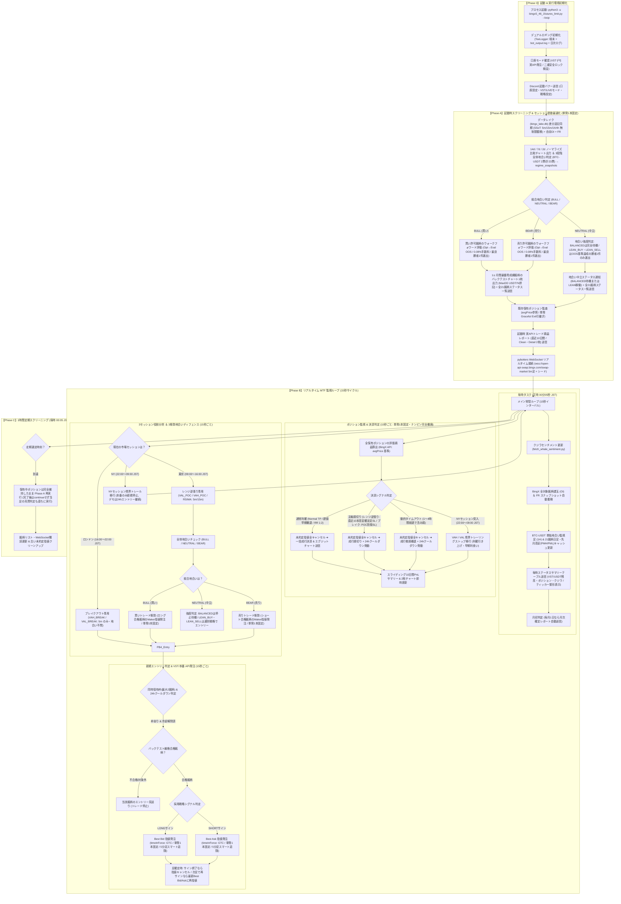
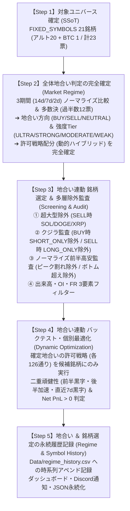

# bingx5_46 プロジェクト運用ルール & 開発アーキテクチャ規約 (PROJECT_RULES)

本ドキュメントは、`bingx5_46`（BingX USDT無期限先物 自動売買ボット）プロジェクトの設計思想、システム起動シーケンス、データパイプライン、取引戦略、資金管理、およびサーバー運用に関する最高位の規約（Single Source of Truth）です。
コアロジック（ノーマライズ3段階地合い判定・セッション連動個別最適化（126通り）・地合いディフェンス）は `hype5_45` と完全同一のアルゴリズムを維持しつつ、取引基盤として **BingX USDT無期限先物（豊富なUSDT流動性）** および **BingX公式 VSTデモ口座（実API発注検証）** に完全特化しています。

---

## 0. システム起動から常駐監視への全体動作シーケンス (System Lifecycle & Execution Sequence)

本システムは、VPS サーバー（Oracle #2）上で常駐プロセスとして完全自律稼働する MTF（マルチタイムフレーム）高機能自動売買ボットです。



### 【各フェーズの要約】
* **【Phase 0】起動 & 実行環境初期化**:
  アンバッファ起動（`-u`）、`TeeLogger` デュアルロギング、二重安全ロック＆VSTデモ口座設定確認、Discord 起動バナー送信（`payload_json` による文字化け防止徹底）。
* **【Phase A】起動時スクリーニング & セッション連動最適化 (単発1本固定・ナンピン完全撤廃)**:
  5分足ストア差分同期（SSoT: BingX USDT先物 65日分）、14d/7d/2d ノーマライズ比較チャート送信 ＆ 3段階全体地合い判定（`BTC-USDT` 2票/計23票）。
  - **BULL (買い)**: 買い推奨銘柄を対象にセッション連動個別バックテスト（東京レンジ逆張り5m/15m、ロンドンブレイクアウト5m: 全戦略 単発1本固定・計126通り）を実行。
  - **NEUTRAL (中立)**: 強度判定を実施。`BALANCED`（拮抗中立）は新規エントリー完全停止（ノーポジ待機・既存ポジション建値早期撤退のみ）。`LEAN_BUY`（買い寄り中立）および `LEAN_SELL`（売り寄り中立）は選別された弱い戦略セットで個別最適化・エントリーを実行。
  - **BEAR (売り)**: 売り推奨銘柄を対象にセッション連動個別バックテスト（東京レンジ逆張り5m/15m、ロンドンブレイクアウト5m: 全戦略 単発1本固定・計126通り）を実行。
  厳格基準（全体10回以上 ＆ 前半純利益>0 ＆ 後半純利益>前半純利益、後半利益最大選抜）クリア銘柄を選定し最優秀銘柄チャート1枚を送信、既存ポジション監査（`avgPrice` 基準・単発Graceful Exit引継ぎ）、直近10日間実損益レポート送信、pybotters WebSocket 5分足リアルタイム購読開始。
* **【Phase B】リアルタイム MTF 監視ループ (15秒サイクル)**:
  * **Phase B1 (毎時 00:05 JST)**: クジラセンチメント更新、BingX OI/FR スナップショット自動蓄積、BTC地合い足更新、**Hype版と完全統一した毎時ステータス配信（`-USDT` 省略・4カラム整列）**、月初レポート送信。
  * **Phase B2 (ポジション監視 & 決済判定)**: 保有銘柄の利確（Normal TP または 非合致時の建値早期撤退、数学的RR 1:2）・戦略別主軸損切り（レンジ逆張りは直近10本高安確定足SL［上限キャップ: 動的MAE］、ブレイクアウトはPOC直上/直下防衛SL ＆ 24hクールダウン）・動的タイムアウト撤退（1〜4時間経過で含み損なら微損撤退）。**全戦略単発1本固定（ナンピン完全撤廃・追加発注物理遮断）**。さらに **NY時間帯（22:00〜09:00 JST）突入時は VAH/VAL 境界トレーリングストップ（利確引き上げ）へ自動移行**。決済時は必ず既存の未約定指値をすべてキャンセルしてから成行決済を実行する。
  * **Phase B3 (3セッション役割分担 ＆ 3態勢地合いディフェンス)**:
    - **東京セッション (09:00〜16:00 JST)**: レンジ逆張り専用（`VAL_POC` / `VAH_POC` / `RSIMA` / `RSIMA_SHORT`: 5m/15m）。地合い連動（BULLは買い、BEARは売り、BALANCEDは待機、LEANは選別取引）。
    - **ロンドンセッション (16:00〜22:00 JST)**: ブレイクアウト専用（`VAH_BREAK` / `VAL_BREAK`: 5m のみ）。地合い不問（上抜け買い / 下抜け売り）。
    - **NYセッション (22:00〜09:00 JST)**: VAH/VAL境界トレーリングストップ移行（利確引き上げ・早期利食い）。デモ検証モード（`BINGX_IS_LIVE=False`）は24時間エントリー継続、本番（`BINGX_IS_LIVE=True`）のみ新規エントリー完全停止。
  * **Phase B4 (新規エントリー判定)**: 最大2銘柄枠内で「バックテスト厳格合格銘柄」のみ採用戦略シグナルを判定し、BingX API（VSTデモまたは本番）へ Best Bid（買い）/ Best Ask（売り）指値発注 ＆ 足確定ごとのライフサイクル管理（Pending & Resubmit）。全戦略単発1本固定（目標額100%フルロット）。
* **【Phase C】1時間定期スクリーニング (毎時 00:05 JST)**:
  保有中ポジションは利確・損切りまで一切強制決済せず維持し、Phase A と同様に最新データで全体地合い判定・推奨銘柄最適化を再実行。**定期選定完了後、ループを `continue` して確定足をスキップすることを厳禁とし、直ちにその確定足の決済・エントリー判定を実行する。**

---

## 1. 銘柄選定・検証データ収集規約 (Data Pipeline)

### 💎 【単一データ源泉 (SSoT)】データレイク基盤 (`Data/lake/bingx_lake.db`) ＆ 追記型永続時系列ストア
* **巨大データ一括取得・ZIP送信の完全廃止 ＆ 正本一本化**:
  * 全市場600銘柄以上のダウンロードや巨大CSV/ZIP（`daily_*.csv`, `merged_*.csv`, `bingx_all_markets_1h_*.csv/.zip`）の生成・運用は廃止し、`symbol_universe.py` で単一定義された **実取引ユニバース 21銘柄＋`BTC-USDT`（計22銘柄）** のみを管理対象とする。
  * 唯一の正本（SSoT: Single Source of Truth）を **SQLite データレイク `Data/lake/bingx_lake.db`（WALモード・外部キー制約有効）** とし、既存の `Data/candles_5m/*.csv`、`Data/oi_store/*_oi.csv`、`Data/regime_history.csv`、`Data/trades_history.csv` を `migrate_to_lake.py` で無損失統合する（外部可視化用の読み取り専用CSVスナップショットは `Data/lake/exports/` に出力）。
* **時系列蓄積・確定足専用原則 (`lake_store.py`, `candle_5m_store.py`)**:
  * **65日切り捨て（`disk_max_bars`）の完全撤廃**: `market_candles` テーブルへ 5分足（`5m`）を最小粒度として無制限追記蓄積（180日超のバックフィル含む）し、確定済み `5m` 足から `15m` / `1h` / `4h` の全4時間軸を `closed='left', label='left'` で決定的生成・格納する（`PRIMARY KEY (symbol, timeframe, ts_utc)`）。
  * **未来情報混入（未確定足リーク）の構造的遮断**: すべてのローソク足は開始時刻 `ts_utc`（UTC秒）で格納し、基準時刻 `data_cutoff_utc = T` における参照時は常に `ts_utc + tf_sec <= T` を満たす確定足のみをSQLで抽出する。
  * **建玉 (OI)・ファンディングレート (FR) の因果結合 (`market_oi_fr`)**: `bingx_oi_collector.py` が収集する全銘柄 OI/FR を単一キー `{SYMBOL}`（`{SYM}-USDT` 統一）で追記保存し、`oi_chg_4h` 等は各足確定時刻 `bar_close_utc` 以前の最新観測値のみを後方 `merge_asof` で動的結合する（未来値の逆補間を厳禁）。
* **テーブル構成（全9テーブル・蓄積ループ）**:
  1. `universe_symbols`: 対象22銘柄およびメガキャップ除外定義
  2. `market_candles`: `5m` / `15m` / `1h` / `4h` の確定OHLCV
  3. `market_oi_fr`: 建玉・FR・マーク価格の時系列スナップショット
  4. `regime_snapshots`: 基準時刻ごとの3段階地合い・クジラ・前半高安監査結果
  5. `backtest_runs`: 実行ID、`data_cutoff_utc`、`opt_start/end`、`eval_start/end`、手数料設定、Gitコミット識別子
  6. `backtest_cells`: 銘柄×戦略×方向×時間軸×パラメータごとの最適化窓・評価窓成績、格付け（`QUALIFIED` / `PROVISIONAL` / `INSUFFICIENT_N` / `REJECTED_EV`）、伸び切りバケット別統計（`eval_ext_stats_json`）
  7. `backtest_simulated_trades`: 全擬似約定・未約定キャンセル・エントリー/決済手数料・伸び切り指標（`ext_pct`, `ext_atr`, `va_upper/lower`, `range_high/low`）の1件単位明細
  8. `daily_selections`: 選定結果（最上位勝者1件、または基準未達時 `NO_CANDIDATE`）および実行ステータス（`SELECTED` / `NO_CANDIDATE` / `EXECUTED` / `BLOCKED_RISK`）
  9. `live_trades`: VSTデモ実トレード約定・決済結果（`selection_id` で選定根拠と紐づけて自動書き戻し）

### 🧭 【ウォークフォワード評価 ＆ 日次勝者選定仕様】(`lake_backtest_engine.py`, `lake_reproduce.py`)
* **アウトオブサンプル (OOS) 厳格分離（インサンプル選定の禁止）**:
  * すべてのバックテスト選定は **Stage 1: 最適化窓（`[opt_start_utc, opt_end_utc)`）** と **Stage 2: 評価窓（`[eval_start_utc, eval_end_utc]`、`opt_end_utc <= eval_start_utc`）** に分離する。
  * パラメータ探索は最適化窓のみで行い、候補パラメータを凍結した上で境界ポジションを完全パージ・リセットし、評価窓へ1回のみ適用する。**勝者の判定は評価窓の手数料後成績のみ** で行う。
* **手数料 ＆ Maker指値追随シミュレーション基準**:
  * 全擬似約定に **往復 `0.08%`（エントリー Maker `0.02%` ＋ エグジット Taker `0.06%`）** を厳密算入し、`entry_fee_usdt`・`exit_fee_usdt`・`net_pnl` を個別に記録する。
  * 実ボット（`bingx5_46_2api.py`）に合わせ、シグナル確定後の次5m足から最良気配相当（Long: `close * 0.9998`, Short: `close * 1.0002`）で指値追随し、実際に5m足高安へ到達した場合のみ約定、シグナル終了時は `CANCEL_SIGNAL_END` として即時キャンセルする（安易な無条件成行約定を禁止）。約定足の決済判定は保守的に損切り・防衛SLを利確より先行評価する。
* **件数閾値（格付け）＆ 伸び切り度合い軸**:
  * 評価窓トレード数により格付けを行う：**`n < 10` は不採用（`INSUFFICIENT_N`）**、**`10 <= n < 30` は「参考（`PROVISIONAL`）」として格下げ**、**`n >= 30` を本採用（`QUALIFIED`）** とする。また **`eval_ev <= 0` はすべて除外（`REJECTED_EV`）** とする。
  * すべてのシグナル時点で VA 境界（`VAH`/`VAL`）および直近レンジ高安からの乖離を **`%` 換算（`ext_pct`）** および **`ATR_14` 換算（`ext_atr`）** として因果算出し、`< 0.5 ATR` / `0.5-1.5 ATR` / `>= 1.5 ATR` の3区分成績を `eval_ext_stats_json` に集計する。
* **当日のトレード勝者選定（最良1件限定 ＆ 見送り原則）**:
  * 現行リスクルール（**1日1トレード・09:00 JST リセット**、日次最大損失 `-$1.50` サーキットブレーカー、SL後24時間クールダウン、RR 1:2、`MIN_VOLUME_SURGE_RATIO = 1.5`、地合い方向ロック、既存持ち越し時のみ合計枠 `MAX_ACTIVE_POSITIONS = 2`）をすべて維持する。
  * 合格候補の中から **最上位1件（`QUALIFIED` を `PROVISIONAL` より優先し、`eval_ev`・`eval_pf`・`eval_trades` で決定論的に順位付け）** のみを選定する。**基準を満たす候補が存在しない日は新規取引を見送り（`NO_CANDIDATE`）、枠を無理に埋めない。**
* **再現性保証 (`lake_reproduce.py`)**:
  * `python lake_reproduce.py --run-id <run_id>` は外部APIへ一切接続せず `Data/lake/bingx_lake.db` のみから任意の過去 `run_id` の全セル成績と日次勝者選定結果を再計算し、数値完全一致を検証できる構造を維持する。

### 🏛️ 建玉（OI）時系列蓄積 ＆ ファンディングレート（FR）モニタリング
* **自前蓄積最優先**: 毎時 00 分およびスクリーニング時に BingX 全対象銘柄の建玉（Open Interest: USDT建て想定元本）および Funding Rate スナップショットを `Data/oi_store/` へ自動蓄積。データが存在する時間帯は BingX 純正実測建玉を最優先採用する。
* **外部補完と自然移行**: 蓄積前の過去分（直近35日分）は全クラウド・日本人環境互換の OKX 公開API（1時間OI・8時間FR履歴）を最優先（未上場時のみBybitフォールバック）で境界比率スケーリング補完し、稼働に伴い自然と 100% BingX 純正データへ置き換える。現在値の一律べた塗りは厳禁。
* **バックテスト＆実運用 100% 一致統合 (`enrich_candles_with_oi_fr`)**: 5分足およびリサンプリング後の15分足に `openInterest`、`oi_chg_4h`（直近4時間OI変化率%）、`fundingRate`（8時間率）を結合し、30日間の個別最適化バックテストとリアルタイム監視ループで完全に同一の3要素エントリー精度フィルターを適用する。

---

## 2. 取引対象銘柄 ＆ 全体地合い判定・銘柄選定統合規約 (Symbols, Market Regime & Screening Pipeline)

本章は、ボットが起動時および毎時（1時間ごと）に実行する **「① 対象銘柄ユニバース確定 ➔ ② 全体地合い判定の完全確定 ➔ ③ 地合い連動 銘柄選定＆多層除外監査 ➔ ④ 地合い連動 個別最適化バックテスト ➔ ⑤ 地合い＆選定銘柄の永続履歴記録」** の一連のパイプライン仕様を一元的に集約・定義する。

### 🔄 全体実行パイプライン（順序の厳格原則）
本システムでは、**「地合い判定をまず完全に終わらせ、その結果に基づいて銘柄選定・監査を行い、絞り込まれた推奨銘柄のみをバックテストして過去履歴に記録する」** という厳格な順序（パイプライン）で動作する。地合いが確定する前の銘柄選定や、監査前の無差別なバックテストは一切行わない。



---

### 🎯 2-1. 取引対象銘柄ユニバース (Single Source of Truth)
USDCよりも圧倒的に出来高・流動性が厚い **USDT無期限先物ペア** を対象とし、月次銘柄剪定に基づき最適化された精鋭銘柄群で構成する：
* **固定選定アルトリスト (`FIXED_SYMBOLS` 21銘柄 / 各1票 = 計21票)**:
  `HYPE-USDT`, `SOL-USDT`, `DOGE-USDT`, `XRP-USDT`, `SUI-USDT`, `AVAX-USDT`, `LINK-USDT`, `APT-USDT`, `NEAR-USDT`, `ARB-USDT`, `UNI-USDT`, `OP-USDT`, `TIA-USDT`, `RENDER-USDT`, `INJ-USDT`, `TAO-USDT`, `AAVE-USDT`, `ENA-USDT`, `ZEC-USDT`, `1000PEPE-USDT`, `WIF-USDT`
  *(※ `FET-USDT` は実発注ゼロ・低流動性のため月次剪定で除外。超高流動性・値幅ブーストの `1000PEPE` および単体PF 1.59 の `WIF` を新規採用)*
* **BTC 先行指標 (`BTC-USDT` 1銘柄 / 2票分 = 計2票)**:
  `BTC-USDT` は市場全体の牽引役として 2 票分の投票権を持つ（※`BTC-USDT` 自身はアルト発注対象外）。
* **総投票数: 23 票**（「過半数」の判定基準: **12 票以上**）
* **ETH (`ETH-USDT`) の完全除外規約**:
  ETH は BTC への遅行・連動傾向が強く先行指標としての優位性がないため、トレード対象および地合い監視対象から完全に除外する（WebSocket 購読も行わない）。

---

### 📊 2-2. 【第1フェーズ】全体地合い判定の完全確定 (Market Regime Determination)
銘柄選定やバックテストに入る前段階として、まず **全体地合い（Market Regime）を完全に確定** させる。

#### ① 3期間ノーマライズ比較 (14d / 7d / 2d)
固定選定全21銘柄について、**【14d (336h)】・【7d (168h)】・【2d (48h)】** の3期間ノーマライズ比較データ（起点価格 $P_0 = 1.0$）を用いて、各期間の勢力図を投票集計する：
* **買い票 (BUY)**: 起点以上（現在価格 $\ge 1.0$）かつ 後半モメンタム維持銘柄。
* **売り票 (SELL)**: 起点未満（現在価格 $< 1.0$）かつ 後半下落モメンタム維持銘柄。
* **各期間の判定**:
  - 買い合格票 $\ge 12$ 票 ➔ その期間は **「買い (BUY)」**
  - 売り合格票 $\ge 12$ 票 ➔ その期間は **「売り (SELL)」**
  - いずれも 12 票未満 ➔ その期間は **「中立 (NEUTRAL)」**

#### ② 総合地合い（Overall Regime）の多数決判定
3期間の判定結果（BUY / SELL / NEUTRAL）を集計し、多数決で相場の基本方向を決定する：
* **BUY期間数 > SELL期間数** ➔ **総合地合い: `BUY` (買い相場)**
* **SELL期間数 > BUY期間数** ➔ **総合地合い: `SELL` (売り相場)**
* **同数 (BUY == SELL)** ➔ **総合地合い: `NEUTRAL` (中立相場)**

#### ③ 地合い強度（Strength Tier ＆ net_score）の精密算出
総合地合いの定性判定に加え、相場の勢い・過熱度・偏りを数値化した「強度メトリクス」を毎時算出し、許可する戦略配分を動的に決定する：
* **平均票数 & ネットスコア計算式**:
  $$\text{mean\_buy} = (\text{buy}_{14d} + \text{buy}_{7d} + \text{buy}_{2d}) / 3.0$$
  $$\text{mean\_sell} = (\text{sell}_{14d} + \text{sell}_{7d} + \text{sell}_{2d}) / 3.0$$
  $$\text{net\_score} = (\text{mean\_buy} - \text{mean\_sell}) / 22.0 \quad (-1.0 \sim +1.0)$$
* **強度ティア（Strength Tier）分類 ＆ 動的ハイブリッド戦略配分**:
  | 総合地合い | 強度ティア | 条件 | 許可戦略 (動的ハイブリッド配分) | 狙い・市場力学 |
  | :--- | :--- | :--- | :--- | :--- |
  | **BUY 🟢** | `ULTRA_BUY` | 3期間BUY一致 (BBB) | `VAH_BREAK` ＋ `VAL_POC` ＋ `RSIMA` | 全揃い強気推進波を高値ブレイクで捉え、押し目も徹底追従 |
  | **BUY 🟢** | `STRONG_BUY` | $\text{mean\_buy} \ge 16.0$ | `VAH_BREAK` ＋ `VAL_POC` ＋ `RSIMA` | 強い買い相場。順張りブレイクと押し目買いの両面攻略 |
  | **BUY 🟢** | `MODERATE_BUY` | $13.0 \le \text{mean\_buy} < 16.0$ | `VAL_POC` ＋ `RSIMA` ＋ ✨`VAL_BREAK` | 買い勢い鈍化。高値ブレイクを止め、押し目買い＆急反落売りブレイクを解禁 |
  | **BUY 🟢** | `WEAK_BUY` | $\text{mean\_buy} < 13.0$ | `VAL_POC` ＋ `RSIMA` ＋ ✨`VAL_BREAK` | 弱い買い。レンジ押し目買い中心、失速時の売りブレイクを狙う |
  | **NEUTRAL ⚪** | `LEAN_BUY` | $\text{net\_score} \ge +0.15$ | `VAL_POC` ＋ `RSIMA` ＋ ✨`VAL_BREAK` | 買い寄り中立。レンジ押し目買い ＆ 反落売りブレイク |
  | **NEUTRAL ⚪** | `BALANCED` | $-0.15 < \text{net\_score} < +0.15$ | なし（新規完全停止） | 拮抗中立。完全ノーポジ待機 ＆ 既存ポジション建値早期撤退(+0.20%)のみ |
  | **NEUTRAL ⚪** | `LEAN_SELL` | $\text{net\_score} \le -0.15$ | `VAH_POC` ＋ `RSIMA_SHORT` ＋ ✨`VAH_BREAK` | 売り寄り中立。レンジ戻り売り ＆ 急反発買いブレイク |
  | **SELL 🔴** | `WEAK_SELL` | $\text{mean\_sell} < 13.0$ | `VAH_POC` ＋ `RSIMA_SHORT` ＋ ✨`VAH_BREAK` | 弱い売り。安値追いブレイクを止め、戻り売り＆急反発買いブレイクを解禁 |
  | **SELL 🔴** | `MODERATE_SELL` | $13.0 \le \text{mean\_sell} < 16.0$ | `VAH_POC` ＋ `RSIMA_SHORT` ＋ ✨`VAH_BREAK` | 中気売り。選別戻り売り ＆ 自律反発買いブレイク（ハイブリッド） |
  | **SELL 🔴** | `STRONG_SELL` | $\text{mean\_sell} \ge 16.0$ | `VAL_BREAK` ＋ `VAH_POC` ＋ `RSIMA_SHORT` | 強い下落相場。ブレイクダウンで推進波を捉え、戻り売りも叩く |
  | **SELL 🔴** | `ULTRA_SELL` | 3期間SELL一致 (SSS) | `VAL_BREAK` ＋ `VAH_POC` ＋ `RSIMA_SHORT` | 全揃い強気下落。売りブレイク ＆ 戻り売りフル稼働 |

---

### 🛡️ 2-3. 【第2フェーズ】地合い連動 銘柄選定 ＆ 多層除外監査 (Regime-Driven Symbol Screening & Multi-Layer Audit)
全体地合い（BUY / SELL / NEUTRAL）が確定した直後、その地合いと矛盾するリスク銘柄をバックテスト前に物理遮断し、**真に優位性のある推奨銘柄のみを抽出** する。

#### ① 超大型銘柄除外ガード (`EXCLUDED_MEGA_CAPS`)
* **全態勢（買い・売り）共通の物理遮断**:
  `SOL-USDT`, `DOGE-USDT`, `XRP-USDT` の超大型3銘柄は、板が厚くHFT機関投資家のストップ狩り・リバウンド急変動が激しく、時価総額の重さによる利確到達率低迷・タイムアウト率高止まりを回避するため、**ロング・ショート問わず全エントリー対象から物理的に完全事前除外** する（第5章および実運用コードと完全統一）。

#### ② クジラセンチメント逆風監査
大口投資家の資金動向（`fetch_whale_sentiment.py`）に基づき、地合いと逆行する銘柄を事前除外：
* **買い態勢 (BULL) 時**: 大口売り偏重（`SHORT_ONLY`）の銘柄を除外（下落リスク回避）。
* **売り態勢 (BEAR) 時**: 大口買い偏重（`LONG_ONLY`）の銘柄を除外（踏み上げリスク回避）。大口売り偏重（`SHORT_ONLY`）は追い風として採用。

#### ③ ノーマライズ前半高安監査 (完全対称マトリクス)
14d / 7d / 2d の正規化推移に基づき、相場の天井打ち崩壊・底打ち反発を精密監査：
* **買い相場 (BULL) の採用・除外ルール**:
  - **🟢 採用・追加 (好機)**:
    - 後半高値更新型 (順張り上昇トレンド)
    - セリクラ底打ち反転型 (前半ボトム急反発): 期間内最安値が前半50%以内にあり、現在値がレンジ半値ライン ($Min + (Max - Min) \times 0.5$) 以上まで買い戻された銘柄を買い候補に正式採用。
  - **🔴 除外・遮断 (リスク)**:
    - 前半ピーク半値割れ型 (ピークアウト警戒): 期間内最高値が前半50%以内にあり、現在値がレンジ半値未満に沈んでいる銘柄はロング対象から完全除外。
* **売り相場 (BEAR) の採用・除外ルール**:
  - **🟢 採用・追加 (好機)**:
    - 後半安値更新型 (順張り下落トレンド)
    - 天井崩壊トレンド型 (前半ピーク急落): 期間内最高値が前半50%以内にあり、現在値がレンジ半値ライン以下に沈み込んでいる銘柄を売り候補に正式温存。
  - **🔴 除外・遮断 (リスク)**:
    - 前半ボトム半値超え型 (底打ち反発警戒): 期間内最安値が前半50%以内にあり、現在値がレンジ半値超えまで戻している銘柄はショート対象から完全除外。

#### ④ Volume × OI × FR 3要素エントリー精度フィルター（実売買・バックテスト完全一致仕様）
* **出来高倍率 (Volume Ratio = 直近確定足出来高 ÷ 直前20本平均出来高)**:
  - **出来高急増ゲート必須化**: 全戦略共通で薄商いノイズを物理遮断するため、**下限 $\text{vol\_ratio} \ge 1.5$ を必須化**（実売買 `MIN_VOLUME_SURGE_RATIO = 1.5` 準拠）。
  - レンジ逆張り・RSIMA: $1.5 \le \text{vol\_ratio} \le 2.5$（大口実需を伴う反発のみ採用し、異常スパイク足を除外）
  - ブレイクアウト: $1.5 \le \text{vol\_ratio} \le 4.0$（大口実需による出来高急増を必須化し、アルト垂直ロケット初動を捕捉）
* **Open Interest (4時間OI変化率)**:
  - ブレイクアウト: $+0.8\% \le \text{oi\_chg\_4h} \le +5.0\%$（燃料点火確認）
  - 通常逆張り: SELL時 $-3.0\% \le \text{oi\_chg\_4h} \le +3.0\%$ / BUY時 $-3.0\% \le \text{oi\_chg\_4h} \le +5.0\%$
* **Funding Rate (8時間FR)**:
  - SELL時: $\text{fundingRate} \ge -0.005\%$（ショート過密・スクイズ危険域を遮断）
  - BUY時: $-0.005\% \le \text{fundingRate} \le +0.025\%$（ロング過密清算ドミノを遮断）

---

### 🚀 2-4. 【第3フェーズ】地合い連動 バックテスト・個別最適化の実行 (Dynamic Backtest & Optimization Pipeline)
第2フェーズの監査を通過した推奨銘柄に対してのみ、第1フェーズで確定した許可戦略を実行する。

* **セッション連動個別最適化 (東京レンジ vs 欧州ブレイク / 計126通り)**:
  - 各銘柄ごとに **① 東京セッション用（レンジ逆張り最適: `VAL_POC`/`VAH_POC` vs `RSIMA`/`RSIMA_SHORT`）** と **② 欧州セッション用（ブレイクアウト最適: `VAH_BREAK`/`VAL_BREAK`）** の2種類の最適パラメータを並列選出。
  - 時間帯（東京 09:00〜16:00 JST / 欧州 16:00〜22:00 JST）に応じて最適ロジックを自動切替。
* **全戦略・全方向 完全単発1本固定規約**:
  - ナンピンは完全ゼロ（目標投資額100%フルサイズ $15.0 USDT / 1枠のみ）。
* **三段階鮮度ゲート (Triple-Stage Recency Gate) による厳格合格判定**:
  1. 最低取引回数 10 回以上 (`trade_count >= 10`)
  2. 二重頑健性クリア: 前半純利益プラス (`pnl_first_half > 0`) かつ 後半純利益加速 (`pnl_second_half > pnl_first_half`)
  3. 直近7日純利益プラス (`pnl_recent_7d > 0` かつ `trades_recent_7d >= 1`)
  4. 往復0.08%手数料控除後 **Net PnL > 0**（手数料負け戦略の完全排除）
* **監視銘柄の確定 ＆ 最優秀チャート出力**:
  - 合格銘柄の中から総合スコア上位 **最大2銘柄（`MAX_ACTIVE_POSITIONS = 2`）** をリアルタイム監視対象（`selected_symbols`）に採用。
  - 最優秀成績銘柄の資産曲線チャート **1 枚のみ** を Discord 送信（MaxDD USDT/%併記）。

---

### 📜 2-5. 【第4フェーズ】地合い ＆ 銘柄選定の永続履歴記録規約 (Regime & Symbol History Logging SSoT)
相場環境の変化、地合い判定の妥当性、および銘柄選定の精度を過去データから客観的・学術的に検証可能とするため、**すべての判定結果を永続ファイルに時系列記録・蓄積** する。

* **時系列CSVストア (`Data/regime_history.csv`)**:
  - 起動時および毎時（00:05 JST）の定期選定完了時に、以下のレコードを1行アペンド追記する：
    ```text
    timestamp,overall_regime,regime_pattern,strength_tier,net_score,mean_buy_votes,mean_sell_votes,allowed_strategies,recommended_symbols,excluded_symbols,selected_symbols
    ```
* **過去データへの地合い・銘柄記録（Rollback Reconstruction ＆ レイク同期）**:
  - `Data/lake/bingx_lake.db`（および互換出力 `Data/regime_history.csv`）の過去時系列データを用い、過去の日付ごとの地合い判定および選定結果を遡及計算して `regime_snapshots` テーブル ＆ `Data/regime_history.csv` に蓄積する。
  - これにより、過去の「いつがBULLで、いつがBEARで、いつがNEUTRALだったか」「その時どの銘柄が選定されていたか」を完全に可視化・追跡可能とする。
* **単一状態スナップショット (`Data/market_state.json` ＆ `Data/last_selection_result.json`)**:
  - 最新時点の地合い状態、各期間（14d/7d/2d）の詳細票数、除外理由マップ、および個別最適化パラメータをアトミック書き込みで永続化。
* **ダッシュボード ＆ Discord 通知の同期**:
  - `show_symbol_status.py` により、全21銘柄のステータス（選定・除外・理由・Net PnL）をコンソールおよび Discord へ即時同期送信。

---

## 3. 基本戦略体系（Pure 3大戦略体系）＆ 個別最適化規約 (Triple Pure Strategy System & Individual Optimization)

### 🧩 3-1. セッション連動 Pure 3大戦略体系（各態勢 126通り / 単発1本固定）
ボリュームプロファイル（レンジ回帰 ＆ バリューエリア・ブレイクアウト）と RSI-EMA（モメンタムスキャルピング）の3大コアロジックを軸とし、**トレード機会損失を引き起こしていた EMA200 フィルターを完全撤廃**。
欧州時間帯（17:00〜01:00 JST）等で発生する強いトレンド・ボラティリティ拡大局面を収益化する **「ブレイクアウト戦略（`VAH_BREAK` / `VAL_BREAK`）」** を統合し、**買い（LONG / BULL時）3戦略 ＋ 売り（SHORT / BEAR時）3戦略 の完全対称な計6戦略体系（各態勢126通り）** を構成する：

#### 📊 買い3大戦略（LONG）＆ 売り3大戦略（SHORT）完全対比マトリクス

| 分類 | コアロジック | EMA200 フィルター | 買い戦略 (LONG / BULL用) | 売り戦略 (SHORT / BEAR用) | 探索数内訳 (計126通り) |
| :--- | :--- | :--- | :--- | :--- | :--- |
| **VPレンジ回帰 (Pure)** | **ボリュームプロファイル内回帰** | **なし** (完全撤廃) | **`VAL_POC`** (VAL上抜け回帰) | **`VAH_POC`** (VAH下抜け回帰) | **72通り**（2足種 5m/15m × 9 MP期間 × 4 TR） |
| **VPブレイクアウト (Pure)** | **バリューエリア外ブレイク順張り** | **なし** (完全撤廃) | **`VAH_BREAK`** (VAH上抜けブレイク) | **`VAL_BREAK`** (VAL下抜けブレイク) | **36通り**（5m足限定 × 9 MP期間 × 4 TR） |
| **RSIMA系 (Pure)** | **RSI × RSI-EMA** | **なし** (完全撤廃) | **`RSIMA`** (GC反転スキャル) | **`RSIMA_SHORT`** (DC反落スキャル) | **18通り**（2足種 5m/15m × 9 パラメータ） |

* **検索グリッド詳細（データレイク ウォークフォワード SSoT: `lake_backtest_engine.py` 完全統一）**:
  * **VPレンジ回帰系 (`VAL_POC`, `VAH_POC`)**:
    - **2足種（5m, 15m）** × 3 MP期間（100, 150, 200）× **3 利確幅比率 `target_ratio`（0.55, 0.70, 0.85）**（ビン数 `num_bins = 50`、バリューエリア比率 `value_area_pct = 0.70`、指数減衰 `use_decay = True`）
  * **VPブレイクアウト系 (`VAH_BREAK`, `VAL_BREAK`)**:
    - **2足種（5m, 15m）** × 3 MP期間（100, 150, 200）× **3 利確幅比率 `target_ratio`（0.50, 0.70, 0.90）**（POC防衛 ＆ RR 1:2 以上保証）
  * **RSIMA系 (`RSIMA`, `RSIMA_SHORT`)**:
    - **2足種（5m, 15m）** × 5 パラメータ組（`RSIMA`: `(35,60), (40,60), (40,65), (45,65), (45,70)` / `RSIMA_SHORT`: `(65,40), (60,40), (60,35), (55,35), (55,30)`）
  * 全戦略 単発1本固定（ナンピン完全ゼロ・目標投資額100%フルロット）で、90日最適化窓（Opt）→ 90日評価窓（OOS Eval）の2段階ウォークフォワード検証を実行し、OOS純利益・件数・PFで勝者を選定する。

---

### 🎯 3-2. セッション別デュアル最適パラメータ保持 ＆ 時間帯連動スイッチング規約（各126通り / 単発1本固定）

* **【東京レンジ ＆ 欧州ブレイク デュアル最適パラメータ保持モデル (Dual Session Best Retention)】**:
  * 従来のように1銘柄につき1戦略のみを残す方式では、ブレイクアウトが総合1位になった銘柄が東京時間（09:00〜16:00 JST）に稼働停止となり、逆にレンジ逆張りが総合1位になった銘柄が欧州時間（16:00〜22:00 JST）に稼働停止となる機会損失が生じる。
  * これを解消し、かつ各銘柄の「レンジ適性 vs ブレイクアウト適性」の傾向を定量比較するため、各銘柄の個別最適化（計126通り）において以下の **2種類の最適パラメータを同時に選出・保持** する：
    1. **🗼 東京セッション用 最適パラメータ (`range_params` / 09:00〜16:00 JST 稼働)**:
       - レンジ逆張り部門（LONG時: `VAL_POC` [5m/15m] vs `RSIMA` [5m/15m]、SHORT時: `VAH_POC` [5m/15m] vs `RSIMA_SHORT` [5m/15m]）の中から最良パラメータを選出。
       - 独立して Triple-Stage Recency Gate 合否（`is_range_qualified`）および動的MAE・動的タイムアウトを算出。
    2. **🏰 欧州セッション用 最適パラメータ (`breakout_params` / 16:00〜22:00 JST 稼働)**:
       - ブレイクアウト部門（LONG時: `VAH_BREAK` [5m]、SHORT時: `VAL_BREAK` [5m]）の中から最良パラメータを選出。
       - 独立して Triple-Stage Recency Gate 合否（`is_breakout_qualified`）および動的MAE・動的タイムアウトを算出。
  * **監視銘柄の採用条件と時間帯別自動スイッチング**:
    - `is_range_qualified`（東京レンジ合格）**または** `is_breakout_qualified`（欧州ブレイク合格）の**いずれか一方でも合格していれば、当該銘柄を監視対象（`selected_symbols`）として採用**する。
    - **東京時間（09:00〜16:00 JST）**: `range_params` が合格（`is_qualified == True`）している銘柄について、`range_params` の戦略・足種・パラメータでレンジ逆張りロジックを稼働させる。
    - **欧州時間（16:00〜22:00 JST）**: `breakout_params` が合格（`is_qualified == True`）している銘柄について、`breakout_params` の戦略・5m足・パラメータでブレイクアウトロジックを稼働させる。
    - **ポジション保有中の時間帯跨ぎ保護**: 東京時間でエントリーしたポジションが16:00を跨いで欧州時間に入った場合でも、`scale_in_states` に記録されたエントリー時の戦略・足種・パラメータを決済完了まで100%維持する。

総合地合い（BULL / BEAR）に応じて、戦略体系の個別最適化と選定アプローチを適用する：

* **【ロング個別最適化（BULL時：セッション連動 単発固定選定アプローチ）】**:
  * **全戦略 単発1本固定 (`max_trades = 1`) 原則**:
    * ナンピンによる資金拘束・大損リスクを永久に排除するため、**ロングは全戦略（`VAL_POC`, `VAH_BREAK`, `RSIMA`）ともナンピンを完全撤廃し単発1本固定（目標投資額100%フルロット $15.0 USDT）** とする。
    * 評価足種: レンジ逆張り（`VAL_POC`, `RSIMA`）は **5m / 15m**、ブレイクアウト（`VAH_BREAK`）は **5m のみ**（計126通り）。
  * **自力選定基準（Triple-Stage Recency Gate ＆ 直近利益最大選抜）**:
    * 買い3大戦略を単発1本（`max_trades = 1`）でバックテスト。
    * **三段階頑健性 ＆ 直近1週間（7d）実効性ゲート（Triple-Stage Recency Gate）**:
      1. 全体取引回数 10回以上（`trade_count >= 10`）
      2. 前半15日間の純利益がプラス（`pnl_first_half > 0`）
      3. 後半15日間の純利益が前半純利益を上回る（`pnl_second_half > pnl_first_half`）
      4. **【直近実効性】直近7日間の純利益がプラス（`pnl_recent_7d > 0`）かつ 直近取引発生（`trades_recent_7d >= 1`）**（昔稼いで直近1〜2週間沈黙・死んでいる設定を完全排除）
    * 上記を満たす候補の中で、**直近7日間の純利益（`pnl_recent_7d`）および後半純利益** が最大の優良パラメータを最優先（Tier 1）本番採用。直近黒字がなければ二重頑健性合格群（Tier 2）から選抜。

* **【ショート個別最適化（BEAR時：単発固定厳選アプローチ）】**:
  * **単発1本固定 (`max_trades = 1`) 原則**:
    * アルトコイン特有の急激なショートスクイーズ・踏み上げリスクを物理的に根絶するため、**ショートは全戦略（`VAH_POC`, `VAL_BREAK`, `RSIMA_SHORT`）ともナンピンを一切行わず単発1本固定（目標額100%フルロット）** とする。
  * **自力選定基準（Triple-Stage Recency Gate ＆ 直近利益最大選抜）**:
    * 売り3大戦略（計126通り）を単発1本（`max_trades = 1`）でバックテスト。
    * **三段階頑健性 ＆ 直近1週間（7d）実効性ゲート（Triple-Stage Recency Gate）**:
      1. 全体取引回数 10回以上（`trade_count >= 10`）
      2. 前半15日間の純利益がプラス（`pnl_first_half > 0`）
      3. 後半15日間の純利益が前半純利益を上回る（`pnl_second_half > pnl_first_half`）
      4. **【直近実効性】直近7日間の純利益がプラス（`pnl_recent_7d > 0`）かつ 直近取引発生（`trades_recent_7d >= 1`）**（昔稼いで直近失速・横ばい・沈黙している設定を完全排除）
    * 上記をクリアした優良パラメータの中から、**直近7日純利益（`pnl_recent_7d`）が最大** のパラメータを最優先（Tier 1）本番採用。直近黒字がなければ二重頑健性合格群（Tier 2）から選抜。基準を満たすパラメータが存在しない銘柄は「個別最適化不合格」としてエントリーを物理遮断し、ノーポジで安全待機する。

* **Volume × OI × FR 3要素エントリー精度フィルター（バックテスト＆実運用完全一致仕様）**:
  * コミット `5bbfce9`（2026-10-26）導入時のシグナル解析（`archive_scripts/run_20symbols_5m_with_gates.py` 等によるシミュレーション検証結果に基づく設計値、※独立集計CSVは未永続化）および実トレードにおけるノイズ低減知見に基づき、初期エントリー判定時（バックテスト・実運用共通）に以下の3要素フィルターを適用する：
  * **① Volume（出来高倍率 = 直近確定足出来高 ÷ 直前20本平均出来高 / 全戦略 1.5倍以上必須）**:
    * **出来高急増ゲート必須化**: 全戦略共通で薄商いノイズを物理遮断するため、**下限 `vol_ratio >= 1.5` を必須化**（実売買 `MIN_VOLUME_SURGE_RATIO = 1.5` およびバックテスト `build_entry_precision_filter` 完全統一）。
    * **レンジ回帰・RSIMA戦略（`VAL_POC`, `VAH_POC`, `RSIMA`, `RSIMA_SHORT`）**: 下限 **`vol_ratio >= 1.5`** かつ 上限 `vol_ratio <= 2.5`（異常スパイク足での逆張り遮断 ＆ 大口実需必須化）。
    * **ブレイクアウト戦略（`VAH_BREAK`, `VAL_BREAK`）**: 下限 **`vol_ratio >= 1.5`** かつ 上限 `vol_ratio <= 4.0`（アルトコインの一気抜け・垂直ロケットを掴むため、大口実需を伴う出来高急増を必須化）。
  * **② Open Interest（4時間OI変化率 `oi_chg_4h`）**:
    * **ブレイクアウト戦略（`VAH_BREAK`, `VAL_BREAK`）**: **`+0.8% <= oi_chg_4h <= +5.0%`**（単なる損切り踏み上げ解消や投げ売りではなく、大口の新規建てによる燃料点火が確認された本物のブレイクアウトのみを厳格選定）。
    * **レンジ回帰・RSIMA戦略（通常）**:
    * **SHORT時（BEAR）**: `-3.0% <= oi_chg_4h <= +3.0%`（OIが+3.0%超で急増している大口買い集め・トレンド爆発局面や、-3.0%超の投げ売り一巡局面でのショートを遮断）。
    * **LONG時（BULL）**: `-3.0% <= oi_chg_4h <= +5.0%`（OIが-3.0%超で急減しているロング投げ売り・資金流出崩壊局面でのロングを遮断）。
  * **③ Funding Rate（8時間資金調達率 `fundingRate`）**:
    * **SHORT時（BEAR）**: `fundingRate >= -0.00005`（`-0.005%` / 8h 以上。ショート過密によるショートスクイズ危険域を遮断）。
    * **LONG時（BULL）**: `-0.00005 <= fundingRate <= +0.00025`（`-0.005% 〜 +0.025%` / 8h。極端な逆風およびロング過密による清算ドミノ域を遮断）。

* **手数料体系 ＆ バックテスト・実運用控除規約 (Fee Structure & Net PnL SSOT)**:
  * **BingX 公式手数料体系（USDT無期限先物 VIP0）**:
    - **Maker 手数料**: `0.020%`（0.0002）- 指値発注（Post-Only / GTC）
    - **Taker 手数料**: `0.050%`（0.0005）- 成行決済・ストップロス
  * **バックテスト・シミュレーション保守控除基準（ペシミスティック評価SSOT）**:
    - 取引コストやスリッページを保守的に織り込むため、シミュレータ内部では以下の料率を標準採用する：
      - エントリー時（Maker）: **`0.020%`（`maker_fee = 0.0002`）**
      - 決済時（Taker成行）: **`0.060%`（`fee_rate / taker_fee = 0.0006`）**
      - **往復合計手数料**: **`0.080%`（往復0.08% / 目標投資額 $15.0 USDT [想定元本 $150 USDT] に対して約 $0.12 USDT/回）**
    - **純利益（Net PnL）選定義務**:
      - 21銘柄×全126通りの個別最適化バックテスト（`run_interval_comparison`、`simulate_*_fast`）において、**全取引から往復 0.080% の手数料を 100% 控除した純利益（Net PnL）のみ** を戦略評価・Tier選定・ランキング・Discordレポーティングの唯一の採点基準とする。手数料控除前のグロス損益による評価・採用は永久に禁止する。
  * **建値撤退マージン（`BE_MARGIN_RATIO`）と PnL手数料控除の明確な概念区別**:
    - `PositionTracker` や `VolumeProfileTrailingStop` に記載される建値マージン（`fee_margin_pct = 0.0005` [0.05%] や 地合い中立撤退 `+0.20%`）は、**「往復手数料（約0.08%）を確実に相殺してノーリスクで元本回収するためのエグジット目標価格」** である。
    - 一方、バックテストエンジン内部の PnL 計算（`pnl = ... - fee - entry_fee`）は、**「実際の約定金額に対して往復0.08%を確実に現金控除する実質純利益計算」** であり、両者は完全に独立・整合して機能している。
  * **最大ドローダウン（MaxDD）＆ Net PnL 表示規約**:
    - テーブル・ログ・バックテスト画像・JSON出力すべてにおいて、損益表示は **`Net PnL`** または **`(手数料控除後)`** と明記し、MaxDD は「USDT金額」と「元本に対する下落率（%）」を併記（例: `Net PnL: +1.76 USDT, MaxDD: -10.05 USDT (-10.0%)`）して出力する。

---

### 📐 3-2-2. マーケットプロファイル (Market Profile) 精密算出仕様 ＆ バックテスト・実運用 100% 統一規約 (SSoT)

* **Market Profile 共通算出パラメータ（`lake_backtest_engine.py` / `bingx5_46_3logic.py` / `bingx5_46_1futures_limit.py` 完全一致）**:
  - ローソク足の出来高を実体（Open〜Close）に **60%**、全幅（High〜Low）に **40%** 配分し、価格ビン数 **`num_bins = 50`**・バリューエリア比率 **`value_area_pct = 0.70`**・指数減衰 **`use_decay = True`**（半減期 `max(5.0, period / 2.0)`）で `VAL` / `VAH` / `POC` を算出する。
  - 実運用の `logicinstance.make_logic()` 呼び出し時も必ず `num_bins=50`, `value_area_pct=0.70` を明示伝達し、バックテストと100%同一のバリューエリア境界を参照する。
* **セッション連動バックテスト・実運用完全一致規約**:
  - 採用足種（`5m` または `15m`）の確定足に対して 3要素精度フィルター（Volume Ratio `>= 1.5x` ＆ 上限 `2.5x`/`4.0x`、OI 4h変化率、FR）を統一評価する（5分足への画一事前ブロックを廃止し、15分足戦略採用時は15分足確定バーで統一判定）。
  - **東京セッション（09:00〜16:00 JST）**: レンジ逆張り系（`VAL_POC`, `VAH_POC`, `RSIMA`, `RSIMA_SHORT`）のエントリーシグナルを評価（`tokyo_mask`）。
  - **欧州セッション（16:00〜22:00 JST）**: ブレイクアウト系（`VAH_BREAK`, `VAL_BREAK`）のエントリーシグナルを評価（`london_mask`）。
  - ポジション保有中のエグジット（利確・損切り・タイムアウト）はセッション外であっても継続監視・執行する。また、指値約定直後の同一足内（`elapsed_min < cand_interval`）では、バックテスト（`if not is_fill_bar:`）と同一仕様でハードSL（緊急急変ガード）のみ有効とし、エントリー前確定足終値による誤損切りを防止する。
* **単一シミュレーション・執行仕様（Single Source of Truth: `lake_backtest_engine.py` 準拠）**:
  - バックテスト（`lake_backtest_engine.py`）と本番・実運用シグナル判定（`bingx5_46_3logic.py`）は、エントリー条件・3要素精度フィルター・TP/SL/タイムアウト式のすべてを 100% 同一条件に統一する（旧来の実運用側独自フィルター：レンジ滞在率70%・VA幅1.5%下限・2本猶予クロス・`target_ratio` 無視のTP算出は撤廃し、検証済みOOSモデルに一本化）。

---

### 📊 3-3. 買い3大戦略（LONG）統一エントリー・エグジット仕様（バックテスト・実運用完全一致）

* **戦略 A: ボリュームプロファイル レンジ回帰 Pure (`VAL_POC`) 仕様 (LONG ONLY / 単発1枠固定)**:
  * **足種**: `5m`, `15m` / **MP期間**: `100, 150, 200` / **`target_ratio`**: `0.55, 0.70, 0.85`
  * **固定設定**: `num_bins = 50`, `value_area_pct = 0.70`, `use_decay = True`, `max_trades = 1`（EMAフィルターなし）
  * **新規買いエントリー条件 (`INITIAL_ENTRY`)**:
    * `VAL > 0` かつ `VAH > VAL` かつ **`VAL * 0.970 <= close <= VAL * 1.001`**（VAL周辺〜下限3%以内の押し目ゾーン）、クールダウン解除済、3要素精度フィルター（`1.5 <= vol_ratio <= 2.5` 等）通過。
  * **利確・損切り**:
    * **利確目標**: `Target TP = max(VAL + (VAH - VAL) * target_ratio, entry_px * 1.004)`（+0.40%フロア保証）。
    * **損切り**: **直近10本安値（Swing Low）下抜け確定足終値 (`close < sl_confirm_px`)**（最小幅: `entry_px * 0.9980`、最大幅キャップ: 動的MAE / ハードSL `-3.0%`）、リアルタイム `-3.0%` 急落安全弁、および動的タイムアウト撤退。

* **戦略 B: ボリュームプロファイル 上方ブレイクアウト Pure (`VAH_BREAK`) 仕様 (LONG ONLY / 単発1枠固定)**:
  * **足種**: `5m`, `15m` / **MP期間**: `100, 150, 200` / **`target_ratio`**: `0.50, 0.70, 0.90`
  * **固定設定**: `num_bins = 50`, `value_area_pct = 0.70`, `use_decay = True`, `max_trades = 1`
  * **新規買いエントリー条件 (`INITIAL_ENTRY`)**:
    * `VAL > 0` かつ `VAH > VAL` かつ **`prev_close <= prev_VAH` かつ `VAH < close < VAH * 1.04`**、クールダウン解除済、3要素精度フィルター（`1.5 <= vol_ratio <= 4.0`, `+0.8% <= oi_chg_4h <= +5.0%`, FR条件）通過。
  * **利確・損切り（`target_ratio` 連動 TP ＋ POC/RR 1:2 防衛SL）**:
    * **利確目標 (`Target TP`)**: `tp_cand = VAH + (VAH - VAL) * target_ratio`、`target_tp = max(tp_cand, entry_px * 1.008)`（+0.80%フロア保証）。
    * **防衛損切り (`POC / RR 1:2 SL`)**: `tp_dist = max(target_tp - entry_px, entry_px * 0.008)`、`poc_sl = min(POC, entry_px * 0.995)`、`sl_confirm_px = max(poc_sl, entry_px - tp_dist * 0.5)`、`hard_sl_px = max(sl_confirm_px, entry_px * 0.970)`。確定足終値 `close < sl_confirm_px` またはリアルタイム `price <= hard_sl_px` で成行損切り。

* **戦略 C: RSIMA モメンタムスキャルピング Pure (`RSIMA`) 仕様 (LONG ONLY / 単発1枠固定)**:
  * **基本指標**: RSI（期間 9）× RSI-EMA（期間 7） / **足種**: `5m`, `15m`
  * **探索グリッド**: `(l_ep, l_cp) in [(35,60), (40,60), (40,65), (45,65), (45,70)]`
  * **新規買いエントリー条件 (`INITIAL_ENTRY`)**:
    * 確定足 1本クロス判定（`prev_rsi <= prev_ma` かつ `curr_rsi > curr_ma`）かつ `curr_ma < l_ep`、クールダウン解除済、3要素精度フィルター通過。
  * **利確・損切り**:
    * **利確目標**: `curr_rsi > l_cp` かつ 建値 `+0.40%` 以上（`price >= entry_px * 1.0040`）。
    * **損切り**: **直近10本安値（Swing Low）下抜け確定足損切り**（最小幅: 建値 `-0.20%`、ハードSL `-3.0%`）または動的タイムアウト撤退。

---

### 📉 3-4. 売り3大戦略（SHORT）統一エントリー・エグジット仕様（バックテスト・実運用完全一致）

* **戦略 D: ボリュームプロファイル レンジ回帰 Pure ショート (`VAH_POC`) 仕様 (SHORT ONLY / 単発1枠固定)**:
  * **足種**: `5m`, `15m` / **MP期間**: `100, 150, 200` / **`target_ratio`**: `0.55, 0.70, 0.85`
  * **新規売りエントリー条件 (`INITIAL_ENTRY_SHORT`)**:
    * `VAL > 0` かつ `VAH > VAL` かつ **`VAH * 0.999 <= close <= VAH * 1.030`**（VAH周辺〜上限3%以内の戻り売りゾーン）、クールダウン解除済、3要素精度フィルター（`1.5 <= vol_ratio <= 2.5` 等）通過。
  * **利確・損切り**:
    * **利確目標**: `Target TP = min(VAH - (VAH - VAL) * target_ratio, entry_px * 0.996)`（-0.40%フロア保証）。
    * **損切り**: **直近10本高値（Swing High）上抜け確定足終値 (`close > sl_confirm_px`)**（最小幅: `entry_px * 1.0020`、最大幅キャップ: 動的MAE / ハードSL `+3.0%`）、リアルタイム `+3.0%` 急騰安全弁、および動的タイムアウト撤退。

* **戦略 E: ボリュームプロファイル 下方ブレイクダウン Pure ショート (`VAL_BREAK`) 仕様 (SHORT ONLY / 単発1枠固定)**:
  * **足種**: `5m`, `15m` / **MP期間**: `100, 150, 200` / **`target_ratio`**: `0.50, 0.70, 0.90`
  * **新規売りエントリー条件 (`INITIAL_ENTRY_SHORT`)**:
    * `VAL > 0` かつ `VAH > VAL` かつ **`prev_close >= prev_VAL` かつ `VAL * 0.96 < close < VAL`**、クールダウン解除済、3要素精度フィルター（`1.5 <= vol_ratio <= 4.0`, `+0.8% <= oi_chg_4h <= +5.0%`, FR条件）通過。
  * **利確・損切り（`target_ratio` 連動 TP ＋ POC/RR 1:2 防衛SL）**:
    * **利確目標 (`Target TP`)**: `tp_cand = VAL - (VAH - VAL) * target_ratio`、`target_tp = min(tp_cand, entry_px * 0.992)`（-0.80%フロア保証）。
    * **防衛損切り (`POC / RR 1:2 SL`)**: `tp_dist = max(entry_px - target_tp, entry_px * 0.008)`、`poc_sl = max(POC, entry_px * 1.005)`、`sl_confirm_px = min(poc_sl, entry_px + tp_dist * 0.5)`、`hard_sl_px = min(sl_confirm_px, entry_px * 1.030)`。確定足終値 `close > sl_confirm_px` またはリアルタイム `price >= hard_sl_px` で成行損切り。

* **戦略 F: RSIMA モメンタムスキャルピング Pure ショート (`RSIMA_SHORT`) 仕様 (SHORT ONLY / 単発1枠固定)**:
  * **基本指標**: RSI（期間 9）× RSI-EMA（期間 7） / **足種**: `5m`, `15m`
  * **探索グリッド**: `(s_ep, s_cp) in [(65,40), (60,40), (60,35), (55,35), (55,30)]`
  * **新規売りエントリー条件 (`INITIAL_ENTRY_SHORT`)**:
    * 確定足 1本クロス判定（`prev_rsi >= prev_ma` かつ `curr_rsi < curr_ma`）かつ `curr_ma > s_ep`、クールダウン解除済、3要素精度フィルター通過。
  * **利確・損切り**:
    * **利確目標**: `curr_rsi < s_cp` かつ 建値 `-0.40%` 以下（`price <= entry_px * 0.9960`）。
    * **損切り**: **直近10本高値（Swing High）上抜け確定足損切り**（最小幅: 建値 `+0.20%`、ハードSL `+3.0%`）または動的タイムアウト撤退。

---

### ⚖️ 3-5. 決済 ＆ 損切り完全対称マトリクス (Exit & Stop-Loss Unified Specification)

買い（LONG）と売り（SHORT）の利確計算式、および戦略カテゴリ別の損切り・タイムアウト・建値撤退条件を本節に一元化して定義する：

#### 📋 買いトレード (LONG) vs 売りトレード (SHORT) 完全対比仕様表

| 項目 | 買いトレード (LONG / BULL時) | 売りトレード (SHORT / BEAR時) | 完全対称性・仕様根拠 |
| :--- | :--- | :--- | :--- |
| **目標ポジション規模** | 目標額 100%（`$15.0 USDT`） | 目標額 100%（`$15.0 USDT`） | 実証値完全統一 |
| **発注スタイル** | **Best Bid（買い気配最良値）Maker指値** | **Best Ask（売り気配最良値）Maker指値** | 本番リアル板（`open-api.bingx.com`）単一参照規約 |
| **ポジション枠・ナンピン** | **単発 1 枠固定（ナンピン完全ゼロ）** | **単発 1 枠固定（ナンピン完全ゼロ）** | **全戦略・全方向 完全単発一本化規約**（ナンピンによる資金拘束・大損リスクを永久根絶） |
| **① レンジ逆張り 利確**<br>(`VAL_POC` / `VAH_POC`) | **`Target TP = max(VAL + (VAH - VAL) * target_ratio, entry * 1.004)`**<br>（`[0.55, 0.70, 0.85]` 最適化）到達 | **`Target TP = min(VAH - (VAH - VAL) * target_ratio, entry * 0.996)`**<br>（`[0.55, 0.70, 0.85]` 最適化）到達 | **完全対称数式・+0.40%フロア保証・ウォークフォワード統一仕様** |
| **① レンジ逆張り 利確**<br>(`RSIMA` / `RSIMA_SHORT`) | `RSI > l_cp`（過熱: 60/65/70）かつ 平均建値から `+0.40%` 以上利益確保 | `RSI < s_cp`（冷却: 30/35/40）かつ 平均建値から `-0.40%` 以下利益確保 | **完全対称オシレーター条件** |
| **① レンジ逆張り 主軸損切り**<br>(`VAL_POC`, `RSIMA` /<br>`VAH_POC`, `RSIMA_SHORT`) | **【直近10本安値（Swing Low）確定足下抜け】**<br>・基準SL: エントリー時点の採用足種 **直近10本の最安値 (`recent_low`)**<br>・最小幅ガード: `建値 - 0.20%`（ノイズ狩り防止）<br>・最大幅キャップ: **動的MAE 95%ile（`-1.5% 〜 -3.2%` / ハードSL `-3.0%`）**<br>・発動: **確定足終値 `close < sl_price`** で成行損切り | **【直近10本高値（Swing High）確定足上抜け】**<br>・基準SL: エントリー時点の採用足種 **直近10本の最高値 (`recent_high`)**<br>・最小幅ガード: `建値 + 0.20%`（ノイズ狩り防止）<br>・最大幅キャップ: **動的MAE 95%ile（`+1.5% 〜 +3.2%` / ハードSL `+3.0%`）**<br>・発動: **確定足終値 `close > sl_price`** で成行損切り | **直近スイング高安の確定足ブレイクによる早期見切り**<br>（ヒゲ狩りを防ぎつつ、サポート割れ・レジスタンス突破の確定足で即座に撤退。遠すぎる場合は動的MAEでキャップ） |
| **② ブレイクアウト 利確＆損切り**<br>(`VAH_BREAK` / `VAL_BREAK`) | ・**拡張目標利確 (`TP`)**: `max(VAH + (VAH - VAL) * target_ratio, entry * 1.008)`<br>・**POC/RR 1:2 防衛SL**: `poc_sl = min(POC, entry * 0.995)`, `sl_confirm = max(poc_sl, entry - tp_dist * 0.5)`, `hard_sl = max(sl_confirm, entry * 0.970)` | ・**拡張目標利確 (`TP`)**: `min(VAL - (VAH - VAL) * target_ratio, entry * 0.992)`<br>・**POC/RR 1:2 防衛SL**: `poc_sl = max(POC, entry * 1.005)`, `sl_confirm = min(poc_sl, entry + tp_dist * 0.5)`, `hard_sl = min(sl_confirm, entry * 1.030)` | **`target_ratio` 連動 TP ＋ POC防衛・数学的RR 1:2 以上保証（バックテスト・実運用完全一致）** |
| **③ リアルタイム急変安全弁**<br>*(全戦略共通)* | リアルタイム現在価格が **`平均建値 - 3.0%`** 以下に急落した瞬間に足確定を待たず即時成行カット | リアルタイム現在価格が **`平均建値 + 3.0%`** 以上に急騰した瞬間に足確定を待たず即時成行カット | 確定足待機中のフラッシュクラッシュ・踏み上げ急騰から口座を守る物理安全弁 |
| **④ 動的タイムアウト撤退**<br>(`TIMEOUT_EXIT` / 全戦略共通) | 勝てるトレードの90%ile保有時間（**1〜4時間クランプ** / 足種連動バー数）経過時に含み損なら成行微損撤退 | 勝てるトレードの90%ile保有時間（**1〜4時間クランプ** / 足種連動バー数）経過時に含み損なら成行微損撤退 | **塩漬け・膠着完全排除 ＆ 24時間クールダウン** |
| **⑤ 地合い変化時の建値撤退**<br>(`NEUTRAL_EXIT` / 全戦略共通) | 総合地合いが非BULL転落時、**平均建値 +0.20%** 到達で早期撤退 | 総合地合いが非BEAR転落時、**平均建値 -0.20%** 到達で早期撤退 | 往復手数料（約0.08%）を確実にカバーしてノーリスク回収 |
| **⑥ 損切り・タイムアウト後冷却** | `STOP_LOSS` または `TIMEOUT_EXIT` 発動後、該当銘柄は **24時間新規エントリー完全遮断** | `STOP_LOSS` または `TIMEOUT_EXIT` 発動後、該当銘柄は **24時間新規エントリー完全遮断** | 往復被弾・リベンジトレードの物理的完全根絶 |

---

### 🛡️ 損切り・リスク管理アーキテクチャ詳細規約

#### 1. 【レンジ逆張り戦略】確定足 直近10本安値/高値（Swing Low / High）ストップロス規約
* **設計思想（なぜ直近10本高安 ＋ 動的MAEキャップなのか）**:
  * レンジ逆張り（`VAL_POC`, `VAH_POC`, `RSIMA`, `RSIMA_SHORT`）において、エントリー根拠となった「直近の押し安値（サポート）」または「直近の戻り高値（レジスタンス）」を実体終値で明確に抜けた場合、レンジ回帰の前提自体が崩れているため、最大逆行幅まで耐えずに早期見切りするのが最も資金効率が高い。
  * 一方で、直近10本の高安が建値から極端に近すぎる場合はスプレッドや微弱なノイズで狩られやすく、逆に直近10本の高安が建値から遠すぎる場合は1回の損切り額が大きくなりすぎる。
  * そこで、**「主軸は直近10本の安値/高値」** とし、**「最小幅ガード（±0.20%）」** と **「最大幅キャップ（動的MAE 95%ile: 1.5%〜3.2%）」** で挟み込むハイブリッド構造を採用する。
* **基準価格（`sl_price`）算出式**:
  * エントリー時点の採用足種（5mまたは15m）における **直近10本**（5m足なら過去50分、15m足なら過去2.5時間）の最安値 `recent_low = low.iloc[-10:].min()` / 最高値 `recent_high = high.iloc[-10:].max()` を取得。
  * **買い（LONG: `VAL_POC` / `RSIMA`）**:
    $$\text{sl\_price} = \max\left(\min(\text{recent\_low},\; \text{avg\_price} \times 0.9980),\; \text{avg\_price} \times (1.0 - \text{eff\_sl\_pct})\right)$$
  * **売り（SHORT: `VAH_POC` / `RSIMA_SHORT`）**:
    $$\text{sl\_price} = \min\left(\max(\text{recent\_high},\; \text{avg\_price} \times 1.0020),\; \text{avg\_price} \times (1.0 + \text{eff\_sl\_pct})\right)$$
  * ここで $\text{eff\_sl\_pct} \in [0.015, 0.032]$ は、直近30日バックテストの勝ちトレード95%が耐えた最大逆行幅（**動的MAE 95%ile**、デフォルト基準値 `2.50%`）。
* **確定足終値による執行 ＆ リアルタイム急変ガード**:
  * リサンプリング時は未確定の最新バーを除外（`drop_unclosed=True`）し、確定足終値 `close` が `close < sl_price`（ロング）または `close > sl_price`（ショート）となった瞬間に成行損切り（`STOP_LOSS`）を執行。一時的なヒゲによるストップ狩りを回避する。
  * 確定足を待つ間の突発的な暴落・暴騰に対する安全弁として、リアルタイム現在価格が `avg_price * 0.970`（ロング `-3.0%`）または `avg_price * 1.030`（ショート `+3.0%`）に達した場合は足確定を待たずに即時成行カットする。
  * バックテスト・個別最適化シミュレータ（`simulate_val_poc_fast`, `simulate_vah_poc_fast`, `optimize_rsima3_fast`, `optimize_rsima3_short_fast`）と実運用判定を100%完全同期させる。

#### 2. 【ブレイクアウト戦略】POC防衛ストップ ＆ `target_ratio` 拡張TP規約
* **POC防衛・RR 1:2 以上保証ストップ ＆ `target_ratio` 拡張TP**:
  * ブレイクアウト順張り（`VAH_BREAK`, `VAL_BREAK`）では、最適化された `target_ratio` を用いて目標TP（`VAH + VA幅 * target_ratio` / `VAL - VA幅 * target_ratio`、最低 `±0.80%`）を設定し、最も出来高が厚い **POC（Point of Control）**（最低 `±0.50%` 離隔）と `tp_dist * 0.5` の狭い方を防衛SLとすることで、リスクリワード `1:2` 以上を数学的に保証する（ハードSLキャップ `±3.0%`）。
  * リアルタイム現在価格が `hard_sl_px` に到達、または確定足終値が `sl_confirm_px` を逆抜けした瞬間に成行損切りを実行する。

#### 3. 【全戦略共通】動的タイムアウト微損撤退（1〜4時間）＆ ポジション・マージン安全ガード
* **動的タイムアウト微損撤退 (`Dynamic Timeout Exit`)**:
  * 直近30日のシミュレーションにおける勝ちトレードの90%が利確を達成するバー数（`p90_bars`）に安全バッファを加味した `dynamic_timeout_bars`（**下限: 1時間相当、上限: 4時間相当**）を銘柄・戦略ごとに個別算出。
  * エントリーから `dynamic_timeout_bars`（採用足種基準）が経過した時点で含み損（ロングは `current_price < avgPrice`、ショートは `current_price > avgPrice`）の場合、モメンタム喪失と判定して成行微損撤退（`TIMEOUT_EXIT`）を実行し、24時間クールダウンへ移行する。
  * 再起動時も取引所 API の `updateTime` および `scale_in_states` から経過時間・採用足種・スイング高安（`recent_low` / `recent_high`）を完全に復元・維持する。
* **単発1本固定・最大想定元本・有効レバレッジガード**:
  * `MAX_TRADES_COUNT: int = 1`（全戦略単発1本固定、ナンピン発注は物理遮断）。
  * 1銘柄あたりの最大許容ポジション金額上限: `MAX_POSITION_NOTIONAL_LIMIT = base_notional * 1.20`。
  * ポートフォリオ有効レバレッジ上限: **3.0倍** 超での新規エントリー自動ブロック。

---
## 4. 時間帯別3大ロール規約 ＆ 米国時間トレーリングストップ (Time Session Roles & US Trailing Stop)

セッション別値動き特性（`archive_scripts/test_session_backtest.py` による東京レンジ vs 欧州ブレイク検証および10月実トレード知見に基づく設計思想）により、市場セッションごとの役割分担を行うことでダマシ被弾の抑制とトレンド初動の捕捉を両立させる。本システムでは **JST基準の3大時間帯ロール** を厳格に適用する（※勝率向上幅等はバックテスト設計シナリオに基づく推定値）：

| セッション (JST) | 市場の主役 | 相場特性 | 許可される戦略・アクション | 目的・効果 |
| :--- | :--- | :--- | :--- | :--- |
| **東京時間**<br>(09:00〜16:00) | アジア・個人実需 | **低ボラ・綺麗な往復レンジ**<br>ダマシのブレイク多発 | **【レンジ逆張りのみ新規許可】**<br>・BUY時: `VAL_POC` / `RSIMA`<br>・SELL時: `VAH_POC` / `RSIMA_SHORT`<br>※ブレイクアウトはダマシ回避のため遮断 | 勝率70〜85%の安定した逆張り押し目買い・戻り売りを執行 |
| **欧州時間**<br>(16:00〜22:00) | ロンドン・欧州機関 | **トレンド発生・ブレイク初動**<br>レンジ上限・下限を突破 | **【ブレイクアウトのみ新規許可】**<br>・BUY時: `VAH_BREAK`<br>・SELL時: `VAL_BREAK`<br>※逆張りはトレンド被弾回避のため遮断 | ロンドン市場参入による高値更新・安値割れのトレンド初動を順張りで捉える |
| **米国時間**<br>(22:00〜翌09:00) | NY・ETF・先物清算 | **高ボラ・急変動・乱高下**<br>上下に狩りに来る「魔の時間」 | **【デモ/本番 役割分担規約 (W1準拠)】**<br>・**デモ検証モード (`BINGX_IS_LIVE=False`)**: 24時間エントリー継続 ＆ トレーリングストップ検証<br>・**本番リアル運用 (`BINGX_IS_LIVE=True`)**: 新規エントリー完全停止（ノーポジ待機 ＆ 既存ポジションのトレール防衛のみ） | 乱高下・ヒゲ狩りによる無駄な被弾を本番で物理遮断しつつ、デモ環境で防衛トレールのデータを収集 |

### 🛡️ 米国時間 VAH / VAL 境界線トレーリングストップ（Trailing Stop）仕様
* **概要**: 欧州時間までに決着がつかなかったブレイクアウトポジションは、米国時間（22:00〜）突入時に「ブレイクアウトの聖域（境界線）」を守る VAH / VAL トレーリングへ自動移行する。
* **防衛ストップ価格算出**:
  - **買い (`VAH_BREAK`)**: $\text{Trail\_SL} = \max(\text{VAH}, \text{Entry} \times 1.0020)$
    （ブレイクアウト境界線である VAH を割り込んでレンジに逆戻りした瞬間に即座に利確撤退。最低でも建値 +0.20% を固定確保）
  - **売り (`VAL_BREAK`)**: $\text{Trail\_SL} = \min(\text{VAL}, \text{Entry} \times 0.9980)$
    （ブレイクアウト境界線である VAL を上抜けてレンジに逆戻りした瞬間に即座に利確撤退。最低でも建値 -0.20% を固定確保）
* **執行**:
  - リアルタイム現在価格が $\text{Trail\_SL}$ に到達した瞬間に全数量を成行決済（`CLOSE_ALL` / `reason="NY_VAH_TRAIL_TP"`）し、深夜の乱高下全戻しから利益を確実に守り切る。

---

## 5. BingX 発注執行（VSTデモ / 本番）＆ リスク・ポジション管理規約 (Execution & Risk Management)

### 🎯 Maker 指値優先発注（Best Bid / Best Ask）＆ 5分足確定ごとのライフサイクル
* **VSTデモ口座でも本番と同一のAPI指値ロジックを実行**:
  * BingXの公式VSTデモ取引所（`https://open-api-vst.bingx.com`）は豊富な流動性を持つUSDT板と連動しているため、デモ口座検証でも成行に逃げず、本番口座と全く同じ **Maker指値発注（`timeInForce: "GTC"`）** を実行し、実APIの約定挙動・未約定キャンセル・再配置を徹底検証する：
    - **ロングエントリー**: **`order_price = best_bid`（買い気配最良値）** への指値発注（`side="BUY"`, `positionSide="LONG"`）。
    - **ショートエントリー**: **`order_price = best_ask`（売り気配最良値）** への指値発注（`side="SELL"`, `positionSide="SHORT"`）。
  * **相場板情報 (bookTicker) の本番 API 単一参照規約（デモ・本番共通）**:
    - BingX の Web 取引画面および約定判定エンジンは、デモ口座（VST）運用時であっても本番市場（LIVE）のリアルタイム取引板・約定価格に完全連動している。
    - デモ専用ドメイン（`open-api-vst.bingx.com`）の気配値は本番板と同期しておらずスプレッドが 0.3 ドル近く開いた孤立シミュレーション板であるため、**板気配値（`best_bid` / `best_ask`）の取得は、デモ口座運用時であっても常に本番公開 API（`https://open-api.bingx.com/openApi/swap/v2/quote/bookTicker`）を参照する**。
    - これにより、画面の取引板の最前列（ベストアスク・ベストビッド）に 100% 完全に一致した Maker 指値配置を実現する。発注・ポジション照会のみデモ用 API（`open-api-vst.bingx.com`）へルーティングする。
* **5分足確定ごとの指値ライフサイクル（Pending & Smart Resubmit / Cancel）**:
  * **サイン点灯**: サイン（買い/売り）が出たら現在の最良気配値（買いは `best_bid`、売りは `best_ask`）に指値を配置し、その足が確定するまで（最大約4分間＝240秒、15秒×16サイクル）板で押し目・戻りを待機する。
  * **スマート気配値追随（キュー優先順位保持）**: 待機中に最良気配値が変化していない場合は無駄なキャンセル再発注を行わず、指値キューの優先順位を維持する。
  * **サイン終了時**: 足確定時にサインが消滅していた場合、未約定指値を `active_order_cancel` で安全に即時キャンセルし注文を取り消す（突発急変時の誤約定を物理的に防止）。
  * **次足で再サイン点灯時**: 旧指値をキャンセルし、改めてその最新足の最良気配値に指値を出し直す。
* **約定検知とクリーンアップ**:
  * 95%以上の約定（`filled_qty >= target_lot * 0.95`）を検知した瞬間に待機を完了し、余剰指値をキャンセルして利確・損切り監視フェーズへ移行する。

### 🛡️ ポジション管理 ＆ BingX API 固有仕様の厳守
* **平均建値の厳格参照 (`avgPrice`)**:
  * BingX 先物 API（`/openApi/swap/v2/user/positions`）は平均取得価格を **`avgPrice`** フィールドで返却する（`entryPrice` は存在しない）。建値・損益計算・ストップ判定・建値撤退判定では必ず **`p.get("avgPrice")`** を最優先で参照する。
* **決済（Exit / Flatten）時の未約定指値先行キャンセル規約**:
  * 利確・損切り・建値撤退のいずれにおいても、成行決済を発注する直前に、対象銘柄の既存未約定指値をすべて安全にキャンセル（`active_order_cancel`）してから成行決済（ロング決済は `side="SELL"`, ショート決済は `side="BUY"`）を実行し、誤約定・ドテン事故を物理的に遮断する。
* **同時保有上限**: **最大 2 銘柄（`MAX_ACTIVE_POSITIONS = 2`）** 厳守（同時保有 + 待機指値の合計）。
* **ポジション枠 ＆ ナンピン完全撤廃規約**:
  - **全戦略・全方向（ロング・ショート共通）: 単発 1 枠固定（初期 1 本のみ、ナンピン完全ゼロ、目標投資額 100% フルサイズ $15.0 USDT）**。
  - ナンピンによる資金拘束および大損リスクを永久に排除し、思惑通り動けば利確（RR 1:2 または VAH/VALトレール）、外れればPOC防衛SL・動的MAEでサクッと微損撤退する損小利大シングル勝負に一本化する。
* **非合致相場時の建値早期撤退**:
  - 保有中に地合いが変化した場合のリスク管理：
    - ロング保有中かつ総合地合いが `BULL` でなくなった場合 ➔ **平均建値 +0.20%（`avgPrice * 1.0020`）** で早期撤退。
    - ショート保有中かつ総合地合いが `BEAR` でなくなった場合 ➔ **平均建値 -0.20%（`avgPrice * 0.9980`）** で早期撤退。
* **損切り ＆ タイムアウト撤退後の 24時間クールダウン**:
  * 動的MAE損切り（`STOP_LOSS`）または 4時間タイムアウト微損撤退（`TIMEOUT_EXIT`）が発生した銘柄は、リベンジトレード・往復ビンタ防止およびバックテスト仕様完全準拠のため、以降 **24 時間（`SL_COOLDOWN_HOURS = 24.0`）新規エントリーを物理的に完全遮断** する。

### 🛡️ 1日1トレード固定規約 (One Trade Per Day Guard)
* **設計思想・試算根拠**:
  * コミット `5985f73`（2026-11-07）導入時のシミュレーション試算（直近52日間データによる過剰トレード抑制シナリオ試算値：※独立集計CSVは未永続化）に基づき、全銘柄無制限エントリーによる過剰トレード（1日平均12.6回）と手数料負けを抑制するため、「1日1トレード（One Trade Per Day）」に固定して当日の最良初動1本に集中する規律ある運用を執行する。
  * 手数料消費を最小限（想定元本$150に対して1日約$0.12）に抑えることで、無駄打ちを排除し日次損益曲線の安定化を図る（当時のシミュレーション試算値: 想定PF 1.79）。
  * 質の高い当日の初動シグナル1本に集中し、その日のトレード結果を確定させる規律ある日次運用を執行する。
* **営業日基準とリセット時刻**:
  * 東京セッション開始時刻である **JST 09:00（UTC 00:00）** を「新営業日の開始時刻」とする。
  * 毎朝 09:00 JST を跨いだ瞬間に、当日のトレード完了回数 `trades_completed_today` を `0` に自動リセットする。
* **トレード完了の判定 ＆ 物理遮断**:
  * **決済完了時カウント**: ポジションが利確（TP）、損切り（SL）、タイムアウト撤退、建値撤退等で**完全に決済（Flatten）された瞬間に `trades_completed_today += 1`** を加算する（未約定指値キャンセルは回数に含めない）。
  * **新規エントリー物理遮断**: 当日の完了トレード数が 1 回以上（`trades_completed_today >= 1`）に達した場合、翌朝 09:00 JST まで新規エントリーの Maker 指値発注を物理的に完全遮断する。
  * **既存ポジションの維持**: すでにエントリー済みのポジションがある場合は、日を跨いでも通常通り利確・損切りロジックが監視・決済を執行する。
* **状態の永続化 (Process Resilience)**:
  * プロセス再起動や Cron 自動復旧時にも日次カウントがリセットされて二重トレードが発生しないよう、`Data/daily_trade_state.json` に `{ "trade_date": "YYYY-MM-DD", "trades_count": 1, "last_exit_time": "...", "last_pnl": 0.0 }` を即時保存・復元する。
* **ステータス表示 ＆ Discord 通知規約**:
  * 毎時サマリー（正時 00:05 JST）およびコンソールログに当日のトレード進捗を明記する：
    - 未取引時: `🎯 本日トレード: [待機中 0/1回] - シグナル監視中`
    - 取引完了時: `🏁 本日トレード: [完了 1/1回] - 翌日09:00までエントリー休止`

* **🛡️ ポートフォリオ日次損失サーキットブレーカー規約 (Daily Loss Circuit Breaker - W7準拠)**:
  * **設計根拠**: 銘柄単位の24時間クールダウンに加え、急変・連続被弾時の口座破綻リスクを物理遮断するため、日次累積損失上限を設ける。
  * **日次最大許容損失額**: **`-$1.50 USDT`** (`DAILY_MAX_LOSS_USDT = 1.50`、目標投資額 $15.0 の 10% / 最大同時保有枠 $30.0 の 5%)。
  * **サーキットブレーカー発動条件**:
    * `Data/daily_trade_state.json` に当日確定PnL（`daily_pnl_usdt`）を累積加算・永続化。
    * **含み損（Unrealized PnL）動的合算**: 未決済ポジションの含み損を加算した実効損失 `effective_loss = daily_pnl_usdt + min(0, total_unrealized_pnl)` を算出。
    * 実効損失が `-$1.50 USDT` 以下に達した瞬間、当日の**新規エントリーを物理的に全面遮断**（翌朝09:00 JSTまで休止）。保有ポジションは撤退・利確のみ継続。

### 🚀 中堅アルト ＆ 出来高急増（Volume Surge 1.5倍）エントリーゲート規約
* **設計思想・試算根拠**:
  * コミット `5985f73`（2026-11-07）導入時の銘柄別出来高シナリオ試算（※独立集計CSVは未永続化）に基づき、出来高絶対額トップの超大型銘柄（SOL, DOGE, XRP）はHFTの過密競争と時価総額の重さによる利確到達率低迷・タイムアウト率高止まりを回避するためエントリー対象外とする。
  * 一方、超大型を除外した中堅アルト（SUI, NEAR, ARB, ENA, APT, TAO等）に対し、直近20本平均比で **出来高急増 1.5倍以上（`vol_ratio >= 1.5`）** を必須ゲートとすることで、閑散期のノイズシグナルを物理遮断し、大口実需を伴う初動に特化する（当時のシミュレーション試算値: 想定勝率 57.1% / 想定PF 2.13）。
* **対象銘柄の絞り込み (Mid-Cap Selection)**:
  * 超大型銘柄 `SOL-USDT`, `DOGE-USDT`, `XRP-USDT` はHFT狩り場回避のためエントリー対象から除外。
  * 固定選定アルトのうち、資金流入時に素直に2%〜5%の値幅が伸びる中堅アルト銘柄群を主戦場とする。
* **出来高急増判定ロジック (Volume Surge Gate)**:
  * エントリー判定足において、直近20本（約100分間）の平均出来高 $\bar{V}_{20}$ に対する直前確定足出来高 $V$ の比率を算出：
    $$\text{vol\_ratio} = \frac{V}{\max(1.0, \bar{V}_{20})} \ge 1.5$$
  * $\text{vol\_ratio} < 1.5$ の銘柄は、大口の燃料点火を伴わない「薄商いノイズ」とみなしてエントリーを物理的に見送り（スキップ）する。

### 📅 月次銘柄剪定（Monthly Symbol Pruning / Rebalancing）運用規約
* **目的と設計思想**:
  * 暗号資産市場は1ヶ月（月次）単位で大口資金の循環やセクター（ミーム、AI、L2、RWA等）のトレンドがダイナミックに入れ替わる。
  * 日々や数時間単位で銘柄を頻繁に変えるとノイズに振り回されるが、**1ヶ月（月次）に1回、客観的データに基づき「死に銘柄の排除」と「活発な中堅アルトの補充」を行うことで、ポートフォリオの代謝と期待値を最大化**する。
* **剪定実施サイクル**:
  * **毎月1回（月初の定期メンテナンス時）** に実施する。
* **客観的剪定基準（データドリブン4大原則）**:
  1. **実発注頻度・流動性監査（幽霊銘柄の即時リストラ）**:
     * 直近1ヶ月間において、出来高急増コンペを一度も通過できず**実発注回数が0回だった銘柄（例: FET等）は「完全な死に銘柄」としてポートフォリオから即座に除外**する。
  2. **鈍重・タイムアウト監査**:
     * 出来高急増でエントリーしても値幅が伸びず、タイムアウト率が70%〜80%以上に達する鈍重銘柄（例: ADA, LTC等）は不適格として除外。
  3. **新興有望中堅アルトの選抜・補充**:
     * BingX USDT先物ランキング（暗号資産ペア）上位から、24時間出来高 $2M以上・ボラティリティ良好・単体PF 1.3以上の優良銘柄（例: 1000PEPE, WIF等）を選抜して補充する。
  4. **過剰最適化（カーブフィッティング）の厳禁**:
     * バックテストの都合の良い数字を鵜呑みにせず、スリッページ・遅延を想定した厳しい基準で実戦適合性を判定する。

### ⚙️ 数量・価格の丸め込み（Quantization）＆ 資金管理
* **精度メタデータの厳格適用**:
  * 取引所API（`/openApi/swap/v2/quote/contracts`）より `quantityPrecision`、`pricePrecision`、`tradeMinQuantity`（最小発注枚数）を取得し、端数処理エラーによる発注拒否を防止する。
* **レバレッジ**: 原則 **10 倍（`LEVERAGE_FACTOR = 10.0`）** をAPI経由で設定・適用。
* **目標投資額（1枠あたりの想定元本）**:
  * **`$15.0 USDT`**（`BINGX_TARGET_POSITION_VALUE_USDT = 15.0`）。VSTデモ口座・本番口座ともに1枠あたりの基準サイズを `$15.0 USDT` に統一し、本番移行時のロット感覚・スリッページ検証を完全一致させる（後続処理での勝手な100.0等への上書きは厳禁）。
* **必要証拠金チェック**: 発注直前に必要証拠金（`(current_price * lot) / LEVERAGE_FACTOR`）が口座の利用可能残高（VST / USDT）を下回る場合は新規発注を安全にスキップ。

### 📊 エントリー ＆ 決済チャート足種統一規約 (Chart Interval Consistency)
* **バックテスト採用足種（`interval`）への完全準拠**:
  * エントリーチャート（`plot_entry_chart`）および決済チャート（`plot_exit_chart`）は、**個別最適化でバックテストに合格・採用されたパラメータの足種（5m, 15m, 30m, 60m）** に完全に統一して生成する。
  * 5分足採用銘柄はエントリーも決済も **5分足**、15分足採用銘柄はエントリーも決済も **15分足** で描画し、エントリーから決済までの細かい値動きの軌跡（直近48本）を視覚的に明瞭に可視化する。
* **足種ラベルの明記**:
  * チャート画像のタイトルおよび Discord 送信メッセージに `[5m足]` や `[15m足]` のように足種タグを明記し、一目で何分足のチャートか判別可能とする。

### 📈 決済チャート描画・同期・2段プロット規約 (Exit Chart Synchronization & Multi-Panel)
* **ボリュームプロファイルの表示期間完全同期**:
  * 決済チャート（`plot_exit_chart`）描画時、大昔（200本前等）の過去データを引きずった古いバンドは破棄し、画面に描画されるローソク足の実勢価格・出来高分布に基づいて正確な VAH / POC / VAL を再計算して描画する。ローソク足とボリュームプロファイルの線の上下乖離・ズレを完全に根絶する。
* **時間軸・最新決済足の完全同期**:
  * 決済が発生した時刻が確定足の区間外（未確定の最新足）である場合、決済時刻・決済価格を反映した最新足をチャート末尾に自動補完する。05:02の決済なら05:00の足の上に Exit マーカーを配置し、「決済時刻なのに数本前の足にマーカーが付く」時間軸の遅延ズレを永久に防止する。
  * エントリーマーカーも約定時刻の足区間 `[開始時刻, 終了時刻)` に厳密に一致させる。
* **RSIMA戦略時の 2段構成プロット（メインVP ＋ サブRSI/RSIMA）**:
  * **メインチャート（上段70%）**: ローソク足、画面同期ボリュームプロファイル（VAH/POC/VAL）、エントリー＆エグジットマーカー、トレード軌跡点線、決済理由アノテーション。
  * **サブプロット（下段30%）**:
    * **RSIMA戦略の場合**: RSI（期間9）ライン（黄）、RSI-EMA（期間7）ライン（水色）、エントリー閾値線（s_ep/l_ep）、利確閾値線（s_cp/l_cp）、エントリー時・エグジット時のRSIプロット（●）。
    * **VAH_POC戦略の場合**: 出来高バー（陰陽線色分け） ＋ 出来高EMA(20)ライン。
* **ショート利確目標（TP）安全ガード規約**:
  * ショート戦略における目標利確価格（`target_tp`）は、エントリー価格（`avg_entry_price`）より必ず下（利益方向）でなければならない。上空のVAHに起因する逆転計算を防止するため、`target_tp = min(target_tp, avg_entry_price * 0.9960)` の上限安全ガードを適用する。

---

## 5. 口座設定・VSTデモ実API検証 ＆ 二重安全ロック規約

`bingx5_46` では、単なるメモリ上のペーパートレード（AIRモード）ではなく、**BingX公式のVSTデモ口座（`https://open-api-vst.bingx.com`）に対して実際にREST API発注・キャンセル・ポジション管理を行う「VST実API検証モード」** を標準の検証スタイルとする。

[`bingx5_46_1futures_limit.py`](./bingx5_46_1futures_limit.py) 冒頭のフラグで環境を明確に制御する：

```python
# [ 0 ] 本番リアル発注の物理安全ロック (Trueにしない限り本番APIへは絶対発注しない)
ALLOW_LIVE_TRADING = False

# [ 1 ] 口座切替フラグ
#       False = VSTデモ口座 (open-api-vst.bingx.com / 実APIデモ検証モード: デフォルト)
#       True  = 本番リアル口座 (open-api.bingx.com / リアルUSDT運用)
BINGX_IS_LIVE = False

# [ 2 ] ローカル仮想シミュレーションフラグ (AIR Mode)
#       False = 取引所APIへ実際に発注 (VSTデモ口座 または 本番口座: デフォルト)
#       True  = AIRモード (API発注を行わずローカルメモリ上でシミュレーション)
BINGX_IS_AIR = ("--air" in sys.argv or "--mock" in sys.argv)
```

* **本番リアル発注への切替規約（二重安全ロック）**:
  * 本番口座（リアルUSDT）へ切り替える際は、コード内の `ALLOW_LIVE_TRADING = True` かつ `BINGX_IS_LIVE = True` の両方が揃う二重ロック構造を維持し、誤発注を完全に防止する。
* **ポジションメタデータの自動永続化（`Data/active_positions_meta.json`）**:
  * VSTデモ口座・本番口座の実ポジションと連動し、再起動時にも各ポジションの「保有枠数」「エントリー時採用戦略（VAL_POC / RSIMA）」「採用時間足・最適化パラメータ」をローカルJSONから自動復元する。
* **保有中ポジションの Graceful Exit 原則（戦略完全維持）**:
  * 定期スクリーニングで選定外となった銘柄や再起動後であっても、**保有中ポジションはエントリー時の元戦略（VAL_POC または RSIMA）およびその個別最適化パラメータを最後まで完全維持し、利確または損切りまで追従・完遂** すること。

---

## 6. レポーティング ＆ Discord 通知フォーマット統一規約 (Reporting & Analytics)

* **日本語文字化け完全防止 (`payload_json`)**:
  * Discord Webhookへの画像・ファイル送信時は、必ず `payload_json` パラメータを使用し、日本語や絵文字の文字化けを防止する。
* **平時5分足ログ・未約定試行ログのDiscordスパム抑止**:
  * 平時の5分確定足のルーチンチェック、含み損益ログ、未約定の指値発注試行（`[ENTRY>>]`）、指値キャンセル、見送りログはすべてローカルログ（`level="debug"`）のみとし、Discordへは「毎時サマリー」「スクリーニング結果」「実際の約定・決済イベント」のみをクリーンに通知する。
  * **地合い中立待機通知 ＆ 米国時間停止通知の1時間化（毎時1回）**: 地合い中立（NEUTRAL）によるエントリー停止通知および夜間米国セッション停止通知は、10分ごとの連投を完全廃止し、**各時間帯（正時）の初回のみ（1時間に1回）** Discordへ通知する。それ以外の定常ループではローカルログ（`level="debug"`）にのみ記録し、Discordチャンネルを常にクリーンに保つ。
* **毎時ステータスサマリーテーブル (正時 00:05 JST / `hype5_45` 完全統一フォーマット)**:
  * **見出し・残高のコードブロック外表示**:
    `⏰ 【BingX 毎時ステータスサマリー (HH:00 JST)】`
    `💰 残高: $XXX.XX VST (VST Demo Mode) | 監視体制: 5分足 WebSocketリアルタイム稼働中`
  * **テーブル整形規約（列ズレ防止・4カラム統一）**:
    * 銘柄名は表示時に `.replace("-USDT", "")` でティッカーのみ（`HYPE`, `RENDER` 等）に整形し、固定幅フォーマット（`f"{sym:<8}"`）で列ズレを完全に排除する。
    * カラム構成は `銘柄` / `現在価格` / `ポジション` / `クジラ` の4列に統一する。
    * ポジション表記規約:
      * **ショート保有時**: **`保有S({sign}${abs(pnl):.2f}/1枠)`**（例: `保有S(-$0.13/1枠)`）と表記（売り建玉を確実に反映し虚偽ノーポジ表示を完全防止）。
      * **ロング保有時**: **`保有L({sign}${abs(pnl):.2f}/1枠)`**（例: `保有L(+$0.50/1枠)`）と表記。
      * **指値待機時**: **`指値(${price})`** と表記。
      * **未保有時**: `FLAT` ではなく **`ノーポジ`** と表記。
* **エントリー報告・実績トラッカー (real_trade_tracker) の厳格な売買方向 (side) 伝達規約**:
  * 新規エントリー約定時、`_async_post_entry_reporting` には必ず建玉の売買方向（`side="SHORT"` または `side="LONG"`）を厳格に伝達する。
  * `record_real_trade` は伝達された `side` を実績原本（`Data/real_trades_history.json`）へ正確に記録し、逆方向記録を永久に根絶する。
  * **Discordエントリー通知文**:
    * ショート約定時: `🚀🚀🚀 【新規ショートエントリー約定 [Xm足]】 🚀🚀🚀`、利確目標: `VAH-VAL 50%水準 / RSI冷却利確`、ナンピン: `単発1本固定 (ナンピン完全なし)`。
    * ロング約定時: `🚀🚀🚀 【新規ロングエントリー約定 [Xm足]】 🚀🚀🚀`、利確目標: `VAL-VAH 50%水準 / RSI過熱利確`、ナンピン: `単発1本固定 (ナンピンなし)`。
  * **決済トレード軌跡チャート描画 (`plot_exit_chart`) ＆ Market Profile 完全同期規約**:
    * エントリー時の画像出力を廃止し、決済（エグジット）確定時のみ、エントリー位置（▲/▼）からエグジット位置（▼）までのトレード軌跡（点線）、確定損益（PnL）、決済理由（TP/SL/建値撤退）を明確に描画した決済チャート画像を生成・送信する。
    * **Market Profile（VAH/VAL/POC）期間完全同期**: 決済チャート描画時のボリュームプロファイル帯は、固定48本（4時間）等での再計算を完全廃止し、各銘柄の採用戦略が実際に取引判定で使用した **Market Profile 期間（`mp=100〜500`）と 100% 同一の期間** を用いて描画する。これにより、取引判断に用いた真の VAH/VAL ラインと送信チャートの表示ラインの上下乖離を永久に根絶する。
* **ノーマライズ比較チャート（14d / 7d / 2d 全20銘柄）＆ 3期間地合い評価**:
  * 起動時および8時間節目（01:00, 09:00, 17:00 JST）の定期スクリーニング時に、指定全20銘柄＋`BTC-USDT` の **【14日】・【7日】・【2日】** 比較チャート（計3枚、14dには先月高安PMH/PML点線入り）を Discord へ送信（中間時間の毎時スクリーニングでは画像送信をスキップし、地合い判定テキストのみ配信して画像過多を防止）。
  * チャート送信直後に「14日（買い/売り/中立）、7日（買い/売り/中立）、2日（買い/売り/中立）」それぞれの地合い評価と総合評価テキストを即時配信。
* **直近10日間実トレード損益レポート ＆ 累積チャート（Clean版・Detail版）**:
  * 起動時、8時間節目スクリーニング時（01:00, 09:00, 17:00 JST）、およびポジション決済直後に送信。
  * スライディング 10 日間の確定実績サマリー（有効勝率、PnL、PF、銘柄別ランキング）と、**Clean版（SNS共有用）** および **Detail版（千鳥配置アノテーション付き）** の 2 枚の累積損益チャートを生成・送信。
* **実運用損益の取引所 API 直接取得・手動損切り完全同期規約 (API-Driven Realized PnL SSoT)**:
  * **取引所 API 直接取得**:
    ボット内部の約定検知のみに依存せず、起動時・再起動時および定期実行時に BingX 先物 API（`/openApi/swap/v2/user/income?incomeType=REALIZED_PNL`）から実際の確定実現損益データを直接取得して同期する。
  * **手動損切り・外部決済の完全網羅**:
    ユーザーが手動スクリプトや取引所 UI から行った成行決済（Manual Flatten）、外部決済、清算イベントを自動検知し、未登録の決済を `Data/real_trades_history.json` および `Data/trades_history.csv` へ自動補完・反映する。
  * **起動・再起動時の実運用損益表出力**:
    ボット起動・再起動時に、取引所 API 実データと同期した最新の「直近10日間 実運用損益表（集計期間、取引回数、勝敗、勝率、確定損益、PF、平均利益/損失、銘柄別内訳）」をコンソールログ（`bot_output.log`）に整然とした固定幅テーブルで出力し、Discord へサマリーと累積PnLチャート（Clean版・Detail版）を即座に送信する。
* **月初（毎月1日 09:00 JST）月次確定レポート**:
  * 前月1ヶ月間の確定実績（総損益、勝率、PF、銘柄ランキング）および月次チャート（`monthly_performance_YYYYMM.png`）を自動配信（二重送信防止管理付き）。
* **起動時・定期選定時 アスキーアートバナー即時送信規約 (`force_send=True`)**:
  * ボット起動・再起動時および定期選定時刻到達時、`AUTO TRADING SYSTEM START` および `PERIODIC SCREENING & OPTIMIZE` のアスキーアート・システム概要バナーを `force_send=True` で Discord へ即座に送信する。
  * バナー内の戦略表記は「3態勢地合い連動（BULL:買い / NEUTRAL:待機 / BEAR:売り）」および最新のポジション枠・ナンピン・動的MAE仕様を明記する。
* **エントリー・決済時のDiscord通知＆チャート画像出力規約**:
  * **エントリー時**: チャート画像出力を廃止。約定価格、発注数量、想定元本、適用戦略、利確目標、損切り仕様、クジラ流入等の詳細テキスト通知のみを即時送信する。
  * **エグジット時（利確・損切り確定時）**: エントリー位置からエグジット位置までのトレード軌跡（点線）、確定損益（PnL）、決済理由（TP/SL/建値撤退）を明確に描画した決済チャート画像（`plot_exit_chart`）を出力・送信する。

---

## 7. サーバー運用 ＆ Git デプロイ規約 (Infrastructure & Git Workflow)

### 🖥️ VPS 環境 (オラクルナンバー2) & プロセス管理
* **サーバー情報**: Oracle Cloud VPS #2 (`158.101.157.117`) / ユーザー: `ubuntu`
* **SSH秘密鍵**: `C:\Users\user\OneDrive\Desktop\OracleVPS\id_rsa.oracle2`
* **作業ディレクトリ**: `/home/ubuntu/bingx5_46`
* **Python仮想環境 (Venv)**: `/home/ubuntu/pybot-env`
* **Cron 自動死活監視**: `check_and_restart.sh` を 5分間隔（`*/5 * * * *`）で実行し、ダウン時は自動再起動。
* **アンバッファ実行**: ログのリアルタイム出力を担保するため、必ず `python3 -u` で実行。

### 🚨 【絶対厳守】Git ベースデプロイ規約 (SCP コード直接上書きの禁止)
* **Windows ローカル環境から VPS へプログラムコード（`.py`, `.sh`, `.json` 等）を SCP で直接上書きアップロードすることは重大事故の原因となるため絶対に禁止する。**
* **標準デプロイ 4 ステップ**:
  1. **ローカル開発 & 検証**: Python 構文チェック（`python -m py_compile`）、単体テストを実施。
  2. **ローカル Git コミット & プッシュ**: `git add <変更ファイル>` ➔ `git commit -m "..."` ➔ `git push origin main`
  3. **VPS 側 Git プル同期**: `ssh -i "C:\Users\user\OneDrive\Desktop\OracleVPS\id_rsa.oracle2" ubuntu@158.101.157.117 "cd /home/ubuntu/bingx5_46 && git pull origin main"`
  4. **プロセス確認 & 安全な再起動**: SSH経由でボットプロセスを安全に再起動し、`Data/bot_output.log` で正常稼働を確認。
* **データダウンロードの SCP は許可**: ログ（`bot_output.log`）、取引履歴（`.csv`, `.json`）、チャート（`.png`）のダウンロードは安全であり許可される。

### 🌐 クロスプラットフォーム動作保証 ＆ フェイルセーフ例外隔離
* Windows（`cmd.exe` / PowerShell）および Linux（Ubuntu VPS）の双方でエンコードエラーやパス差異なく動作するよう、`encoding="utf-8"` と `pathlib.Path` の使用を徹底する。
* 外部 API 通信（HTTP 502/503、タイムアウト、レート制限等）やバックグラウンド処理は、フェイルセーフな例外ブロック（`except (Exception, BaseException):`）で隔離し、メインループが絶対に異常終了しない構造を維持する。

### 📡 WebSocket リアルタイム通信堅牢化 ＆ 未回収タスク例外（`Task exception was never retrieved`）完全根絶規約
* **送信前クローズ状態チェック**:
  - WebSocket へのメッセージ送信（`ws.send_str()`、`ws.send_json()` 等）を実行する際は、事前に必ずソケットのクローズ状態（`getattr(ws, "closed", False)`）を確認し、クローズ中または切断済みのトランスポートへの無駄な書き込み（`ClientConnectionResetError: Cannot write to closing transport`）を防止する。
* **通信例外の完全隔離 (`_safe_send_str`)**:
  - すべての送信処理は専用の安全送信メソッドを経由し、`try ... except (asyncio.CancelledError, Exception):` で完全防御する。切断例外やキャンセル例外が呼び出し元に波及してプロセスやループを不安定にすることを厳禁とする。
* **非同期タスク強参照保持 ＆ 自動解放パターン（未回収例外の完全根絶）**:
  - `asyncio.create_task` で非同期タスク（Ping/Pong 応答、動的銘柄購読等）を生成する際は、**投げっぱなし（参照破棄）を厳禁** とする。
  - インスタンスレベルのタスクセット（`self._bg_tasks: Set[asyncio.Task] = set()`）にタスクを登録し、`task.add_done_callback(self._bg_tasks.discard)` により完了時に自動解放する Python 公式推奨パターンを必須とする。
  - これにより、ガベージコレクション（GC）による実行中タスクの強制破棄や、標準エラーへの未回収例外（`Task exception was never retrieved`）の出力を永久に根絶する。
  - モジュール停止（`stop()`）時は、残存する全タスクを明示的にキャンセルし、`asyncio.gather(*self._bg_tasks, return_exceptions=True)` で安全に回収・クリーンアップする。
* **pybotters / 外部通信ライブラリの最新安定版維持**:
  - WebSocket クライアントライブラリ（pybotters、aiohttp 等）は常に最新の安定版（例: pybotters v1.11.2 以上）を維持し、古い開発版や既知のバグを含むバージョンの使用を禁止する。

### ⚡ CPUバウンド計算（個別最適化・バックテスト）時の GIL 協調解放規約
* **バックテスト実行中のメインイベントループ保護**:
  - 毎時（1時間ごと）の銘柄スクリーニングおよび個別パラメータ最適化（126通り検証）等の CPU バウンドな Pure Python / Pandas 計算処理を実行する際は、各足種ループやパラメータ探索ループの合間に小刻みなスリープ（`time.sleep(0.005)` 〜 `time.sleep(0.01)`）を必ず挿入する。
* **OSレベルでのコンテキストスイッチ強制**:
  - `asyncio.to_thread` 内で動作していても、計算ループが GIL（グローバルインタプリタロック）を長時間占有すると、メインスレッドの `asyncio` イベントループが遅延し、取引所からの Ping 受信や Pong 応答がタイムアウトして切断される原因となる。
  - 小刻みな `time.sleep` を挟むことで、OSレベルで確実に GIL を解放し、メインスレッドの WebSocket Keep-Alive、リアルタイム価格更新、注文管理ループが途切れることなく滑らかに常駐稼働し続けることを保証する。
